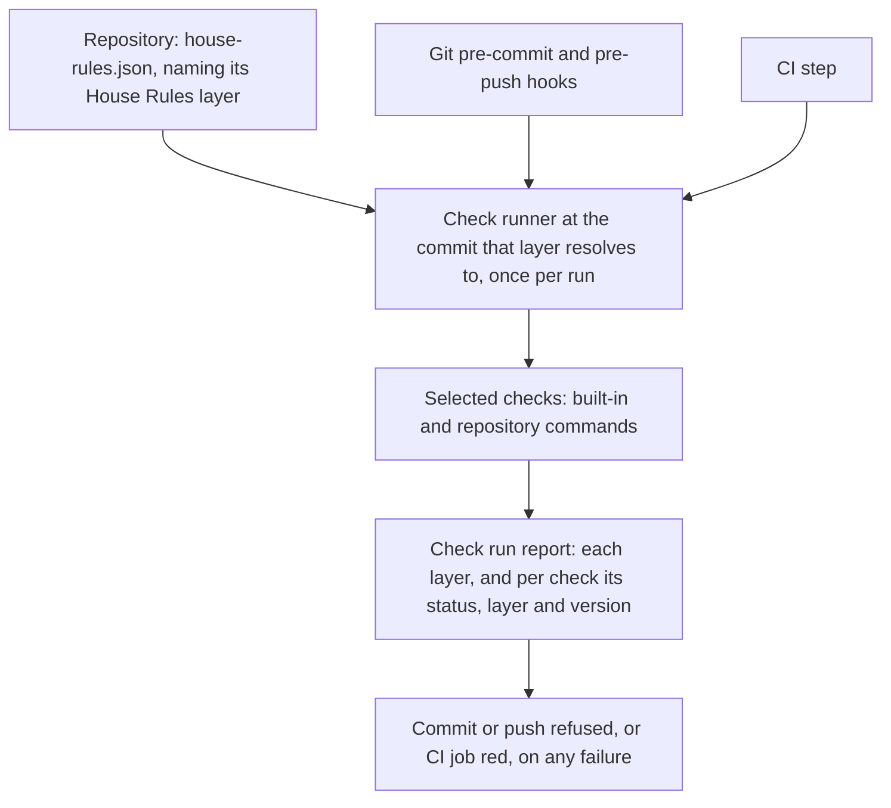

<a id="repository-checks"></a>
# Repository checks

Repository checks run a repository's deterministic rule checks before each commit, before each push and in CI, from one declared configuration.
House Rules ships the runner, a default set of checks and an install procedure.
A repository keeps the defaults, changes their settings, turns them off with a reason or adds its own commands.
The same runner runs in the Git hook and in CI, so both give the same result for the same input.
Readers need Git hooks, a CI workflow and the [spec checker](../../skills/spec-writing/SKILL.md) at the level of "it checks Markdown and metadata".
The operator approved this design for implementation on 2026-10-23; the work is tracked in [#194](https://github.com/symbiotic-build/house-rules/issues/194).
Implementation status: the runner core implements the runner's `run`, `prepare` and `status` commands and starts each check directly. The build queue and the check versions are not implemented yet; they land in the queue and versions work package. `install`, with its hook blocks and CI step, is not implemented yet either; it lands in the install work package, and until then `checks.py install` stops with exit status 2. [Rollout and work packages](#rollout) lists both. The tour and the reports below show the result once all of them have landed.

How does one configuration reach the commit hook, the push hook and CI?



The [check configuration](#check-configuration) holds the repository's choices and names its House Rules [source layer](218-layered-configuration.md#source-layer): a URL and a branch or a commit.
The [check runner](#check-runner) runs at the commit that layer resolves to, once per run, as [House Rules revision and offline use](#revision) explains; the default branch is `main`, so a House Rules merge onto `main` reaches a repository that keeps that ref at its next run.
It reads the configuration, selects the checks for the current [check stage](#check-stage) and runs each [check definition](#check-definition).
Its [check run report](#check-run-report) names each layer with its commit and each check's version. It also says which check failed, why, how to fix it and how to rerun it.
The [hook block](#hook-block) is the few lines of shell that connect a Git hook to the runner.

<!-- spec-docs:navigation document="repository-checks" -->
<!-- Generated by spec-docs; edit authored declarations. -->

## Overview

Repository checks run a repository's deterministic rule checks before each commit, before each push and in CI, from one declared configuration.

**Audience:** House Rules maintainers and repository owners familiar with Git hooks and CI workflows.

**Scope:** The check configuration, the check runner, built-in checks, the install procedure, agent session status and the rule line.

**Non-goals:** Judgment rules that need a reviewer, prose warnings, Warden changes and implementation in this change.

## Document map

Use this map to choose the next explanation to read.

- [Repository checks](194-repository-checks.md#repository-checks) — Read what repository checks do and who runs them.
- [Current state and evidence](194-repository-checks.md#evidence) — See what exists today, what was measured and the constraints.
- [Tour: a default install](194-repository-checks.md#tour) — Follow one install, a refused commit and its fix.
- [Configuration and checks](194-repository-checks.md#configuration) — Name the House Rules layer and declare checks in one file, and write a check to the command contract.
- [Running checks](194-repository-checks.md#running) — See when each check runs, what it reads and how pre-commit stays fast.
- [Installation, hooks and agents](194-repository-checks.md#installation) — Install hooks and CI without breaking other tools, and connect agent sessions.
- [House Rules revision and offline use](194-repository-checks.md#revision) — Know which House Rules commit a run resolves its layer to, what it logs and what works without a network.
- [Overrides and review](194-repository-checks.md#review) — Review overrides, and know which rules stay with reviewers.
- [Worked examples](194-repository-checks.md#examples) — Apply the configuration to another naming style and to a repository without specifications.
- [Requirements](194-repository-checks.md#requirements) — Find the obligations each mechanism must meet.
- [Decisions and alternatives](194-repository-checks.md#decisions) — Read each choice, its authority and the alternatives it rejects.
- [Open questions](194-repository-checks.md#questions) — Confirm that no design choice remains open.
- [Rollout and work packages](194-repository-checks.md#rollout) — Plan the implementation pull requests and adoption.
- [Reference](194-repository-checks.md#reference) — Look up configuration fields, built-ins, commands and the report format.
- [Acceptance](194-repository-checks.md#acceptance) — See the planned demonstrations for each requirement.

## Entity index

Each technical term below links to its defining Markdown section.

- [Global configuration](218-layered-configuration.md#global-configuration) (`layered-configuration.global-configuration`) — The global configuration is the per-user JSON file ~/.config/house-rules/house-rules.json that supplies default sources for repositories without a repository configuration and machine-only budgets.
- [Repository configuration](218-layered-configuration.md#repository-configuration) (`layered-configuration.repository-configuration`) — A repository configuration is the versioned JSON file house-rules.json at a repository's root that lists its source layers, its profiles and its own settings.
- [Source layer](218-layered-configuration.md#source-layer) (`layered-configuration.source-layer`) — A source layer is one entry of sources: a Git repository, named by name and url, at one ref.
- [Check configuration](194-repository-checks.md#check-configuration) (`repository-checks.check-configuration`) — A check configuration is the versioned JSON file house-rules.json at the repository root that names the repository's House Rules source layer and declares its checks.
- [Check definition](194-repository-checks.md#check-definition) (`repository-checks.check-definition`) — A check definition is one command, the stages it runs at, the files it reads and how its result is read.
- [Check installation](194-repository-checks.md#check-installation) (`repository-checks.check-installation`) — Check installation is the repository-checks procedure that writes a repository's configuration, Git hooks and CI step, and prepares the local cache.
- [Check run report](194-repository-checks.md#check-run-report) (`repository-checks.check-run-report`) — A check run report is the runner's account of one run and of each check in it.
- [Check runner](194-repository-checks.md#check-runner) (`repository-checks.check-runner`) — The check runner is skills/repository-checks/scripts/checks.py, one standard-library Python file that reads the configuration, selects checks, runs them and prints the report.
- [Check stage](194-repository-checks.md#check-stage) (`repository-checks.check-stage`) — A check stage is one point in the change loop where the runner runs checks: pre-commit, pre-push or ci.
- [Clone settings](194-repository-checks.md#clone-settings) (`repository-checks.clone-setting`) — A clone setting is a per-clone Git setting that the install writes and the hook blocks read.
- [Hook block](194-repository-checks.md#hook-block) (`repository-checks.hook-block`) — A hook block is the marked shell fragment the install puts into a Git hook file to call the runner.
- [Run placeholders](194-repository-checks.md#run-placeholders) (`repository-checks.run-placeholder`) — A run placeholder is a name in braces in a check's run that the runner replaces with a value of the run before the command starts.
- [Runner environment variables](194-repository-checks.md#runner-environment-variables) (`repository-checks.runner-environment-variable`) — A runner environment variable is an environment variable whose name the runner defines.
- [Runner options](194-repository-checks.md#runner-options) (`repository-checks.runner-option`) — A runner option is one of the double-dash options of the runner's commands, such as --stage and --dry-run.
<!-- /spec-docs:navigation -->

<a id="evidence"></a>
## Current state and evidence

Rule checks that a script can decide run today only when an agent remembers to run them.
This section records what exists, what was measured and which constraints the design must meet.

On 2026-10-22 the operator found commits to a large private specification that no hook or CI step had checked.
The agent ran the spec checker by hand before some commits, and that repository has no CI step for it.

`FACT` House Rules main at `ebb6b37` already has these parts, as read in this session:

- The spec checker reads the staged index (`check --staged`) or one commit (`check --rev REV`), as its [command reference](../specs/spec-system/source-formats.md#sources-and-commands) states.
- Its naming rules and rejected forms are data in the repository's `docs/ENTITIES.json`, not code in the checker ([#190](https://github.com/symbiotic-build/house-rules/pull/190) makes declaring them a rule).
- `scripts/sync.py --install-hooks` registers agent session hooks in agent homes such as `~/.claude/settings.json`. It writes no Git hook and no repository file.
- The PR watcher `skills/agent-lanes/scripts/watch_prs.py` wakes a session when a PR's CI checks or reviews change.
- House Rules' own [specification workflow](../../.github/workflows/spec-docs.yml) runs the spec checker over its whole corpus and audits the declared test selectors. Each consuming repository needs its own copy of such a step, and nothing runs the checker before a commit.

`FACT` These measurements and observations come from this session, at House Rules `ebb6b37` on macOS with Git 2.54.0:

> **Detail — measured behavior**
>
> - Spec checker on a 1.24 MB private specification corpus: 40.7 s wall, 39.8 s CPU with `check`; 40.6 s wall with `check --staged`. One CPU core does the work.
> - Spec checker on House Rules' own documents: 0.8 s CPU. The wall time was 85.4 s, because the command waited 84 s in this machine's shared build queue.
> - A profile of the 40.7 s run put 83% of it in two repeated-work defects: patterns rebuilt 3.2 million times and documents split into lines 276 000 times. [#196](https://github.com/symbiotic-build/house-rules/issues/196) removes them, to the operator's target of 2 s or less on that corpus.
> - The spec checker's runtime file requires CPython 3.11 to 3.14. On this machine `python3` is 3.15.0 and `/usr/bin/python3` is 3.9.6; `python3.14` is installed separately.
> - In a scratch repository, a `.git/hooks/post-commit` hook ran. After `git config core.hooksPath .githooks`, the same hook no longer ran.
> - `git rev-parse --git-path hooks` printed `.git/hooks` before and `.githooks` after that setting. In a linked worktree it printed the main clone's shared hooks folder.
> - `git diff --cached --check` printed `w:1: trailing whitespace.` and exited with status 2.
> - Of the Git clones directly under this workspace folder, six have a tool-written `post-commit` in `.git/hooks`. Five set `core.hooksPath` to a tracked folder, four of them to a Husky folder.

After [#198](https://github.com/symbiotic-build/house-rules/pull/198) removed the two defects, the spec checker took about 1.2 s on the same 1.24 MB corpus, with identical output. That PR's timing table records each run with its machine load.

The design must meet these constraints:

- Never stop another tool's existing hook, which rules out setting `core.hooksPath` on a clone that has hooks in `.git/hooks`.
- Check exactly the staged content at pre-commit, because a working tree can differ from the commit and another session can stage files during a run.
- Never change the working tree or the Git stash, because several agent sessions can share one working tree and one stash.
- Run the runner itself on Python 3.9 or later, and run each check with its own supported interpreter.
- Never fail on prose warnings, which the [writing rules](../../rules/writing.md) §House technical English keep advisory.
- Run every check under the machine's build-queue rule, with no exception for commit checks.

<a id="tour"></a>
## Tour: a default install

Follow one repository from install to a refused commit and its fix.
The repository has a specification registered in `docs/DOCUMENTS.json`, uses GitHub Actions and has no Git hooks yet.
Its declared naming rules reject the spelling "segment id" in favour of "segment identifier".
Everything in this tour uses House Rules defaults.

**Procedure: install, commit, fix and commit again**

1. **Preview the install:** [`python3 <House Rules>/skills/repository-checks/scripts/checks.py install --dry-run`](#runner-options).
   - Lists the four files it would write and the two per-clone Git settings.
   - Writes nothing.
2. **Install:** the same command without [`--dry-run`](#runner-options).
   - Writes the [check configuration](#check-configuration), the pre-commit and pre-push [hook blocks](#hook-block) and the CI workflow.
   - Fetches House Rules main and builds the spec checker's environment in the local cache.
3. **Stage the install and check everything:** `git add` the files the install listed, then [`checks.py run --stage ci --index`](#runner-options).
   - Runs every CI check that reads the snapshot over the staged snapshot, which already holds the new configuration. Existing failures show before the hook starts refusing commits.
   - Here both checks pass.
4. **Commit the install** through a normal PR. A reviewer reads the configuration, which changes no default.
5. **Edit a chapter and commit:** the change adds "segment id" to `docs/specs/storage/recovery.md`.
   - The pre-commit hook builds a snapshot commit of the staged index and runs both default checks on it.
   - The spec checker reports one error; Git refuses the commit.
6. **Fix and rerun one check:** rename to "segment identifier", stage it, then run the `rerun` command the report printed.
   - The spec check passes.
7. **Commit again.** Both checks pass and Git creates the commit.
8. **Push the branch.** The CI step resolves the configuration's House Rules branch itself, runs the same checks and passes. Its job log names the layer, its commit and each check's version.

> **Detail — configuration written in step 2**
>
> ```json
> {
>   "version": 2,
>   "sources": [{"name": "house-rules", "url": "https://github.com/symbiotic-build/house-rules", "ref": "main"}],
>   "checks": {}
> }
> ```
>
> The one `sources` entry is the House Rules layer at its branch `main`. The empty `checks` object means "the House Rules defaults": whitespace and spec-docs at the commit that branch resolves to.

> **Detail — report printed in step 5**
>
> ```text
> repository checks: pre-commit on the staged index, House Rules ebb6b3762d90c7f8ed725b5119eb874325aa6c42 (fetched branch main of https://github.com/symbiotic-build/house-rules, cached 2026-10-23T14:05:00Z)
> FAIL  spec-docs    1.8 s
>       version: ~/.cache/house-rules/environments/5c1e…/bin/python@3f2a9c0d41b7 ~/.cache/house-rules/revisions/ebb6b37…/skills/spec-writing/scripts/spec_docs.py@a81d0e6c2f94
>       spec-docs: error D13 docs/specs/storage/recovery.md:118: rejected form 'segment id'; use 'segment identifier'
>       spec-docs: 1 error, 0 warnings
>       fix: apply the remedy for each code in the spec checker's diagnostic table, run spec_docs.py generate, stage the result
>       rerun: python3.14 ~/.cache/house-rules/revisions/ebb6b37…/skills/repository-checks/scripts/checks.py run --stage pre-commit --only spec-docs
> PASS  whitespace   0.1 s
>       version: /usr/bin/git@9b04e1c7d2aa
> Commit refused: 1 of 2 checks failed. Fix the findings, stage the fixes and commit again.
> ```
>
> Entities in this example: [runner options](#runner-options).
>
> The header names the House Rules layer's full commit, its [layer source](#logged-versions), `fetched`, which says this run fetched the branch `main` of the URL, and the time the cache got that commit. Each `version:` line names the program and the script files the check ran, each with the first 12 hexadecimal digits of its SHA-256.
> The 1.8 s, the revision, the fetch time and the digests are illustrative; the 1.8 s assumes [#196](https://github.com/symbiotic-build/house-rules/issues/196) meets its target of 2 s or less on the large corpus. The version and rerun lines hold full paths; they are shortened here.

The spec check runs on every commit, because the files it reads cannot yet be listed safely, as [Running checks](#running) explains.
The whitespace check runs on every commit too, because every staged file is its input.

<a id="configuration"></a>
## Configuration and checks

This chapter defines what a repository declares and what a check is.
A repository chooses its checks in one file; House Rules supplies the defaults and the command contract every check follows.

<a id="check-configuration"></a>
### Check configuration

A check configuration is the versioned JSON file `house-rules.json` at the repository root that names the repository's House Rules [source layer](218-layered-configuration.md#source-layer) and declares its checks.
It sits at the root so that it can also carry shared House Rules settings beyond checks, as the [configuration file decision](#decision-configuration-file) records.
The runner reads this file from the run's snapshot: the staged index at pre-commit, the commit at pre-push and in CI.
An unstaged edit to it therefore has no effect on the commit being checked.

A snapshot without the file has not adopted repository checks. `run` then checks nothing, prints one line saying so and exits 0.
The runner's `prepare` and `status` commands read the file from the index, as pre-commit does, and count it as present by the rule `run` uses: a regular file or a symbolic link at exactly `house-rules.json`, never a folder of that name or a submodule. A file the index lists but Git cannot read is a [preparation failure](#failure-preparation) with Git's message, never taken for an absent file; [`status --session`](#runner-options) prints that failure and still exits 0.

The file has these top-level fields:

- `version` is 2.
- `sources` lists the source layers. This version accepts exactly one entry, the House Rules layer: `{"name": "house-rules", "url": "<URL>", "ref": "<branch or commit>"}`. Its `url` may be left out and is then `https://github.com/symbiotic-build/house-rules`; any other entry will need one. A `ref` of 40 hexadecimal digits is a SHA-1 commit. A `ref` of 64 hexadecimal digits stops the run with the configuration error "SHA-256 sources are not supported yet", whose repair is to use the source's SHA-1 commit or a branch. Any other `ref` is a branch name that `git check-ref-format --branch` must accept. The install writes the branch `main`. A consuming repository may still use SHA-256 objects itself, as [House Rules revision and offline use](#revision) describes.
- A further entry stops the run with the preparation failure "house-rules: house-rules.json: custom source layers are not supported by this runner yet (#217)", whose repair is to remove the extra entry. Custom layers and their cascade follow in [#217](https://github.com/symbiotic-build/house-rules/issues/217).
- `budgets` optionally maps a hook [check stage](#check-stage) to an entry with `seconds` and `reason`. A snapshot whose checks take longer than its budget gets a warning. CI has no budget.
- `checks` maps a check identity to an entry. An entry for a built-in identity changes that built-in; any other identity adds a repository check.

The run's report records the commit each layer resolved to. That report is the retained run input that the [House Rules revision](../specs/spec-system/source-formats.md#house-rules-revision) reference asks for.

The effective settings come from two layers, applied in the order listed; the second replaces what the first set for the same check:

- **House Rules layer, first:** the built-in [check definitions](#check-definition) at the commit the House Rules source resolved to.
- **Repository layer, second:** the file's `checks` and `budgets`.

Budgets for one machine only belong in the [global configuration](218-layered-configuration.md#global-configuration), which arrives with the resolver work, as the [local file decision](#decision-no-local-file) records.

The report names the layer of every check and of every override, so a reader can tell where each setting came from.
Only the runner at the resolved commit judges the entries. A runner at another commit reads only `version` and `sources`. It then starts the runner at the resolved commit, as [House Rules revision and offline use](#revision) describes.
Entry fields are listed in [Configuration fields](#configuration-fields).
Unknown fields, among them `enforced` in an entry, unknown built-in placeholders and a NUL character in a command argument or in a check identity stop the run with a configuration error.
So does any text in the file that cannot be printed or passed to a program, such as an unpaired surrogate escape like `\ud800` in an argument or a reason. The error names no field and repeats no text. An argument that holds a filename byte that is not UTF-8, which Python keeps as a surrogate escape from `\udc80` to `\udcff`, reaches the program as that byte.
An unsupported version stops it the same way.

Every entry that changes a default carries a `reason`, and so does every repository check.
A field whose value equals the built-in default is no change and needs no reason.
The reason is one sentence a reviewer can judge, such as "Spec checks take 40 s on this corpus; run them at pre-push."
The runner refuses an entry without one, because [Overrides and review](#review) depends on it.

<a id="check-definition"></a>
### Check definition

A check definition is one command, the stages it runs at, the files it reads and how its result is read.
Built-in definitions ship with the runner; repository definitions live in the [check configuration](#check-configuration).
Both follow one contract, so the runner treats a House Rules check and a repository's linter the same way.

The contract has six parts:

- **Inputs.** `paths` lists the repository-relative globs the check reads. `requires` lists files that must exist in the snapshot for the check to apply; a snapshot without them skips the check with that reason. Only a regular file or a symbolic link counts; a folder or a submodule of that name does not.
- **Scope.** `tree` runs once over the whole snapshot. `files` runs once with the matching files as arguments, in place of its [`{files}`](#run-placeholders) argument; a `files` check without a whole [`{files}`](#run-placeholders) argument is a configuration error. A matching file is a path that holds a regular file or a symbolic link in the snapshot. A submodule's path holds no file, so it is never an argument. `diff` runs once with a base and the snapshot. A repository check without `scope` has scope `tree`.
- **Snapshot.** `run` is one argument list. A check that reads the [snapshot commit](#snapshot-handling) names it with [`{snapshot}`](#run-placeholders) and reads files from it, never from the working tree. Only such a check may list a hook stage; a check without [`{snapshot}`](#run-placeholders) reads the working tree and runs in CI only.
- **Result.** Exit status 0 is a pass. Any other status is a failure. For a built-in that House Rules does not enforce yet, it is a warning instead, as [New built-in checks warn first](#warning-first) explains. A command whose program the runner cannot find, or that cannot start, is an error. Through the [build queue](#build-queue), the queue's exit status is the command's result.
- **Output.** The runner shows everything the command printed, unshortened and unchanged, in its [check run report](#check-run-report). `fix` adds one line telling the reader what to change. Every built-in has one, and a repository check without `fix` is a configuration error, so every failure carries a fix line.
- **Version.** The runner records which program and script files the check ran, with their SHA-256, as [What each run logs](#logged-versions) defines. A check needs nothing for this. A check that uses prompts names their versions in its own output.

A deleted or renamed-away file selects a `files` check but is not passed to it, because it no longer exists.
When no matching file remains, because the matching paths were deleted or are submodules, the check skips with "no matching file".
[`{snapshot}`](#run-placeholders) is always a commit identity. [`{base}`](#run-placeholders) is a commit identity, except in three cases where it is the empty tree's identity: before the first commit; at pre-push when a pushed commit has neither a remote commit nor a remote default branch to compare with; and at pre-push when the pushed commit shares no ancestor with the commit it is compared with. Git accepts both in a comparison, so a `diff` check runs the same command everywhere.
At pre-commit [`{base}`](#run-placeholders) is the commit `HEAD` named when the run started; the runner reads it once, for the snapshot's parent and the base.

Commands run without a shell, from the repository root, with standard input closed. A repository check keeps the environment the runner was started with, except its Git variables, which [Git isolation](#git-isolation) sets. Only the built-in spec-docs isolates its interpreter, with Python's `-I` option, as [Built-in checks](#built-in-checks) states.
The runner and every check run with `GIT_NO_REPLACE_OBJECTS=1`, so a local replacement reference cannot change what a commit contains.
A check must not change files, the index or Git references.
The runner adds [`CHECK_STAGE`](#runner-environment-variables), [`CHECK_BASE`](#runner-environment-variables) and [`CHECK_SNAPSHOT`](#runner-environment-variables) to the environment with the same values as the placeholders, so a check script can read the range the runner chose.
A configuration that lists a hook stage for a check without [`{snapshot}`](#run-placeholders) stops with a configuration error.

The built-in definitions at the first implemented revision are whitespace and spec-docs, listed in [Built-in checks](#built-in-checks). Both are enforced.
Spec-docs reads its naming style from the repository's own `docs/ENTITIES.json`.
A repository with another naming style therefore changes its `docs/ENTITIES.json`, not the check, as [Worked examples](#examples) shows.

<a id="warning-first"></a>
### New built-in checks warn first

A House Rules change reaches each adopted repository at its next run after the repository's configured ref includes it: at once for a repository that follows a branch the change lands on, and only after a reviewed move of the ref for one pinned to a commit. A new default check would otherwise refuse commits in every such repository at once.
A built-in definition therefore has the boolean `enforced`, default `true`, which House Rules sets and no configuration can. A built-in definition that omits it is enforced.

A failing check whose definition has `enforced: false` gets the status `warn`.
Its output, fix line and rerun line show as for a failure, but the warning contributes no failure to its snapshot. The snapshot passes, and the commit, the push or the CI job goes ahead, only when no other check fails and preparation succeeds.
A repository that wants such a check off sets `enabled: false` with a reason, as for any default.
A check that cannot start is still an `error`, enforced or not.

**Procedure: add a default check**

1. **Ship it as a warning:** a House Rules PR adds the built-in with `enforced: false`. Each repository sees its findings as warnings from its next run whose configured ref contains that PR.
2. **Enforce it later:** a later House Rules PR sets `enforced: true`. That PR's Rule changes section is the announcement; the [pr-ready](../../skills/pr-ready/SKILL.md) merge procedure carries it into the rules changelog.

A stricter rule inside an existing check, such as a new spec checker diagnostic, is the checker's own business. The checker ships it as a checker warning first; the runner adds nothing for it.

<a id="running"></a>
## Running checks

This chapter explains when checks run, what each run reads and how pre-commit stays fast.

<a id="check-stage"></a>
### Check stage

A check stage is one point in the change loop where the runner runs checks: `pre-commit`, `pre-push` or `ci`.
Each check lists its stages; the runner runs only the checks that list the current stage.
Pre-commit and pre-push are for fast checks on what changed. CI is the full gate.

| Stage | Started by | Snapshot | Change selection |
|---|---|---|---|
| pre-commit | Git `pre-commit` hook | staged index | files staged for this commit |
| pre-push | Git `pre-push` hook | each pushed commit | files changed since that commit's push base |
| ci | CI step | head commit | none: every CI check runs |

At pre-commit and pre-push the runner skips a check whose `paths` match no changed file.
A deleted file counts as changed, because a deletion can break links that other files hold.
At CI every check listed for `ci` runs over the whole commit.
CI therefore also catches a commit made without hooks, such as one from a clone that never ran the install.

A `diff` check needs a base. At pre-commit it is `HEAD`, as the check contract states.
At pre-push Git writes one line per pushed reference to the hook's standard input: local reference, local commit, remote reference and remote commit.
The runner ends a line only at a line feed and separates fields only at a space, so a reference name keeps every other character, such as a no-break space or a Unicode line separator. Bytes of a name that are not UTF-8 stay unchanged.
The runner checks each pushed local commit as its own snapshot, so a commit made in the same clone during the push cannot stand in for the one Git sends. It checks them in the order of Git's lines. A deleted reference, whose local commit is all zeros, has nothing to check. Standard input without any reference line also checks nothing, and the runner says so.

Before using an object Git names, the runner resolves it to the commit it points at (`<object>^{commit}`), so a pushed annotated tag is checked as its commit. A pushed object that resolves to no commit, such as a tag of a tree, stops the run with a [preparation failure](#failure-preparation) naming the reference. A remote object that resolves to no commit counts as absent, so the base falls back to the remote's default branch.

A pushed commit's push base is its merge base with the remote commit Git names, when that commit is present locally. Otherwise it is the merge base with the remote's default branch, and otherwise the empty tree. When the two commits share no ancestor, for example a new unrelated branch, the base is the empty tree too, so every file in the pushed commit counts as changed.

Change selection compares two trees: the push base's and the pushed commit's. It therefore sees the net difference between them, not each commit in between.
For a new branch the merge base gives exactly the branch's own changes.

After a rebase of a branch whose old copy is on the remote, the merge base with that old copy is older than the new upstream. The difference then also holds the upstream commits the branch was moved onto, so more checks can run.
It can also hold fewer files. A change and its reversal across the rebase cancel out, so a file that differs from the new upstream can select no check.
CI runs every CI check on the whole commit, so it catches what such a push skipped.

In CI the base is the PR's base commit, or the previous commit for a push.

<a id="snapshot-handling"></a>
### Snapshot handling

Every check of one snapshot reads that snapshot's fixed content, a commit, so no concurrent edit can change what a check sees. A pre-commit or CI run has one snapshot; a pre-push run has one per pushed commit.
At pre-commit the runner builds it once, at the start, without touching the real index, the working tree or any reference:

**Procedure: build the pre-commit snapshot**

1. **Copy the index file** into a temporary folder. Git replaces that file by an atomic rename, so the copy is one complete version.
2. **Write its tree:** `GIT_INDEX_FILE=<copy> git write-tree`. This writes objects only.
3. **Wrap the tree in a commit:** `git commit-tree <tree> -p HEAD`, without `-p` before the first commit. The runner sets a fixed author and committer, `repository checks <checks@localhost>`, so the step needs no Git identity. No branch or reference points to the commit.

At pre-push the snapshot is each pushed commit that Git names on the hook's standard input, and in CI it is the commit under test.
The runner reads the configuration, `requires` and the changed files from the snapshot, and passes it to every check as [`{snapshot}`](#run-placeholders).
Spec-docs reads it with [`--rev {snapshot}`](#run-placeholders). Whitespace compares it with [`git --attr-source={snapshot} diff --check {base} {snapshot}`](#run-placeholders), so the whitespace rules in `.gitattributes` also come from the snapshot.
Both run under [Git isolation](#git-isolation), so no personal, system or inherited Git configuration changes their result.

A runner at another revision builds a snapshot only to read the configuration, resolves House Rules and starts the runner at the resolved revision, as [House Rules revision and offline use](#revision) describes. That runner builds the snapshot it checks itself. A `HEAD` moved and then restored while the first runner hands over is not noticed; CI checks the commit that results. A file staged after the resolved runner built its snapshot is caught by the comparison below, as the [handover decision](#decision-no-snapshot-handover) records.

After the last check the runner builds the tree of the live index again, the same way. It does so also for a snapshot without a configuration, which ran no check.
When it differs from the snapshot's tree, another process staged something during the run. The run then stops with a [preparation failure](#failure-preparation), because the commit Git is about to write is not the content the checks saw.
Git writes the commit from the live index after the hook exits. A change in that last moment is not detected; CI checks the commit that results.

A check that reads the working tree, such as a linter run on its files, cannot see the snapshot. It runs in CI, on a clean checkout of the commit.
A repository that wants it at pre-commit wraps it to read the files from [`{snapshot}`](#run-placeholders), for example with [`git show {snapshot}:<path>`](#run-placeholders) piped to the tool.

<a id="git-isolation"></a>
### Git isolation

Every check of a snapshot, built-in or repository, runs with an environment that shuts out Git configuration from outside the clone and `house-rules.json`:

- `GIT_CONFIG_GLOBAL=/dev/null` and `GIT_CONFIG_NOSYSTEM=1`: no personal or system Git configuration.
- `GIT_ATTR_NOSYSTEM=1`: no system attributes file.
- `GIT_NO_REPLACE_OBJECTS=1`: Git reads each commit itself, never a local replacement.
- The inherited `GIT_CONFIG_PARAMETERS`, which `git -c` sets for a hook, `GIT_CONFIG_COUNT` and every `GIT_CONFIG_KEY_<n>` and `GIT_CONFIG_VALUE_<n>` are removed. So are the variables that bind Git to another Git directory or index, such as `GIT_DIR` and `GIT_INDEX_FILE`; Git finds the clone's own Git directory from the repository root, the check's working folder.
- The runner then sets `GIT_CONFIG_COUNT=1`, `GIT_CONFIG_KEY_0=core.attributesFile` and `GIT_CONFIG_VALUE_0=/dev/null`. That keeps Git from reading a personal attributes file such as `~/.config/git/attributes`, which Git reads by default even without a [global configuration](218-layered-configuration.md#global-configuration).

The clone's own `.git/config` and `.git/info/attributes` still apply, because Git reads them from the clone's Git directory. A hook's result can therefore differ from CI's in a clone whose owner set them, for example `core.whitespace` in `.git/config` or `* -whitespace` in `.git/info/attributes`. CI's fresh clone has neither, so CI's result decides the PR. Those files are set on purpose by the clone's owner, like skipping a hook. The configuration carries no Git settings, as the [no Git settings decision](#decision-no-git-settings) records.
A check that reads the working tree, one without [`{snapshot}`](#run-placeholders), runs in CI only, in the same environment, and sees the checkout's files and index.
The runner's own Git calls, which build the snapshot and select the changed files, use the clone as it is, because they read its index and objects and not a check's result.

### Keeping pre-commit fast

Pre-commit stays fast because each check is fast, not because slow checks are skipped:

- **Time targets.** Each built-in check has a measured time target, listed in [Built-in checks](#built-in-checks). Spec-docs must take 2 s or less on the 1.24 MB corpus, which [#196](https://github.com/symbiotic-build/house-rules/issues/196) delivers before spec-docs becomes a default.
- **Change selection.** A check runs only when the commit stages one of its inputs. Spec-docs declares every file as its input, because its inputs include linked source files, unclassified Markdown and generated attributes.
- **Measured time.** The report prints every check's duration. The run's total is compared with the pre-commit budget, 10 s by default. A run over budget prints a warning naming the slowest check.
- **Stage choice.** A repository whose own check does not fit moves it to `pre-push` or raises its budget, in both cases with a reason in the configuration.

The budget is a warning, never a timeout.
The [verification rules](../../rules/delivery.md) (§Verification) fail long-running checks on lack of progress, not on elapsed time; the runner adds no timer of its own.

Checks run one at a time, in configuration order with built-ins first.
The report lists them by status instead: errors, failures, warnings, passes, then skipped checks.
Parallel checks would add load on a shared machine. A repository with many slow checks moves them to pre-push instead.

<a id="build-queue"></a>
### Build queue

A machine can declare a build queue: one shared queue in which builds and test runs wait, one at a time.
The runner core starts every check directly; the queue and versions work package implements this section, as [Rollout and work packages](#rollout) lists.
When the environment variable [`HOUSE_RULES_CHECK_QUEUE`](#runner-environment-variables) names the machine's queue command, the runner starts every check through it.
The runner finds the check's program and reads its version before it hands the command to the queue, as [What each run logs](#logged-versions) describes. A program it cannot find is an `error` and never reaches the queue. The queue's exit status is the command's result. A program removed while its command waits in the queue therefore shows as that command's exit status, a failure, not as `error`; the [no launch mode decision](#decision-no-launch-mode) explains why that limit is accepted.
The queue must let a queued tool started inside a queued command, such as a build tool inside a check, run straight through. The queue on the measured machine does this, so a check never waits for itself.
A commit can therefore wait behind another session's build. The [queue decision](#decision-build-queue) records why.

<a id="check-runner"></a>
### Check runner

The check runner is `skills/repository-checks/scripts/checks.py`, one standard-library Python file that reads the configuration, selects checks, runs them and prints the report.
It runs on Python 3.9 or later, because the measured machine's system interpreter is 3.9.6.
The same file runs in the Git hooks and in CI, at the commit the run's House Rules layer resolves to, so a check behaves the same in both.

The runner has four commands, listed in [Runner commands](#runner-commands): `run`, `install`, `prepare` and `status`.
`run` exits 0 when every selected check passed, warned or was skipped. It exits 1 when a check failed or could not start, and 2 when the configuration or preparation failed.
The hooks refuse the commit or push on any nonzero status.

<a id="check-run-report"></a>
### Check run report

A check run report is the runner's account of one run and of each check in it.
It names the stage, each layer the run resolved, and, for each snapshot the run checked, the snapshot and its base. The JSON report holds each identity in full. The text report names where the snapshot came from, "the staged index" or the commit's short identity, and shows the base only at pre-push. Its header line names the House Rules layer's full commit and, in brackets, the layer's source, the branch or commit, the layer's URL and when the cache got the commit: `fetched branch <ref> of <URL>, cached <time>`, `offline branch <ref> of <URL>, cached <time>`, `pinned commit of <URL>, cached <time>` or [`override HOUSE_RULES_REVISION of <URL>, cached <time>`](#runner-environment-variables). For each check it gives the status, duration, version, output, fix line and rerun command.

A run checks one snapshot, except at pre-push, where it checks one per pushed commit. Each pushed commit is checked with its own configuration, and every snapshot of the run uses the one House Rules commit the run resolved. Snapshots whose configurations declare the same `sources` share the one resolution. When two pushed commits' configurations declare different `sources`, the run stops with the [preparation failure](#failure-preparation) "the pushed commits declare different House Rules sources", which names the second reference; its repair is "push them separately". The later shared resolver of [#217](https://github.com/symbiotic-build/house-rules/issues/217) replaces this with a handover per snapshot.

A snapshot's result is `fail` when any of its checks failed or could not start, and `pass` otherwise; a check that warned leaves it `pass`. A preparation failure, which can occur without any snapshot, makes the run's result `error`. Otherwise the run's result is `fail` when any snapshot failed, and `pass` otherwise. A push that only deletes references checks nothing and passes with the line "nothing to check: the push only deletes references".
It is the one output format for every check, so an agent can act on any failure the same way.

Each check's status is `pass`, `fail`, `warn`, `error` or `skipped`. `warn` is a failure of a check that House Rules does not enforce yet, as [New built-in checks warn first](#warning-first) explains. A skipped check states why:

- "disabled: <reason>" for a check turned off;
- "requires docs/DOCUMENTS.json" for a missing required file;
- "no staged input" at pre-commit and "no changed input" at pre-push, when no changed file matches;
- "no matching file" for a `files` check whose matching paths hold no file in the snapshot;
- "reads the working tree; runs in CI on the commit" for a check without [`{snapshot}`](#run-placeholders) in a run on the index;
- "not configured for <stage>" for a check named with `--only` that does not list the stage.

The report then lists every override of a default with its layer and reason, and any warnings. A run that could not resolve its House Rules branch and used the commit last resolved for it adds one warning. That warning names the commit and when it was fetched.
A snapshot without a configuration has one line and checks nothing.
The last line says what the run refused and what to do next.
After a preparation failure, standard output lists the snapshots checked before it, without that last line. Standard error then gets one line with the cause and its repair.

`run --json` prints the same report as one JSON object, defined in [Report format](#report-format).
Output and paths are kept byte for byte. The text report puts six spaces before each line of a check's output and changes nothing else: only a line feed ends a line, so carriage returns, form feeds and trailing blank lines stay as the check printed them. Output whose last line has no line feed gets one at the end of that line. The text report writes bytes that are not UTF-8 unchanged, and writes all text as UTF-8 whatever output encoding the interpreter inherited, such as from `PYTHONIOENCODING`; the JSON report is ASCII and holds them as `\udcXX` escapes.
The CI step prints the text report in the job log, so the log names each layer, its commit and each check's version. The PR watcher then wakes the session on the red check; the session reruns the printed command locally.
A rerun line starts the runner of the run's commit, which resolves the configuration's House Rules ref again. When the ref is a branch that moved since the run, such as after a House Rules merge onto it, the rerun uses the newer commit, and its header says so. A commit ref gives the same commit.

<a id="failure-check-refused"></a>
### Failure state: commit or push refused

This refusal keeps a change that breaks a declared rule out of the commit or the push.

**Trigger:** A selected check exits with a nonzero status, or cannot start. A failure of a check that House Rules does not enforce yet only warns and is no trigger.

**Outcome:** The runner exits 1 and the hook exits with that status, so Git creates no commit or sends no push. The report names each failing check, its output, its fix line and its rerun command.

**Retained state:** The working tree, the index and the stash are unchanged. Staged changes stay staged.

**Recovery:** The author fixes the findings, stages the fixes and commits again. A check that is wrong for the repository is changed in the configuration through a reviewed PR. Skipping the hook with `git commit --no-verify` needs the operator's instruction for that commit, under the [rule line](#rule-line).

**Authority:** The author fixes; the repository's reviewers approve a configuration change; the operator alone allows a bypass.

**Verification:** [Refused commit](#test-checks-refused-commit).

<a id="installation"></a>
## Installation, hooks and agents

This chapter explains what the install writes, why it writes into the existing hooks folder, and how agent sessions and the PR watcher fit in.

<a id="check-installation"></a>
### Check installation

Check installation is the `repository-checks` procedure that writes a repository's configuration, Git hooks and CI step, and prepares the local cache.
An agent or a person runs it once per clone.
Running it again repairs missing pieces and keeps every choice the repository made.

**Procedure: install repository checks in one clone**

1. **Preview:** [`checks.py install --dry-run`](#runner-options). Lists each file and setting with "create", "update", "unchanged" or "refused", and writes nothing.
2. **Install:** `checks.py install`. Performs the listed writes.
3. **Stage the install:** `git add` the configuration and, when written, the CI workflow.
4. **Check everything:** [`checks.py run --stage ci --index`](#runner-options). Every CI check that reads [`{snapshot}`](#run-placeholders) runs over the staged snapshot, and failures in existing files show before the hooks start refusing commits. A check that reads the working tree is listed as skipped with the reason "reads the working tree; runs in CI on the commit".
5. **Commit the repository files** through a reviewed PR. CI then runs the same checks on the commit.

> **Detail — what the install writes**
>
> - `house-rules.json`: created only when absent, with `version` 2, the House Rules layer at its branch `main` and an empty `checks` object. An existing file is never rewritten.
> - The `pre-commit` and `pre-push` hook files in the folder `git rev-parse --git-path hooks` prints: the [hook block](#hook-block) is added or refreshed.
> - Two per-clone Git settings: [`house-rules.checks-runner`](#clone-settings), the runner's absolute path in the cache, and [`house-rules.checks-python`](#clone-settings), an absolute interpreter path.
> - `.github/workflows/repository-checks.yml`, when the repository has `.github/workflows/` or the caller passes [`--ci github`](#runner-options). A rerun never rewrites an existing workflow file. It reports when the runner step differs from the current template, so a repository's own setup steps stay.
> - Cache contents: the tree of the commit the House Rules layer resolves to and the spec checker's environment, built from its hash-locked requirements.

The installer chooses [`house-rules.checks-python`](#clone-settings) as the newest interpreter on `PATH` that every enabled built-in supports.
With spec-docs enabled that range is CPython 3.11 to 3.14. On the measured machine it chooses `python3.14`, not `python3` 3.15.0.

For another CI system the install writes no file and prints the one command the CI job runs.

<a id="hook-block"></a>
### Hook block

A hook block is the marked shell fragment the install puts into a Git hook file to call the runner.
Markers let a rerun replace exactly its own lines and leave other tools' lines alone, the same way other tools mark their blocks in these files.

```sh
# house-rules:repository-checks:begin
runner=$(git config --get house-rules.checks-runner) || {
  echo "repository checks are not installed in this clone; run: python3 <House Rules>/skills/repository-checks/scripts/checks.py install" >&2
  exit 1
}
"$(git config --get house-rules.checks-python)" -I "$runner" run --stage pre-commit || exit $?
# house-rules:repository-checks:end
```

Entities in this example: [clone settings](#clone-settings), [runner options](#runner-options).

The pre-push block runs [`--stage pre-push`](#runner-options) instead, and also handles the pushed references that Git writes once to the hook's standard input:

```sh
# house-rules:repository-checks:begin
runner=$(git config --get house-rules.checks-runner) || {
  echo "repository checks are not installed in this clone; run: python3 <House Rules>/skills/repository-checks/scripts/checks.py install" >&2
  exit 1
}
refs=$(mktemp) || { echo "repository checks: cannot create a temporary file; push refused" >&2; exit 1; }
cat > "$refs" || { echo "repository checks: cannot save the pushed references; push refused" >&2; rm -f "$refs"; exit 1; }
"$(git config --get house-rules.checks-python)" -I "$runner" run --stage pre-push --remote "$1" < "$refs" || { status=$?; rm -f "$refs"; exit $status; }
exec < "$refs" || { echo "repository checks: cannot reopen the pushed references; push refused" >&2; rm -f "$refs"; exit 1; }
rm -f "$refs"
# house-rules:repository-checks:end
```

Entities in this example: [clone settings](#clone-settings), [runner options](#runner-options).

The block saves the reference lines to a temporary file and gives them to the runner. When creating or writing that file fails, the block names the failure, removes the file and refuses the push before any check runs, so a partial copy never stands for the whole push. After the runner passes, the block reopens the hook's standard input from that file, so another tool's lines after the block read the same lines; a large-file extension's pre-push hook is one such reader. Removing the file after `exec` is safe, because the open input stays readable until the hook exits.

When that reopening fails, the push is refused after the checks ran. A plain `/bin/sh` exits at the failed redirection before the block's message and removal run, so the author may see only the shell's own error and a leftover temporary file.
The block holds no machine paths: both paths come from per-clone Git settings, so the block can also live in a tracked hooks folder.

The install handles each existing hook file one way:

- **No file:** create it with `#!/bin/sh`, the block and mode 0755.
- **File with the markers:** replace the lines between them.
- **Shell script without the markers:** insert the block directly after the first line, so it runs before any later `exit` in the file.
- **Hook file that is not executable:** refuse, and print the `chmod +x` command. Git ignores such a file, and making it executable would also start the other tool's code.
- **File written by the pre-commit framework:** refuse, and print the `repo: local` entry that calls the runner from that framework's configuration.
- **Any other file:** refuse, naming the file and its first line.

The install never sets `core.hooksPath`.
When the repository already set it, for example to a Husky folder, `git rev-parse --git-path hooks` points there and the block goes into that folder's files.
A block in a tracked folder is a repository change; the install lists it with the other files to commit.

A linked worktree shares its main clone's Git settings. It shares the hooks folder only when that folder is the default or an absolute `core.hooksPath`.
A relative `core.hooksPath` resolves inside each worktree, so each of those worktrees needs its own install. The session status line reports a worktree whose hooks folder lacks the block.

<a id="agent-sessions"></a>
### Agent sessions and the PR watcher

Agents commit with Git, so the Git hooks check their commits without any agent-side hook.
The agent side only needs to notice a clone where the hooks are missing.

`scripts/sync.py --install-hooks` registers one more session-start handler beside the House Rules context and the approved-work listing.
It runs [`checks.py status --session`](#runner-options) from the House Rules main checkout. In a repository with a [check configuration](#check-configuration) it prints one line:

- `repository checks: ready (House Rules ebb6b37, offline branch main of https://github.com/symbiotic-build/house-rules, cached 2026-10-23T14:05:00Z, hooks installed)`, or
- what is missing, with the command that fixes it: no hook block, a hook file that is not executable, "House Rules main not fetched yet" for the configured branch, or the spec checker's environment not built.

In a managed repository, one that has `.agents/rules.md`, without a configuration it prints the install command. Elsewhere it prints nothing.
It always exits 0. A configuration error becomes its one line, so a broken file never stops a session from starting.
It reports the commit last resolved for the configured branch and when it was fetched, or the configured commit; it never fetches. With that commit prepared it hands over to its runner, which knows which checks need an environment. Otherwise it reports "House Rules <branch> not fetched yet" with the `prepare` command, and checks the environment only after `prepare`.
It runs Git commands only, no checks, and needs no network.

The PR watcher needs no change.
The CI step appears on the PR as one more check. The watcher already wakes the session when a check turns red, and the job log holds the report with its rerun command.

No end-of-turn agent hook runs checks.
The Git hook already gates every commit, and an end-of-turn hook would run on turns that commit nothing.

<a id="revision"></a>
## House Rules revision and offline use

This chapter explains which House Rules commit a run uses, what the run logs about it, and what works without a network.

The configuration's House Rules layer names a URL and a ref, as a repository pins its toolchain in a settings file. The ref is a branch or a commit:

- **A branch**, by default `main`, resolves at every run. A House Rules merge onto that branch therefore reaches the repository at its next run, and the run's report names the new commit. A merge onto another branch does not reach it.
- **A commit** is used as it is, until a reviewed change of the configuration moves it.

A new default check cannot refuse commits everywhere at once, because it warns first, as [New built-in checks warn first](#warning-first) explains.
Another commit runs for a deliberate one-run test through the [revision override](#revision-override), which no file stores.

**Procedure: resolve the House Rules layer of one run**

1. **Read the override:** when [`HOUSE_RULES_REVISION`](#runner-environment-variables) is set, the run uses that commit and skips the next step.
2. **Resolve the ref:** a commit ref is the commit. For a branch, `git ls-remote <URL> refs/heads/<branch>` names its commit.
3. **Fetch the tree:** unless the cache already holds that commit's files, the runner fetches the commit and extracts it into the cache.
4. **Hand over:** a runner at another commit starts the runner at the resolved one and passes it the layer, so the started runner does not resolve again. The started runner builds the snapshot it checks itself.

> **Detail — resolution**
>
> - The URL and the ref come from the snapshot's configuration. A test fixture or a fork names its own URL there. A URL that carries a password, or any user name over `http` or `https`, stops the run with the configuration error "the House Rules URL in house-rules.json carries credentials; use a Git credential helper"; an `ssh` login without a password is allowed. So does a URL in Git's explicit remote-helper form, URL-scheme characters followed directly by `::`, such as `https::https://…`, because the address after `::` goes to a helper unchecked: "the House Rules URL in house-rules.json uses Git's <transport>:: form, which this runner does not accept; use a plain URL and a Git credential helper". `ssh://[::1]/repo` is no such form. Messages and reports therefore show the URL as written, as the [URL credentials decision](#decision-no-url-credentials) records. A URL that Python's URL parser refuses stops the run with "the House Rules URL in house-rules.json cannot be parsed; correct it", which shows neither the URL nor the parser's message.
> - Each fetch creates a new temporary bare repository, a `.partial-` folder in the source's folder, and fetches the one commit into it with depth 1. It extracts the commit into a temporary revision folder, writes the commit's fetch time, renames that folder into place and deletes the repository. A commit whose folder the cache already holds needs no fetch. A commit ref and the override's commit are fetched the same way.
> - It asks for a branch with `ls-remote` and then fetches by commit, instead of fetching the branch. It reads Git's output as bytes: a line feed ends each record and a tab separates the commit from the reference, so a branch name keeps every other character, such as U+2028.
> - Two runs that resolve the same branch at the same time may leave either result in its record; the next run asks again.
> - Every fetch and `ls-remote` passes `-c http.lowSpeedLimit=1 -c http.lowSpeedTime=30`: Git stops a transfer that moves less than 1 byte per second for 30 s. The runner adds no timer, because the [verification rules](../../rules/delivery.md) (§Verification) fail long-running steps on lack of progress, not on elapsed time. These settings cover HTTP URLs, such as the default; another transport keeps Git's own behaviour.
> - The handing runner passes the resolved layer in the environment variable [`HOUSE_RULES_RESOLVED`](#runner-environment-variables). The started runner accepts it only when the layer names that runner's own commit, and removes it, so no check inherits it. When the layer's name, URL and ref differ from the source the started runner reads from the configuration, another process changed the configuration in between; the run stops with the preparation failure "the configuration changed during the run; run again". A snapshot's commit is a full object identity of the repository's own object format: 40 hexadecimal digits for SHA-1, 64 for SHA-256. A House Rules revision is always a 40-digit commit.

A run resolves once, at its first snapshot that has a configuration, before that snapshot's checks. Every later snapshot of the run uses the same commit, so two commits of one push always run at one commit; a later snapshot that declares other `sources` stops the run.
A run whose snapshots have no configuration checks nothing and resolves nothing, so it needs no network.

The runner prepares a revision once and reuses it:

> **Detail — cache layout**
>
> - The cache root is [`HOUSE_RULES_CACHE`](#runner-environment-variables), or `$XDG_CACHE_HOME/house-rules`, or `~/.cache/house-rules`.
> - `sources/<source hash>/` holds what the cache knows of one source. `<source hash>` is the lower-case hexadecimal SHA-256 of the UTF-8 bytes of the source's URL as written, so every source gets one name of 64 characters, whatever its length or characters. The default URL gives the hash of `https://github.com/symbiotic-build/house-rules`.
> - `sources/<source hash>/branches/<branch hash>.json` records the commit last resolved for one branch of that source: `url`, `branch`, `revision` and `fetched`, the UTC time of the fetch, such as `2026-10-23T14:05:00Z`. `<branch hash>` is the lower-case hexadecimal SHA-256 of the branch name's UTF-8 bytes, where a surrogate escape stands for its byte. The runner publishes a record only after the commit's tree is in `revisions/<commit>/`, so an interrupted or failed fetch leaves the previous record and its commit usable.
> - `sources/<source hash>/.partial-*` are the temporary repositories of that source's fetches.
> - `revisions/<commit>/` holds that commit's files, extracted with `git archive`, keyed by the commit alone. The fetch repository is made without a template, and the archive reads no personal or system attributes file, so an outside `export-ignore` cannot leave a file out of the tree. A tree is ready when that folder exists. An existing tree is never replaced: a fetch whose rename fails because the folder exists removes its own temporary folder and uses the existing tree.
> - `revisions/<commit>.fetched` holds one line, the UTC time of the fetch, such as `2026-10-23T14:05:00Z`. A fetch writes it create-only, keeping an existing file, just before it renames its folder into place. It is the `fetched` time of a commit ref and of the override; a tree without it gives its folder's modification time. Files are read-only; folders stay writable, so the cache can be removed.
> - The cache keeps no Git repository. Each fetch's temporary repository is deleted when the fetch ends, as the [fetch decision](#decision-fetch-repository) explains. A deletion that fails leaves the `.partial-` folder, which no run uses, as the [fetch removal decision](#decision-fetch-removal) records.
> - `environments/<digest>/` holds one virtual environment per requirements lock and interpreter version. The digest is SHA-256 over the lock file and `CPython <major>.<minor>`.
> - The environment's interpreter is the running one when the spec checker supports it, and otherwise the newest supported `python3.<minor>` on `PATH`.
> - A revision or environment is built in a temporary folder whose name starts with `.partial-`, and renamed into place. Two hooks that prepare the same revision at once both end with one complete copy.
> - The cache survives an interrupted process, because nothing uses an entry before its rename and no run reuses anything Git locks. An interrupted fetch leaves only its temporary repository, with any lock file Git left in it. No run ever uses a `.partial-` folder, so any of them may be deleted when no run is active.
> - The cache is not built to survive a host power loss: an entry can then be incomplete. The repair has two steps: delete the cache folder, then run the install again from a House Rules checkout. The install prepares the cache and points [`house-rules.checks-runner`](#clone-settings) at the runner of the current commit, and the hooks work again after it. `checks.py prepare` alone is not enough when the branch moved since the install, because the hooks still name the earlier commit's runner.
> - Extracting a revision from its commit makes its files the commit's files; the runner trusts a cache entry after that and checks only that its folder exists.

The runner in a hook is the one at the path in [`house-rules.checks-runner`](#clone-settings), at the commit the install prepared.
After the House Rules branch moves, that runner resolves the new commit, prepares it and hands over. The runner that runs the checks is therefore always at the run's resolved commit.

Offline use works for each layer as follows:

- A branch ref is asked for at every run. Offline, the run uses the commit last resolved for that URL and branch, and the report's source is `offline`. The run adds one warning that names that commit and its fetch time, shown below.
- With no commit ever resolved for that branch, the run stops with a [preparation failure](#failure-preparation), also shown below. At pre-push its repair reads "push again when online". The push fetches House Rules and builds its environment itself.
- A commit ref needs a network only until the cache holds its files; after that it works offline without a warning.
- Building the spec checker's environment the first time installs hash-locked wheels with pip. Offline, pip can use its own wheel cache; otherwise the run stops with a preparation failure that names `checks.py prepare` to run when online.
- The checks themselves make no network calls. The spec checker checks external links by syntax only.

> **Detail — offline warning and failure lines**
>
> ```text
> warning: cannot fetch House Rules main from https://github.com/symbiotic-build/house-rules (fatal: unable to access …); using the main last fetched, ebb6b3762d90c7f8ed725b5119eb874325aa6c42, fetched 2026-10-23T14:05:00Z
> repository checks: cannot fetch House Rules main from https://github.com/symbiotic-build/house-rules (fatal: unable to access …); run again when online
> ```

Warden chooses its own House Rules revision for its review prompts.
That choice is independent of the revision a check run uses; the report names the revision it ran, so a reviewer can tell them apart.

<a id="revision-override"></a>
### Revision override

A revision override is the environment variable [`HOUSE_RULES_REVISION`](#runner-environment-variables), a full 40-character commit, that runs that House Rules commit, fetched from the configured URL, instead of the configured ref for one run.
It exists for deliberate tests, such as checking a repository against the revision before a House Rules change.

The variable works for direct runs and for hooks alike. A Git hook inherits the environment of the `git commit` or `git push` that starts it.
Nothing stores it, and the next run without the variable uses the configured ref again. To keep another commit, a repository names it as its ref through a reviewed change.
The report marks every run that used it: the layer has `"source": "override"`, and the text header ends with "(override HOUSE_RULES_REVISION of <URL>, cached <time>)".

The revision in the example below is illustrative and holds no runner. To follow it, substitute a House Rules revision that contains `skills/repository-checks/scripts/checks.py`; a revision without the runner stops the run with a preparation failure.

> **Detail — a deliberate test at an earlier revision**
>
> ```text
> HOUSE_RULES_REVISION=ebb6b3762d90c7f8ed725b5119eb874325aa6c42 checks.py run --stage ci --head HEAD
> repository checks: ci on commit 9f3c2a1, House Rules ebb6b3762d90c7f8ed725b5119eb874325aa6c42 (override HOUSE_RULES_REVISION of https://github.com/symbiotic-build/house-rules, cached 2026-10-23T14:05:00Z)
> ```
>
> Entities in this example: [runner environment variables](#runner-environment-variables), [runner options](#runner-options).

A value that is not a full commit identity, or a commit the House Rules URL does not have, stops the run with a [preparation failure](#failure-preparation).

<a id="logged-versions"></a>
### What each run logs

Each run records what it ran, so a reader of any report or CI log can tell which rules produced a result.
The runner core records the House Rules revision but no check versions; the queue and versions work package implements the check versions and their text lines.

- **Layers.** The run object's `layers` lists each layer the run resolved; this version resolves only the House Rules layer. A layer has six fields. `name` is the layer's name, `house-rules`. `url` is its URL as written. `ref` is the configured branch or commit. `revision` is the full commit it resolved to. `source` says where that commit came from: `fetched`, a branch this run fetched; `offline`, a branch as last resolved, because this run could not fetch it; `pinned`, a commit ref; or `override`, the [revision override](#revision-override). `fetched` is an ISO 8601 UTC time. For source `fetched` it is the time of this run's fetch, and for `offline` the time of the last fetch. For `pinned` and `override` it is the time in `revisions/<commit>.fetched`, written when the fetch that first put the commit's folder into the cache placed it.
- **Provenance.** Each check result has `layer`: `house-rules` for a built-in, `repository` for a repository check. Each override has `layer` `repository`.
- **Text header.** The text report's header names each layer as `<source> <what> of <URL>, cached <fetched>`, where `<what>` is `branch <ref>` for `fetched` and `offline`, `commit` for `pinned` and [`HOUSE_RULES_REVISION`](#runner-environment-variables) for `override`.
- **Check versions.** Each check result that ran holds `version`, a list of `path` and `sha256` pairs. The first pair is the program, the first argument after placeholder expansion. A program with a slash is taken from the repository root. A program without one is the first `PATH` entry that is a folder and holds it as an executable regular file, listed by its full path. Relative `PATH` entries count from the repository root, the check's working folder, and are joined, never normalized, so `link/../bin` resolves through the file system as the start does. One pair follows for every other argument that names an existing regular file, in argument order. A [`{files}`](#run-placeholders) argument is the check's input, not its version, so its files are left out.
- **Versions of checks that did not run.** A skipped check has `version` set to `null`. A check whose program the runner cannot find has an empty `version`.
- **Prompt versions.** No built-in check uses a prompt. A repository check that uses prompts names their versions in its own output, which the report shows unchanged; the runner does not parse it.

The runner reads these files immediately before it starts the command, or hands it to the [build queue](#build-queue) when the machine has one. Only the program it selects is read; a `PATH` entry that is no folder, and a candidate that is not an executable regular file, are passed over unread. The command then starts through Python's `subprocess`, from the repository root, with standard input closed. `subprocess` looks the program up on `PATH` itself and restores the default signal dispositions, so a check that `SIGPIPE` ends fails, as it does when a shell starts it.

A file the runner cannot read stops the run with a [preparation failure](#failure-preparation) before the command starts, because a version without its checksum would not identify what ran. What a version guarantees is the [version read decision](#decision-version-read).

The text report prints one `version:` line under each check that ran, listing `path@<first 12 hexadecimal digits of the SHA-256>` for each item.
For spec-docs it names the environment's interpreter and `spec_docs.py`; for whitespace it names the `git` program.

<a id="decision-version-read"></a>
### Decision: a version is what the runner read

**Choice:** A check's version is the SHA-256 of each file as the runner read it immediately before it handed the command to the queue or started it. A file that changes after that read, also while the command waits in the queue, is outside the guarantee. The version names the first executable `PATH` candidate. When the start's own lookup passes that candidate because it cannot start, such as a script whose first line names a missing interpreter, and runs a later one, that is outside the guarantee too. The repository keeps its check scripts unchanged during a run. Edits to other files during a run keep the [snapshot handling](#snapshot-handling) behaviour: checks read the snapshot, and a change to the staged index stops a pre-commit run.

**Authority:** Lead decision, 2026-10-23, on the blocking decision of the Warden round 3 triage of [#206](https://github.com/symbiotic-build/house-rules/pull/206), which asked the lead to define the version's guarantee when a file changes during startup. The lead extended its boundary on the same day, with the [no launch mode decision](#decision-no-launch-mode), after Warden round 4.

**Reason:** In the round 3 triage's probe, a script replaced after its checksum was read but before the program started produced the replacement's output under the first script's checksum. No read before a start can exclude that without running the program from a copy. A repository keeps its check scripts as stable during a run as the checks expect their own inputs to be, so the read before the start identifies what ran in every ordinary case.

**Rejected alternatives:** Running the program from a copy of the files it was hashed from would close the window, but needs a capture of every version file and changes the paths a check sees. Calling the checksum an observation without any expectation on the repository would narrow the logged version's meaning further than needed.

<a id="decision-no-launch-mode"></a>
### Decision: no launch mode

**Choice:** The runner starts each check itself, through `subprocess`, directly or through the build queue. It finds the program and reads the version files before the start. There is no internal mode that starts the program and reports its start.

**Authority:** Lead decision, 2026-10-23, after Warden rounds 3 and 4 of [#206](https://github.com/symbiotic-build/house-rules/pull/206) and the premise check the review procedure requires after repeated fix rounds.

**Reason:** The launch mode reimplemented process start: signal dispositions, `PATH` fallback and start confirmation. Each review round found new defects in it, such as a check that survived `SIGPIPE`, a lookup that stopped at an unusable `PATH` entry, a malformed start record that crashed the runner and a child left running when its record could not be written. Its two purposes were narrow:

- **Telling a start failure from a finding through a queue.** This changes a result only for a check with `enforced: false`, whose failure warns. No such check exists today, and a built-in's programs live in the read-only cached revision or the prepared interpreter. For an enforced check, a start failure and a finding both refuse with exit status 1.
- **Reading the version when the program starts.** The [version read decision](#decision-version-read) puts a file that changes while its command waits outside the guarantee.

The limit that remains: a program removed while its command waits in the queue shows as that command's exit status, a failure, not as `error`.

**Rejected alternatives:** Repairing the launch mode again would have been another fix round on a mechanism in which every round had found new defects; the review procedure limits fix rounds per PR and asks for a premise check instead. A queue protocol that reports starts would need every machine's queue to change.

<a id="failure-preparation"></a>
### Failure state: runner cannot prepare

This refusal keeps a commit from passing without its checks having run.

**Trigger:** The configuration is invalid, the House Rules URL carries credentials, the House Rules URL cannot be parsed, the House Rules branch cannot be resolved and the cache holds no commit resolved for it before, a commit ref cannot be fetched, or the resolved commit has no runner. A pushed commit names another House Rules source than the run resolved.
The [revision override](#revision-override) is not a full commit identity, or the House Rules URL lacks its commit.
The cache cannot be written, or no supported interpreter or environment can be prepared.
The live index's tree differs from the snapshot at the end of a pre-commit run.
The snapshot cannot be built: the index copy cannot be read, its temporary folder cannot be created, used or removed, or the index still has unmerged entries.
The installed Git cannot read attributes from a commit (`--attr-source`).
A file that a check's version names cannot be read, such as a program whose mode allows running but not reading.
A pushed object resolves to no commit, such as a tag of a tree.
At pre-push, the [hook block](#hook-block) cannot create or write its temporary copy of the pushed references; the block refuses the push itself, before the runner starts. Reopening the copy after the checks can fail too; the push is then refused after the checks ran.

**Outcome:** The runner exits 2 and prints one error line naming the cause and the command that repairs it. The hook refuses the commit or push.
The report's `error` names the pushed reference the failure concerns: the reference of a pushed commit with an invalid configuration, for example. A failure outside any pushed reference names none.

**Retained state:** The working tree, the index and the stash are unchanged. A partly built cache entry is left in its temporary folder and is never used. A failed fetch deletes its temporary repository; an interrupted one, or one whose deletion failed, leaves it, unused. A failed temporary copy of the pushed references is removed, except when a plain `/bin/sh` exits at a failed reopening; the file then stays in the temporary folder.

**Recovery:** The author runs the printed repair: the same run again when online, `checks.py prepare` when online for an environment, `checks.py install` for a missing setting, or a configuration fix through a reviewed PR.
At pre-push the offline repair is to push again when online, because the push fetches House Rules and builds its environment itself.
For an invalid revision override the author corrects [`HOUSE_RULES_REVISION`](#runner-environment-variables) or unsets it; for a commit without a runner the author names another ref or URL in `sources`. For a URL that cannot be parsed the author corrects it. For pushed commits that declare different sources the author pushes them separately. For a URL with credentials the author removes them and sets up a Git credential helper.
For a changed index the author reviews what was staged and commits again.
For unmerged entries the author resolves the conflicts and stages the result; for an unreadable index the author runs the commit again, and repairs the clone if the error repeats.
For a temporary folder of the index copy that cannot be created, used or removed, the author frees space in, or repairs access to, the temporary folder and runs again. When an earlier failure came first, the failed removal is added to its cause and its repair stays.
For an old Git the author installs a Git that supports `--attr-source`.
For an unreadable version file the author makes the file readable or changes the check.
For a pushed object with no commit the author pushes that reference without the hook's check, under the [rule line](#rule-line), or changes the reference.
For a failed temporary copy the author frees space in, or repairs access to, the temporary folder and pushes again.

**Authority:** The author repairs the clone; a configuration change needs the repository's normal review.

**Verification:** [Preparation failure](#test-checks-preparation-failure).

<a id="review"></a>
## Overrides and review

This chapter explains how a repository's changes to the defaults stay visible, and which rules stay with reviewers.

Every change to a default is one entry in one file, with a reason.
A reviewer therefore sees each override in the PR's diff of `house-rules.json`, without reading hook scripts or CI files.
Each report also lists the active overrides with their layers, so a reader of a CI log sees them without opening the file.

CI reads the configuration from the commit under test, not from the PR's base.
GitHub documents that a `pull_request` workflow runs the workflow file from the PR's own merge commit. A PR could therefore change the CI step itself, and reading the base configuration would not stop that.
Review of the PR is the control for both files.
This differs from the `.rule-changes.json` file of the [rule-changes specification](../specs/rule-changes/rule-changes.md), which a review service reads from the base outside the PR's control.

### What stays with reviewers

The runner automates only checks a script decides the same way every time.
These rules stay with reviewers:

- Judgment rules: design fit, whether a name says what a thing does, word order in names, one term per concept across documents.
- Prose warnings from the writing rules, which never fail a run.
- Meaning of rule-text changes, which the rule-preservation review owns.
- Whether a configuration override's reason is good enough.

A passing run proves only that the configured checks passed. It does not prove conformance to the rules a reviewer checks.

<a id="rule-line"></a>
### Rule line

The implementation adds these lines to [rules/delivery.md](../../rules/delivery.md) §Verification.
They replace the one-line pre-commit rule that the naming-defaults follow-up to [#190](https://github.com/symbiotic-build/house-rules/pull/190) planned; that follow-up adds only the naming defaults.

> **Detail — proposed rule text**
>
> - A repository runs its fast deterministic rule checks before each commit and the same checks in CI, from one declared configuration.
> - The House Rules [check runner](#check-runner) (skill `repository-checks`) is the default way. Another runner that runs the same checks at both points also meets this rule.
> - Never skip a repository's Git hooks (`git commit --no-verify`, `git push --no-verify`) without the operator's instruction for that change.

<a id="examples"></a>
## Worked examples

This chapter applies the configuration to two repositories unlike the tour's.

### A repository with another naming style

This TypeScript repository spells setting names in lower camel case, `maxUploadBytes`, where the House Rules example convention uses lower snake case.
It keeps every default check and adds its own linter for code names.

**Procedure: swap the naming style**

1. **Declare the style for specifications** in `docs/ENTITIES.json`: one naming rule for `setting` symbols. Spec-docs now refuses `max_upload_bytes` in a setting's symbols.
2. **Record the style for code** in `.agents/rules.md`, the repository's bible, as the naming rules require.
3. **Add the code check** to the configuration with its reason.
4. **Add the linter's setup** to the CI workflow: Node.js and `npm ci`, before the runner step.
5. **Commit the files** through a reviewed PR. The CI run on that PR already runs the new check.

> **Detail — naming rule and configuration entry**
>
> ```json
> {"naming_rules": [
>   {"id": "setting-symbol", "kind": "setting", "field": "symbols",
>    "pattern": "[a-z]+(?:[A-Z][a-z0-9]*)*",
>    "message": "Settings are lower camel case."}
> ]}
> ```
>
> ```json
> "checks": {
>   "code-names": {
>     "run": ["npx", "--no-install", "eslint", "--max-warnings=0", "{files}"],
>     "paths": ["src/**/*.ts"],
>     "stages": ["ci"],
>     "scope": "files",
>     "fix": "Rename to the convention in .agents/rules.md §Naming.",
>     "reason": "Code names follow the repository's lower camel case convention."
>   }
> }
> ```
>
> The linter's own configuration holds its naming rule. The command has no [`{snapshot}`](#run-placeholders), so it reads the working tree and runs in CI only, with every matching file.

The default spec-docs check needed no change, because its naming style is data in `docs/ENTITIES.json`.
A repository that wants the linter before each commit wraps it to read each file from [`{snapshot}`](#run-placeholders) and adds `pre-commit` to its stages, as [Running checks](#running) explains.

### A repository with no specifications

This small script repository has no `docs/DOCUMENTS.json`.
Its install writes a configuration that keeps every default check.

> **Detail — report at its first commit**
>
> ```text
> repository checks: pre-commit on the staged index, House Rules ebb6b3762d90c7f8ed725b5119eb874325aa6c42 (fetched branch main of https://github.com/symbiotic-build/house-rules, cached 2026-10-23T14:05:00Z)
> PASS  whitespace   0.1 s
>       version: /usr/bin/git@9b04e1c7d2aa
> SKIP  spec-docs    requires docs/DOCUMENTS.json
> All 1 selected check passed; 1 skipped.
> ```

The spec check skips with a stated reason; nothing is disabled, so no override needs a reason.
When the repository later adds a specification, the check starts running without a configuration change.
A repository that wants no whitespace check sets `"whitespace": {"enabled": false, "reason": "…"}`.

<a id="requirements"></a>
## Requirements

These obligations make the mechanisms above implementable and testable.
Their status is specified; the operator approved them with the design on 2026-10-23.

<a id="req-checks-one-configuration"></a>
### Requirement: one configuration with defaults

A repository declares all its checks in one place.

**Actor:** [Check runner](#check-runner).

**Condition:** A repository has a [check configuration](#check-configuration).

**Result:** The runner applies the built-in [check definitions](#check-definition) at the commit of the run's House Rules layer, changed by the repository's entries. It refuses unknown fields, among them `house_rules` and an entry's `enforced`, unknown built-in placeholders, and any changed default or repository check without a reason. It refuses an unsupported version, a [source layer](218-layered-configuration.md#source-layer) after House Rules, a URL with credentials, a ref that is neither a 40-digit commit nor a valid branch name, a 64-digit ref, and a URL in Git's `<transport>::` form. It refuses text that cannot be printed, without naming or repeating it.

**Verification:** Fixture configurations through the runner.

**Tests:** [Default install](#test-checks-default-install), [naming override](#test-checks-naming-override), [no specifications](#test-checks-no-specs), [change selection](#test-checks-change-selection).

**Status:** specified.

**Basis:** [Configuration file decision](#decision-configuration-file).

<a id="req-checks-same-runner"></a>
### Requirement: the same runner in hooks and CI

Hook and CI resolve the same layers and run every check without personal, system or inherited Git configuration, so a check gives the same result for the same snapshot, base and layers in every clone whose owner set no Git configuration of its own.

**Actor:** Check runner.

**Condition:** A hook or a CI step runs repository checks.

**Result:** Both run `checks.py run` at the commit the configuration's House Rules layer resolves to, with the same configuration. A runner at another commit prepares and runs the runner at the resolved commit. Two runs resolve different commits when the layer's branch moves between them; the [pinned layers decision](#decision-source-layers) accepts that, and each report names each layer's commit and each check's version, so a reader can tell which input differed. Every check reads Git under [Git isolation](#git-isolation): no personal, system or inherited Git configuration and no personal or system attributes file changes a check's result. The clone's own `.git/config` and `.git/info/attributes` still apply, so a hook's result can differ from CI's in a clone whose owner set them; CI's fresh clone decides.
A repository check's other clone-local inputs, such as a tool on the machine or the check's environment apart from Git, can still differ between a clone and CI's fresh clone. Keeping them equal is the repository's responsibility.

**Verification:** Fixture House Rules whose main moves between runs; personal, system and inherited Git configuration and a personal attributes file; a clone with its own `user.name`.

**Tests:** [Default install](#test-checks-default-install), [main moves](#test-checks-main-moves), [refused commit](#test-checks-refused-commit), [change selection](#test-checks-change-selection).

**Status:** specified.

**Basis:** [One runner decision](#decision-one-runner) and the [Git environment decision](#decision-git-environment).

<a id="req-checks-snapshot"></a>
### Requirement: check the snapshot without changing the working tree

A pre-commit check sees what the commit contains, and no run disturbs other work in the same working tree.

**Actor:** Check runner.

**Condition:** Any stage.

**Result:** Every check of a snapshot reads that snapshot's commit; at pre-commit the run's one snapshot is built from a copy of the index. A runner that hands over passes only the resolved layer; the started runner builds the snapshot it checks and compares the final index with its tree. The configuration and `requires` come from it. A hook stage accepts only checks that read [`{snapshot}`](#run-placeholders). A pre-commit run whose live index no longer matches the snapshot at the end stops. The runner never writes the working tree, the index, the stash or references.

**Verification:** Fixtures with partly staged files and with a file staged by another process during a run.

**Tests:** [Refused commit](#test-checks-refused-commit), [naming override](#test-checks-naming-override).

**Status:** specified.

**Basis:** [Snapshot decision](#decision-snapshot).

<a id="req-checks-fast"></a>
### Requirement: run only checks whose inputs changed

Pre-commit and pre-push stay fast without skipping a check whose inputs changed.

**Actor:** Check runner.

**Condition:** Stage `pre-commit` or `pre-push`.

**Result:** A check runs when at least one changed or deleted file matches its `paths`, and is skipped with a stated reason otherwise. At pre-push each pushed commit's changes are counted from its own push base. The report prints each duration and warns when the total exceeds the stage's budget. CI runs every CI check regardless of changes. Each built-in meets its time target.

**Verification:** Fixture commits that touch and do not touch each check's inputs, including a one-commit push; timing of each built-in on its target corpus.

**Tests:** [Change selection](#test-checks-change-selection), [spec-docs time](#test-checks-spec-docs-time).

**Status:** specified.

**Basis:** [Build-queue decision](#decision-build-queue) and the operator's target in [#196](https://github.com/symbiotic-build/house-rules/issues/196).

<a id="req-checks-report"></a>
### Requirement: failure output an agent can act on

Every failure tells the reader what failed, how to fix it and how to rerun only that check.

**Actor:** Check runner.

**Condition:** A check fails or cannot start, or preparation fails.

**Result:** The [check run report](#check-run-report) gives each layer with its URL, ref, commit, source and fetch time, each check's status, layer, version, full output, fix line and rerun command, the active overrides with their layers and the warnings. Each version is the SHA-256 of each file as the runner read it immediately before the start, under the [version read decision](#decision-version-read), and the text report keeps the output unchanged apart from its indentation. A check that a signal ends is a failure, never a pass. A program the runner cannot find is an `error`, also on a machine with a build queue. `--json` gives the same content in the [report format](#report-format).
The runner core meets this requirement without the check versions and the build queue, which the queue and versions work package adds.

**Verification:** Golden report text and JSON for the tour's failure; versions of a built-in and a repository check.

**Tests:** [Refused commit](#test-checks-refused-commit), [preparation failure](#test-checks-preparation-failure), [logged versions](#test-checks-logged-versions).

**Status:** specified.

**Basis:** [One runner decision](#decision-one-runner).

<a id="req-checks-install"></a>
### Requirement: install without overwriting choices or other hooks

A rerun of the install repairs what is missing and changes nothing the repository or another tool owns.

**Actor:** [Check installation](#check-installation).

**Condition:** Any clone, with or without existing hooks, `core.hooksPath` or configuration.

**Result:** The install writes only the items listed in check installation, never sets `core.hooksPath`, keeps hook lines outside its markers, refuses hook files it cannot edit safely or that are not executable, and never rewrites an existing configuration. [`--dry-run`](#runner-options) writes nothing.

**Verification:** Fixture clones with existing hooks, a non-executable hook, a Husky folder, a relative hooks folder with a linked worktree, a pre-commit framework hook and an existing configuration.

**Tests:** [Install over existing hooks](#test-checks-install-existing).

**Status:** specified.

**Basis:** [Hook location decision](#decision-hook-location).

<a id="req-checks-offline"></a>
### Requirement: configured House Rules layer and offline

Every run uses the House Rules layer its configuration names, at the latest commit of a branch ref, and a clone that resolved a branch once keeps working without a network.

**Actor:** Check runner.

**Condition:** The layer's ref is a branch or a commit, a run can reach the layer's URL or cannot, and a [revision override](#revision-override) is set or is not.

**Result:** Without an override, a run resolves the layer once and every snapshot of the run uses it; a pushed commit that names another source stops the run. A branch resolves at every run. When asking for the branch or fetching it fails, the run uses the commit last resolved for that URL and branch and warns with that commit and its fetch time. A cache or preparation failure is no such fetch failure and stops the run even when the cache holds an earlier commit. With no commit ever resolved for the branch, it stops with the [preparation failure](#failure-preparation) and its repair. A commit ref is used as it is. With an override, the run uses that commit for that run only, and the report marks it; no file stores it. The report names each layer's commit, source and fetch time in every case. An interrupted fetch never stops a later run. A configuration that names another source by the time the resolved runner reads it stops the run.

**Verification:** Fixture House Rules reached through a `file://` URL, with main moved between runs, a failing or unreachable URL, and an override.

**Tests:** [Main moves](#test-checks-main-moves), [offline main](#test-checks-offline-main), [revision override](#test-checks-revision-override), [preparation failure](#test-checks-preparation-failure), [change selection](#test-checks-change-selection).

**Status:** specified.

**Basis:** [Pinned layers decision](#decision-source-layers).

<a id="req-checks-warning-first"></a>
### Requirement: new default checks warn first

A new default check reports its findings without refusing commits until a later House Rules change enforces it.

**Actor:** Check runner.

**Condition:** A built-in definition has `enforced: false`, and its check fails.

**Result:** The check's status is `warn`; its output, fix line and rerun line show as for a failure; it contributes no failure to its snapshot. The snapshot's result is `pass` and the run exits 0 when no other check fails and preparation succeeds. A check whose program cannot start is an `error` all the same. A built-in definition that omits `enforced` is enforced. A configuration entry that sets `enforced` is a configuration error.

**Verification:** Fixture House Rules revision with an extra built-in that fails and is not enforced.

**Tests:** [Warning first](#test-checks-warning-first).

**Status:** specified.

**Basis:** [Pinned layers decision](#decision-source-layers).

<a id="decisions"></a>
## Decisions and alternatives

Each record below states its own authority. The lead made most choices on 2026-10-22 within the operator's direction, and the operator approved the whole design on 2026-10-23.
The operator's direction, quoted: "We should provide sane defaults but it should be all overridable and the hooks should work with different type of rules than we chose as defaults even if they are good."

<a id="decision-approval"></a>
### Decision: implement the design

**Choice:** Approve this design and implement it now, in the work packages under [Rollout and work packages](#rollout).

**Authority:** Operator decision, 2026-10-23, relayed by the lead session. The operator answered "1. 1" to the question "Should the merged enforcement design be implemented now? 1. Go: implement it now (recommended)."

**Reason:** No design choice was open, and [#196](https://github.com/symbiotic-build/house-rules/issues/196) met the spec-docs time target in [#198](https://github.com/symbiotic-build/house-rules/pull/198).

**Rejected alternatives:** Waiting for more review rounds on the draft would delay the gap this design closes: rule checks before a commit still depend on agents remembering to run them.

<a id="decision-configuration-file"></a>
### Decision: one JSON file at the repository root

**Choice:** Declare the repository's House Rules settings, its [source layers](218-layered-configuration.md#source-layer) and its checks first, in `house-rules.json` at the repository root, versioned JSON. Amended on 2026-10-24 by the [local file decision](#decision-no-local-file): there is no local file.

**Authority:** Lead decision, 2026-10-22, which the operator left to the lead ("you tell me"); the operator's example name was `.house-rules.toml`. That decision named `.agents/checks.json`, beside the bible. The lead renamed the file to `house-rules.json` at the root on 2026-10-24, so that the configuration can also carry shared settings beyond checks.

**Reason:** The runner must read it on Python 3.9, and Python has no TOML reader before 3.11. House Rules already keeps tool configuration in JSON (`.rule-changes.json`, `docs/DOCUMENTS.json`). The file now names its House Rules source layers, which the [pinned layers decision](#decision-source-layers) lets later carry shared settings as well as checks, so a name for checks alone in the rules folder no longer fits. A file at the root named after House Rules is where a reader looks for a repository's House Rules settings, as for a toolchain file.

**Rejected alternatives:** `.house-rules.toml` needs Python 3.11 or a third-party reader in every hook. YAML needs a third-party reader. Settings inside the bible's Markdown would need a parser for a second format in a prose file. `.agents/checks.json`, the first choice, names only checks; the 2026-10-22 objection that a file named after House Rules describes its owner no longer holds, because the file now holds the repository's House Rules settings and not only its checks.

<a id="decision-latest-house-rules"></a>
### Decision: always run at the latest House Rules main

**Status:** superseded on 2026-10-24 by the [pinned layers decision](#decision-source-layers). Its logging and warning-first parts stay in force through that decision; the record below is kept as history.

**Choice:**

- Repository checks always run against the latest House Rules main. `.agents/checks.json` has no revision field, and a run resolves main once, so pushed commits cannot disagree on a revision.
- An older revision runs only through the [revision override](#revision-override), a deliberate test for one run. No [repository configuration](218-layered-configuration.md#repository-configuration) stores it, and the report records that the run used it.
- Every run logs the House Rules revision, each check's version as the runner read it before the start, and any prompt versions it used. They appear in its output and so in the CI log, as [What each run logs](#logged-versions) defines.
- A newly added default check reports as a warning first. It starts failing commits only after a later House Rules change, merged and announced, enforces it, as [New built-in checks warn first](#warning-first) describes.

**Authority:** Operator decision, 2026-10-23, relayed by the lead session. The operator wrote: "Everything should definitely log the prompt versions and house rules versions and check versions but I don't see any reason to keep stale version other than deliberate tests which ofc we can do but that would be something which you'd do deliberately?" The lead chose the configuration, override, logging and warning-first mechanisms from it on the same day.

**Reason:** A stale House Rules revision has no use except a deliberate test, so the default is main and a test override is explicit and leaves no trace in any repository. Logging the revision and each check's version lets a reader of any report tell which rules produced it. A warning-first default keeps a House Rules merge from refusing commits in every repository at once.

**Rejected alternatives:** A per-repository pin in `.agents/checks.json`, moved by a reviewed PR, which this design held before: rejected by the operator, because a stale version has no use except deliberate tests. It also let pushed commits disagree on a revision. Bot PRs that move each repository's pin: rejected for the same reason; they would keep stale versions in place until each PR merges, and add one PR per repository per House Rules merge.

<a id="decision-source-layers"></a>
### Decision: source layers pinned in the configuration

**Choice:**

- The configuration names its House Rules source layer in `sources`: a URL and a ref, which is a branch or a commit, as a repository pins its toolchain in a settings file that local runs and CI share. The default is the branch `main`, so a repository follows House Rules main unless it pins a commit through a reviewed change.
- Every run resolves the layer once and logs each layer: name, URL, ref, commit, fetch time and where the commit came from: `fetched`, a branch fetched now; `offline`, a branch as last resolved; `pinned`, a commit ref; or `override`.
- An older commit still runs for a deliberate one-run test through the [revision override](#revision-override), and the report marks it.
- The effective settings come from layers in order, each later entry replacing an earlier one for the same check, stage or setting: the House Rules layer, then the repository's file.
- This runner accepts only the House Rules layer. Further layers, such as a shared custom rule repository pointed to by commit or branch, and their cascade follow in [#217](https://github.com/symbiotic-build/house-rules/issues/217).

**Authority:** Operator decision, 2026-10-24, relayed by the lead. The operator wrote: "the repos are pinned to some branch / commit same as local the local should be updated based on repo or org settings same as rust toolchain... How else should this work? Same with custom settings they should be shareable between local and remote (or not coz it's env specific) It means you could have custom rule repo which is shared and pointed to by commit/branch same as custom settings for rust in setting file in the repo..." The operator added: "Well it's not 'organization' defaults it's just the custom what we already support but it could have more levels with latest entry replacing previous if they match [custom-setting-1, custom-setting-2]". The operator's earlier decision of 2026-10-23 still stands: no stale version is kept except deliberately, as the [latest House Rules decision](#decision-latest-house-rules) quotes it.

**Reason:** A local run and CI read the same file, so they resolve the same layers, as a toolchain file makes local builds and CI use one toolchain. A branch ref keeps a repository on the latest House Rules without a pin to move, which honours the earlier decision; a commit ref is a deliberate, reviewed choice, which that decision allows. Shareable settings belong in the tracked file; settings that are specific to one machine belong in the untracked local file, which therefore cannot change a result.

**Rejected alternatives:**

- **Always the latest main with no source field**, the [latest House Rules decision](#decision-latest-house-rules): superseded. The operator asked for repositories pinned to a branch or commit in a settings file, like a toolchain.
- **A per-repository commit pin as the only source**, the design's first draft: rejected. A pin that must move through a PR keeps stale versions in place, which the operator rejected on 2026-10-23; the branch ref keeps the latest version by default.
- **Organization defaults as a separate concept**: rejected. The operator called them "just the custom what we already support", more levels of the same layers in which a later entry replaces an earlier one.

<a id="decision-one-runner"></a>
### Decision: one runner, run at the resolved revision

**Choice:** Ship one standard-library runner in House Rules; hooks and CI always run it at the House Rules revision the run resolves, prepared in a per-user cache.

**Authority:** Lead proposal, 2026-10-22; approved with the design on 2026-10-23. Its revision rule follows the [latest House Rules decision](#decision-latest-house-rules) of 2026-10-23.

**Reason:** One program in both places is what makes hook and CI results agree. Running the runner at the resolved revision means its checks and built-ins come from one known commit, which the report names. The [spec-writing skill](../../skills/spec-writing/SKILL.md) already forbids copying the checker into consuming repositories.

**Rejected alternatives:** A copy of the runner in each repository drifts from House Rules and multiplies fixes. A published Python package needs a release process House Rules does not have. Running a local House Rules checkout in place would let an uncommitted local edit change the checks, and the report could not name a commit for it.

<a id="decision-built-in-results"></a>
### Decision: built-in checks give equal results in every clone

**Status:** superseded on 2026-10-24 by the [Git isolation decision](#decision-git-isolation). The equal-result guarantee stays and now covers every check; the `-c core.whitespace` pin and the accepted attribute-file boundary below are replaced. The record is kept as history.

**Choice:** Keep the equal-result guarantee for built-in checks: the same snapshot, House Rules revision and base give the same built-in result in a hook and in CI. The whitespace built-in runs [`git -c core.whitespace=blank-at-eol,space-before-tab,blank-at-eof --attr-source={snapshot} diff --check {base} {snapshot}`](#run-placeholders). The `-c` value is Git's default set, so a clone's own `core.whitespace` cannot change the result, and the whitespace rules in `.gitattributes` still come from the snapshot. A repository check's own clone-local inputs are the repository's responsibility.

**Authority:** Lead decision, 2026-10-24, on the blocking lead decision of the Warden round 1 triage of [#212](https://github.com/symbiotic-build/house-rules/pull/212), which asked whether clone-specific settings may change hook and CI results.

**Reason:** The earlier design guaranteed equal results for the same snapshot. In the triage's probe, a change to `core.whitespace` alone turned a failing whitespace run into a passing one for the same snapshot and base. A built-in is House Rules' own command, so House Rules can fix its inputs; a repository check's inputs belong to the repository.

**Limit:** Git still reads attribute files outside the snapshot with `--attr-source`: the clone's `$GIT_DIR/info/attributes`, a global `core.attributesFile` and the system attributes file. A probe on 2026-10-24 with Git 2.54.0 found that `* -whitespace` in `$GIT_DIR/info/attributes` turned the check off, also with the `-c` value. The lead accepted this boundary on the same day: those files are untracked inputs that a clone's or machine's owner sets on purpose, like skipping a hook. A hook's whitespace result can then differ from CI's, and CI's fresh clone, which has none of them, decides the PR. No further mechanism is added for them.

**Rejected alternatives:** Accepting that a clone's own Git settings change a built-in's result would narrow the guarantee the operator approved with the design. Controlling every clone-local input of repository checks needs an execution policy the runner cannot enforce for arbitrary commands.

<a id="decision-git-isolation"></a>
### Decision: checks read Git through an isolated Git directory

**Status:** superseded on 2026-10-24 by the [Git environment decision](#decision-git-environment). The temporary Git directory, its alternates and its index copy are removed. The record is kept as history.

**Choice:** Every check, built-in or repository, runs with a temporary bare Git directory whose objects come from the clone through alternates and whose configuration holds only the configuration's `git_settings`, written into its configuration file, with what Git needs to read the objects and an empty `core.attributesFile`. The check's environment points `GIT_DIR` at it, unsets `GIT_WORK_TREE`, removes inherited configuration variables and sets `GIT_CONFIG_GLOBAL=/dev/null`, `GIT_CONFIG_NOSYSTEM=1`, `GIT_ATTR_NOSYSTEM=1` and `GIT_NO_REPLACE_OBJECTS=1`, as [Git isolation](#git-isolation) defines. Git's defaults apply in every clone unless `git_settings` changes them for all clones alike. The directory is made from an empty template, so no personal template reaches it. A check that reads the working tree also gets the repository root as its work tree and a copy of the checkout's index.

**Authority:** Lead decision, 2026-10-24, on the blocking lead decision of the Warden round 2 triage of [#212](https://github.com/symbiotic-build/house-rules/pull/212), which asked how the whitespace check controls clone-specific binary classification.

**Reason:** The triage found two more Git settings of a clone that changed the whitespace result for the same snapshot: rename detection and a named diff driver's `binary` setting. Native options did not remove the driver difference, so pinning one setting after another could not deliver the guarantee. An isolated Git directory removes every clone, user and system setting and attribute file at once. A probe on 2026-10-24 with Git 2.54.0 found that Git still reads a personal attributes file, `$XDG_CONFIG_HOME/git/attributes`, with `GIT_CONFIG_GLOBAL=/dev/null` and `GIT_ATTR_NOSYSTEM=1`; the empty `core.attributesFile` stops that. Settings a repository really needs are shared through `git_settings`, so they apply in every clone and in CI.

**Rejected alternatives:** Expanding the accepted clone-local exception to diff drivers would let hook and CI results differ and weaken the guarantee. Pinning each further setting with `-c`, such as `--no-renames`, would leave every setting not yet found. Running each check against a fresh clone would copy the repository for every run.

<a id="decision-fetch-removal"></a>
### Decision: a failed removal of a fetch repository is ignored

**Choice:** The runner deletes each fetch's temporary repository and ignores a deletion that fails. The fetch's own result, success or Git's error, stays the run's result.

**Authority:** Lead decision, 2026-10-24, in the review of [#212](https://github.com/symbiotic-build/house-rules/pull/212) for mechanisms no requirement needs.

**Reason:** A `.partial-` folder left by a failed removal is never used and is harmless, as the cache layout already says. Reporting it needed a second error channel through every fetch.

<a id="decision-no-snapshot-handover"></a>
### Decision: the resolved runner builds its own snapshot

**Choice:** The handing runner passes only the resolved layer, in [`HOUSE_RULES_RESOLVED`](#runner-environment-variables). The runner at the resolved revision builds the snapshot it checks itself.

**Authority:** Lead decision, 2026-10-24, in the review of [#212](https://github.com/symbiotic-build/house-rules/pull/212) for mechanisms no requirement needs.

**Reason:** Passing the snapshot needed its own validation and tests, and protected only the moment of the handover.

**Limit:** A `HEAD` moved and then restored during the handover is not noticed; CI checks the commit that results. The comparison of the live index with the snapshot at the end of a pre-commit run still catches staging after the resolved runner built its snapshot.

<a id="decision-no-url-credentials"></a>
### Decision: a source URL carries no credentials

**Choice:** A source URL that carries a password, or any user name over `http` or `https`, is the configuration error "the House Rules URL in house-rules.json carries credentials; use a Git credential helper". An `ssh` login without a password is allowed. A URL in Git's `<transport>::` form is refused as well, by Git's own rule: URL-scheme characters, the first a letter or digit, followed directly by `::`. The address after `::` would reach a helper unchecked, so its credentials could not be refused. Messages, reports and the cache use the URL as written; the cache names a source by the SHA-256 of its URL.

**Authority:** Lead decision, 2026-10-24, in the review of [#212](https://github.com/symbiotic-build/house-rules/pull/212) for mechanisms no requirement needs.

**Reason:** Redacting credentials from every message, report and cache key needed a parser and a rule for each transport. A tracked file should hold no credentials in the first place. This closes [#210](https://github.com/symbiotic-build/house-rules/issues/210) by refusing credentials instead of redacting them.

<a id="decision-no-local-file"></a>
### Decision: no local configuration file

**Choice:** The runner reads no `house-rules.local.json`. Budgets for one machine only belong in the [global configuration](218-layered-configuration.md#global-configuration), which arrives with the resolver work, not in [#212](https://github.com/symbiotic-build/house-rules/pull/212). The file name `house-rules.json` stays.

**Authority:** Lead decision, 2026-10-24, in the review of [#212](https://github.com/symbiotic-build/house-rules/pull/212) for mechanisms no requirement needs.

**Reason:** The local file could set only budgets, which only warn, yet needed its own parser, layer and errors.

<a id="decision-no-git-settings"></a>
### Decision: no Git settings in the configuration

**Choice:** `house-rules.json` has no `git_settings`; a file that holds the field is refused as an unknown field. The runner passes only `core.attributesFile=/dev/null` to the checks, as [Git isolation](#git-isolation) defines. It supersedes the `git_settings` parts of the [Git isolation decision](#decision-git-isolation) and the [Git environment decision](#decision-git-environment).

**Authority:** Lead decision, 2026-10-24, after the Warden round 4 triage of [#212](https://github.com/symbiotic-build/house-rules/pull/212).

**Reason:** The lead's reason, quoted: "`git_settings` existed only to restore settings the removed isolated Git directory shut out, and blocking credential-carrying settings one by one is the repeated-repair pattern. A repository that needs a CI-wide Git setting can ask for it later as a new feature."

<a id="decision-git-environment"></a>
### Decision: checks shut out Git configuration from outside the clone through the environment

**Choice:** Every check runs with the clone's own Git directory and the environment that [Git isolation](#git-isolation) defines. It shuts out personal and system Git configuration, the personal and system attributes files and configuration inherited through `git -c` or `GIT_CONFIG_COUNT`, and passes `core.attributesFile=/dev/null`. Amended on 2026-10-24 by the [no Git settings decision](#decision-no-git-settings): it also passed the configuration's `git_settings`, which are removed. The clone's own `.git/config` and `.git/info/attributes` still apply; CI's fresh clone decides.

**Authority:** Operator decision, 2026-10-24, on the question whether the isolated Git directory was overkill. The operator chose to keep only the environment part, quoted: "3. 1 check for other overcomplications with and do a warden sweep after".

**Reason:** The isolated directory needed further machinery for every Git storage feature it met, such as split indexes, shallow clones and quoted alternate paths. The environment shuts out every input that does not belong to the clone or the configuration with a few variables. The clone's own files are set on purpose by its owner, and CI's fresh clone has none of them.

**Rejected alternatives:** Keeping the isolated Git directory and adding its missing storage features would grow a mechanism no requirement needs beyond the clone's own files. Removing the environment variables too would let a personal or system setting change a check's result in every clone of that user or machine.

<a id="decision-fetch-repository"></a>
### Decision: a new repository for each fetch

**Choice:** The cache keeps no shared Git repository. Each fetch of a branch, a commit ref or an override creates a temporary bare repository in the source's folder of the cache, fetches the one commit with depth 1, extracts it into a temporary revision folder, renames that folder into place and deletes the repository. `git ls-remote` still resolves main, and a commit whose files the cache holds needs no fetch.

**Authority:** Lead decision, 2026-10-23, on the blocking decision of the Warden round 2 triage of [#206](https://github.com/symbiotic-build/house-rules/pull/206), which asked the lead to choose how interrupted fetches recover.

**Reason:** The cache promises to survive an interrupted process. A shared repository broke that promise: in the triage's reproduction, a shallow fetch killed after it took `source.git/shallow.lock` left that lock, and the next healthy fetch exited 128 because the lock existed. When no fetch ever reuses a repository that Git locks, an interrupted fetch leaves only an unused temporary folder, and the promise holds without any lock recovery. The runner uses a fetched commit only to extract its files, so it needs no repository after the extraction. The cost is that each fetch transfers one whole tree; at this design's revision that is 2.5 MB as a tar archive and 0.6 MB compressed.

**Rejected alternatives:** A recovery procedure that tells the author to delete a leftover lock by hand narrows the promise and needs a recorded decision to do so. Deleting a lock that a run finds is unsafe, because another fetch may still own it. Recording which process owns each lock would add a mechanism only to keep a repository the runner does not need.

<a id="decision-hook-location"></a>
### Decision: marked blocks in the existing hooks folder

**Choice:** Add a marked [hook block](#hook-block) to the hook files in the folder Git already uses, and never set `core.hooksPath`.

**Authority:** Lead proposal, 2026-10-22; approved with the design on 2026-10-23.

**Reason:** Setting `core.hooksPath` stopped an existing `.git/hooks/post-commit` from running in the scratch test, and six local clones have such a tool-written hook. Five other clones already set `core.hooksPath` for another tool; writing into the folder Git reports works for both cases. Marked blocks follow the convention other tools already use in these files.

**Rejected alternatives:** A tracked `.githooks/` folder with `core.hooksPath` silently disables other tools' hooks and fights tools that set the same setting. The pre-commit framework adds a third-party Python tool, its own configuration and network fetches of hook repositories; a repository that already uses it calls the runner from a local hook entry instead. Plain hook files written without markers could not be refreshed without overwriting other tools' lines.

<a id="decision-snapshot"></a>
### Decision: one snapshot commit per run

**Choice:** Build one snapshot commit at the start of a pre-commit run from a copy of the index, and give every check that commit. Allow at hook stages only checks that read it; run working-tree checks in CI. Stop when the live index differs from the snapshot at the end. Never modify the working tree.

**Authority:** Lead decision, 2026-10-22, after Warden rounds 1 and 2 asked for one; approved with the design on 2026-10-23.

**Reason:** A pre-commit check must see what the commit contains, or a commit can pass with content no check saw. Several agent sessions can share one working tree and one Git stash. Hiding unstaged changes during a run would change files another session is editing, and a stash entry could be applied by the wrong session. The spec checker and `git diff --check` already read a commit. A scratch test built the snapshot this way and left the index file and every reference byte-identical; the spec checker read the snapshot through `--rev`.

**Rejected alternatives:** Running a working-tree check with only a warning lets the hook pass a commit whose staged content fails; Warden round 1 found that this contradicts the snapshot requirement. Running working-tree checks only when their inputs have no unstaged changes, with captures of the index at the start and the end, was the round 1 fix. Warden round 2 found two interleavings that pass it: a working-tree file corrected after the guard, and a staged file changed and restored during the run. Letting each check read the live index (`--staged`) has the same gap. Hiding unstaged changes for the duration of the run, which the pre-commit framework's documentation describes, edits a shared working tree; this was not reproduced in this session. Exporting the index into a temporary tree for every check costs a full copy per commit and breaks tools that find their configuration relative to the repository. Locking the index for the run would block other sessions' work; detecting a change and asking for a rerun costs nothing in the normal case.

<a id="decision-build-queue"></a>
### Decision: commit checks wait in the build queue

**Choice:** Run every check through the machine's build queue when the machine declares one, with no exception for commit checks. Make slow checks fast instead.

**Authority:** Operator decision, 2026-10-22, quoted: "no... the queue is there for something... No skips if it runs cargo or whatever... Also it should be solved by fixing the time it takes and fixing slow code..."

**Reason:** The queue keeps builds and tests from overloading a shared machine. A commit check is one more such command. The 84 s wait measured in [Current state and evidence](#evidence) came from a slow check meeting a busy queue; [#196](https://github.com/symbiotic-build/house-rules/issues/196) addresses the slow check.

**Rejected alternatives:** Commit checks skip the queue: rejected by the operator, because the queue exists to protect the machine and the fix for slow checks is faster code.

<a id="decision-no-agent-stop"></a>
### Decision: no end-of-turn agent check

**Choice:** Agents get a session-start status line only; no agent hook runs checks.

**Authority:** Lead proposal, 2026-10-22; approved with the design on 2026-10-23. The lead's brief listed agent session start and stop as possible stages.

**Reason:** Agents commit with Git, so the Git hook already checks every agent commit. An end-of-turn hook would run the checks on turns that commit nothing and duplicate the hook's result.

**Rejected alternatives:** An end-of-turn [check stage](#check-stage) adds cost to every turn for no extra coverage. A tool-permission rule that denies `--no-verify` matches command text only and misses other ways to skip hooks; the rule line and CI cover that case.

<a id="decision-ci-head-configuration"></a>
### Decision: CI reads the configuration under test

**Choice:** CI reads `house-rules.json` from the commit under test and lists every active override in its report.

**Authority:** Lead proposal, 2026-10-22; approved with the design on 2026-10-23.

**Reason:** GitHub documents that a `pull_request` workflow runs the workflow file from the PR's merge commit, so a PR controls its own CI step anyway. A PR that changes the configuration must run with that configuration to show what it changes.

**Rejected alternatives:** Reading the base configuration, as the rule-changes preparer does, would protect nothing the PR cannot change through the workflow file, and would check a configuration change with the configuration it replaces.

<a id="questions"></a>
## Open questions

No design choice is open. The operator answered the build-queue question, and left the file name and the warning budget to the lead.
Spec-docs runs at pre-commit by default; the operator's answer is to make it fast rather than move it.
Both conditions for implementation hold: the operator approved the design on 2026-10-23, and [#196](https://github.com/symbiotic-build/house-rules/issues/196) met its time target in [#198](https://github.com/symbiotic-build/house-rules/pull/198).

<a id="rollout"></a>
## Rollout and work packages

The operator approved four work packages on 2026-10-23. The lead later split the runner work package into two, so the work lands as five implementation PRs, in the order below.
Each PR follows the normal review and closes nothing until the last one closes [#194](https://github.com/symbiotic-build/house-rules/issues/194).

- **Runner and built-ins:** `skills/repository-checks/scripts/checks.py` with `run`, `prepare` and `status`, the whitespace and spec-docs definitions, and its tests. Depends on [#196](https://github.com/symbiotic-build/house-rules/issues/196) for the spec-docs time target. Gate: the acceptance cases below as unit tests. The lead split it after the first runner PR, [#206](https://github.com/symbiotic-build/house-rules/pull/206), reached the review procedure's limit of three fix rounds. It lands as two work packages, one PR each:
  - **Runner core:** every part of the runner except the build queue and the check versions. It starts each check directly.
  - **Build queue and check versions**, the queue and versions work package: checks started through the [build queue](#build-queue), and the [check versions](#logged-versions). Depends on the runner core.
- **Custom [source layers](218-layered-configuration.md#source-layer):** further `sources` entries and their cascade, in [#217](https://github.com/symbiotic-build/house-rules/issues/217), a separate PR; this runner refuses them until then.
- **Install procedure:** `install`, `skills/repository-checks/SKILL.md` and its `INDEX.md` entry. Depends on the runner. Gate: the install fixture cases.
- **Agent status line:** the extra session-start handler in `scripts/session_context.py` and `scripts/sync.py --install-hooks`. Depends on the runner's `status`. Gate: `scripts/test_sync.py`.
- **Rule line and House Rules adoption:** the [rule line](#rule-line), House Rules' own `house-rules.json`, and its CI step, which replaces the corpus check in `.github/workflows/spec-docs.yml`; that workflow keeps its tests and selector audit. Depends on the install. Gate: CI on that PR.

Repositories adopt by running the install; nothing changes in a repository that has not.
After adoption, a House Rules merge reaches the repository at its next run only when the configured ref contains it: a branch that the merge lands on, or a commit ref moved to it by a reviewed change. A new default check warns until a later House Rules PR enforces it.
Removing adoption is deleting the configuration, the hook blocks and the workflow file; the install's [`--dry-run`](#runner-options) lists them.

<a id="reference"></a>
## Reference

This chapter lists the exact fields, built-ins, commands and report format for the tour and the worked examples.

<a id="configuration-fields"></a>
### Configuration fields

Top-level fields of `house-rules.json`:

| Field | Type | Meaning |
|---|---|---|
| `version` | 2 | the file's shape |
| `sources` | list of one source | the House Rules layer |
| `budgets` | object | warning budgets per hook stage |
| `checks` | object | check identity to entry |

A source has `name`, `house-rules` for the House Rules layer; `url`, which the House Rules layer may leave out; and `ref`, a branch or a commit of 40 hexadecimal digits.

Fields of one entry in `checks`. A built-in entry may set any field; a repository check needs `run`, `stages`, `paths`, `fix` and `reason`.

| Field | Type | Meaning |
|---|---|---|
| `enabled` | boolean | `false` turns the check off; needs `reason` |
| `run` | list | command arguments |
| `stages` | list of stages | where the check runs |
| `scope` | `tree`, `files` or `diff` | how inputs are passed |
| `paths` | list of globs | input files |
| `requires` | list of paths | skip unless all exist |
| `fix` | text | one-line fix hint |
| `reason` | text | why the entry differs from the default |

`enforced` is not a configuration field. House Rules sets it in each built-in definition, and an entry that sets it is a configuration error.

A `budgets` entry has `seconds`, a positive number, and `reason`. The default pre-commit budget is 10 s and needs no entry. Pre-push has no default budget, and CI has no budget.

Glob `**/` matches zero or more folders and `*` matches within one path segment, as in the `.rule-changes.json` file of the [rule-changes specification](../specs/rule-changes/rule-changes.md).

<a id="run-placeholders"></a>
### Run placeholders

A run placeholder is a name in braces in a check's `run` that the runner replaces with a value of the run before the command starts.
A placeholder lets one definition run unchanged at every stage, because the runner supplies the snapshot, the base and the House Rules paths.

| Placeholder | Value |
|---|---|
| [`{files}`](#run-placeholders) | one argument per selected file; `files` scope only |
| [`{base}`](#run-placeholders) | the base commit, or the empty tree's identity |
| [`{snapshot}`](#run-placeholders) | the snapshot commit |
| [`{house_rules}`](#run-placeholders) | the tree of the run's House Rules revision |
| [`{python}`](#run-placeholders) | the interpreter of that revision's spec checker environment |

[`{base}`](#run-placeholders) and [`{snapshot}`](#run-placeholders) hold the same values at every stage that the [snapshot handling](#snapshot-handling) defines.

<a id="runner-environment-variables"></a>
### Runner environment variables

A runner environment variable is an environment variable whose name the runner defines.
The runner reads those whose names start with `HOUSE_RULES_` and sets those whose names start with `CHECK_` for each check, so a reader can tell from its name which side owns a variable.

| Variable | Meaning |
|---|---|
| [`HOUSE_RULES_REVISION`](#runner-environment-variables) | revision override for one run |
| [`HOUSE_RULES_CACHE`](#runner-environment-variables) | cache root |
| [`HOUSE_RULES_CHECK_QUEUE`](#runner-environment-variables) | build-queue command |
| [`HOUSE_RULES_RESOLVED`](#runner-environment-variables) | set only by a handing runner |
| [`CHECK_STAGE`](#runner-environment-variables) | set for each check: the stage |
| [`CHECK_BASE`](#runner-environment-variables) | set for each check: the value of [`{base}`](#run-placeholders) |
| [`CHECK_SNAPSHOT`](#runner-environment-variables) | set for each check: the value of [`{snapshot}`](#run-placeholders) |

<a id="clone-settings"></a>
### Clone settings

A clone setting is a per-clone Git setting that the install writes and the hook blocks read.
Clone settings keep machine paths out of the hook blocks, so a block can also live in a tracked hooks folder.

| Setting | Value |
|---|---|
| [`house-rules.checks-runner`](#clone-settings) | the runner's absolute path in the cache |
| [`house-rules.checks-python`](#clone-settings) | an absolute interpreter path |

<a id="naming-conventions"></a>
### Naming conventions

Each kind of public name in this design follows one convention:

- Configuration fields, built-in definition fields and report fields are lower snake case: `skip_reason`, `requires`, `enforced`. A compound name puts its modifiers before the head noun, as in `skip_reason`, and a true-or-false field is one adjective or participle, as in `enabled` and `enforced`. They have no prefix or suffix.
- Git settings sit in the `house-rules` section, and the key after it is lower kebab case, subject first: [`house-rules.checks-runner`](#clone-settings). The section is the only prefix; the key has no suffix.
- Check identities are lower kebab case, noun first: `spec-docs`. They have no prefix or suffix.
- Layer names are lower kebab case, noun first: `house-rules` for the House Rules layer, and `repository` for the configuration's own layer. They have no prefix or suffix.
- Configuration files are named `house-rules` followed by their extension: `house-rules.json`. No other affix applies.
- Stages are lower kebab case: a hook stage is `pre-` followed by the Git command its hook runs before, as in `pre-commit`, and `ci` stands alone. No further restriction applies.
- Command options are lower kebab case after the `--` prefix: [`--dry-run`](#runner-options). An option that takes a value is named for that value's noun, as in [`--stage`](#runner-options); for word order, no further restriction applies.
- Runner commands are one lower-case verb: `run`, `install`, `prepare`, `status`. One word has no word order, and they have no prefix or suffix.
- Placeholders are a lower snake-case noun in braces: [`{snapshot}`](#run-placeholders), [`{house_rules}`](#run-placeholders). The braces are the only affix; for word order, no further restriction applies.
- Environment variables are upper snake case. Those the runner reads start with `HOUSE_RULES_`, such as [`HOUSE_RULES_REVISION`](#runner-environment-variables) and [`HOUSE_RULES_CACHE`](#runner-environment-variables). Those it sets for checks start with `CHECK_`. After the prefix, modifiers come before the head noun, as in [`HOUSE_RULES_CHECK_QUEUE`](#runner-environment-variables); there is no suffix.
- Statuses, results and scopes are one lower-case word: `pass`, `warn`, `error`, `files`. One word has no word order, and they have no prefix or suffix.
- Layer sources, which say where a layer's commit came from, are one lower-case word without a prefix or suffix: `fetched`, `offline`, `pinned`, `override`.

A new name follows the convention of its kind. Repositories that adopt the checks name their own repository checks; they follow these conventions only for the fields and options the runner defines.

The spec checker enforces four of these conventions. `docs/ENTITIES.json` registers the [runner environment variables](#runner-environment-variables), [clone settings](#clone-settings), [run placeholders](#run-placeholders) and [runner options](#runner-options) as entity symbols, with one naming rule for the `setting` kind and one for the `interface` kind. `spec_docs.py check` then refuses a registered symbol that breaks its pattern, such as `HouseRulesCache` or `--dryRun`.

> **Detail — the two naming rules**
>
> - `repository-checks-setting-symbol`: `(?:HOUSE_RULES|CHECK)(?:_[A-Z]+)+|house-rules\.[a-z]+(?:-[a-z]+)*`.
> - `repository-checks-interface-symbol`: `\{[a-z]+(?:_[a-z]+)*\}|--[a-z]+(?:-[a-z]+)*`.
> - Each rule applies to every entity of its kind that `docs/ENTITIES.json` registers, for every House Rules document. No other entity of those kinds registers symbols today; one that does later must fit the pattern, or the rule gains an alternative for it.

Reviewers check the rest of the list:

- **Word order and prefixes**, such as noun first for identities and subject first for Git setting keys, which no pattern can tell apart.
- **Names that are ordinary words**: configuration and report fields, check identities, layer names, stages, runner commands, statuses and layer sources. The checker matches a registered symbol in prose too, so registering `run` or `pass` would turn every use of the word into a technical use.
- **`--base`, `--only` and `--json`**, which other House Rules documents use for the spec checker's own options. Registered here, those uses would count as uses of a runner option outside this design.

<a id="built-in-checks"></a>
### Built-in checks

| Identity | Stages | Scope | Requires | Enforced | Time target |
|---|---|---|---|---|---|
| `whitespace` | pre-commit, ci | diff | nothing | yes | none set |
| `spec-docs` | pre-commit, ci | tree | `docs/DOCUMENTS.json` | yes | 2 s or less on the 1.24 MB corpus |

> **Detail — built-in commands and inputs**
>
> - `whitespace` reads every file and runs [`git --attr-source={snapshot} diff --check {base} {snapshot}`](#run-placeholders) at every stage, under [Git isolation](#git-isolation): Git's default whitespace rules and rename detection apply, unless the clone's own `.git/config` or `.git/info/attributes` changes them, as [Git isolation](#git-isolation) explains. Without `--attr-source`, Git reads `.gitattributes` from the working tree, and an unstaged edit there could turn the check off. The runner checks at preparation that Git supports the option; Git 2.54.0 does.
> - `spec-docs` declares `**` as its input: every file. The checker classifies every candidate Markdown file in any letter case, resolves links to source files and checks generated attributes, so no narrower list is complete. It runs [`{python} -I {house_rules}/skills/spec-writing/scripts/spec_docs.py check --root . --rev {snapshot}`](#run-placeholders) at every stage.
> - `-I` runs that interpreter isolated from inherited Python settings: a `PYTHONPATH` that names another parser package cannot change what the checker imports. The runner builds the environment the same way, with `python -I -m venv` and `<environment>/bin/python -I -m pip install`. Repository checks keep the environment they inherit.
> - It passes no `--base`. With a base, the checker also requires review-assignment input for changed requirements, which only the review procedure supplies.

<a id="runner-commands"></a>
### Runner commands

The runner has four commands, each with its [runner options](#runner-options).

```text
checks.py run --stage pre-commit|pre-push|ci [--base REV] [--head REV | --index] [--remote NAME] [--only ID]... [--json]
checks.py install [--dry-run] [--ci github]
checks.py prepare
checks.py status [--session]
```

Entities in this example: [runner options](#runner-options).

`prepare` resolves the House Rules layer of the index's configuration, or the revision override's commit, and fetches it. It then builds the environment that the configuration needs.
`status` never fetches. It prints the effective set from the runner at the commit a run would use offline: the revision override when set, else the commit ref, else the commit last resolved for the branch. Each override line names its layer. A check that warns first is listed with "(warning only)". With no commit resolved for the branch it prints "House Rules <branch> not fetched yet" and that the effective set is unavailable until `prepare`, because that commit's runner defines it.

The runner reads the [runner environment variables](#runner-environment-variables) whose names start with `HOUSE_RULES_`.

A pre-push rerun line also names the snapshot and its base, [`--head <commit> --base <base>`](#runner-options). With [`--head`](#runner-options) the runner checks that one commit and reads no standard input.
A CI rerun line holds the CI machine's paths, such as `.tmp/house-rules`. To rerun it locally, the reader replaces them with the local runner.

The workflow the install writes for GitHub Actions has four steps. It checks out the repository with full history and sets up Python 3.13. It checks out nothing of House Rules; it clones House Rules main and runs that runner, which then resolves the configuration's layer:

```text
git clone --depth 1 https://github.com/symbiotic-build/house-rules .tmp/house-rules
python .tmp/house-rules/skills/repository-checks/scripts/checks.py run --stage ci --base <PR base or previous commit> --head <commit>
```

Entities in this example: [runner options](#runner-options).

The runner then resolves the configuration's House Rules layer itself. For the default branch `main` it normally equals the clone's commit; after a House Rules merge between the two steps, or for another ref, the cloned runner hands over to the resolved one. The job log holds the text report with each layer and each check's version.

<a id="runner-options"></a>
#### Runner options

A runner option is one of the double-dash options of the runner's commands, such as `--stage` and `--dry-run`.

[`--remote NAME`](#runner-options) names the pushed remote at pre-push; the runner then reads the pushed reference lines from standard input. [`--index`](#runner-options) builds the snapshot from the staged index, as pre-commit does, for the install's preflight; [`--head`](#runner-options) names a commit instead. `--only` limits the run to named checks and is what the report's rerun line uses. `--base` accepts a commit or the empty tree's identity, so a rerun line can repeat any base the runner chose.

<a id="report-format"></a>
### Report format

`run --json` prints one object for the run, with one entry in `snapshots` for each snapshot it checked.
The report's `version` is 3. The configuration's `version` is 2.

```json
{"version": 3, "stage": "pre-commit", "result": "fail",
 "layers": [{"name": "house-rules", "url": "https://github.com/symbiotic-build/house-rules", "ref": "main",
             "revision": "ebb6b3762d90c7f8ed725b5119eb874325aa6c42", "source": "fetched",
             "fetched": "2026-10-23T14:05:00Z"}],
 "warnings": [],
 "snapshots": [
 {"reference": null, "source": "index",
 "base": "4e1a…", "snapshot": "9f3c…", "result": "fail",
 "checks": [
  {"id": "spec-docs", "layer": "house-rules", "status": "fail", "seconds": 40.6,
   "command": ["…/python", "-I", "…/spec_docs.py", "check", "--root", ".", "--rev", "9f3c…"],
   "version": [{"path": "…/python", "sha256": "3f2a9c0d41b7…"}, {"path": "…/spec_docs.py", "sha256": "a81d0e6c2f94…"}],
   "output": "spec-docs: error D13 docs/specs/storage/recovery.md:118: …",
   "fix": "apply the remedy for each code in the spec checker's diagnostic table, …",
   "rerun": "… checks.py run --stage pre-commit --only spec-docs",
   "skip_reason": null},
  {"id": "whitespace", "layer": "house-rules", "status": "pass", "seconds": 0.1,
   "command": ["git", "--attr-source=9f3c…", "diff", "--check", "4e1a…", "9f3c…"],
   "version": [{"path": "/usr/bin/git", "sha256": "9b04e1c7d2aa…"}],
   "output": "", "fix": null, "rerun": "… --only whitespace", "skip_reason": null}],
 "overrides": [],
 "warnings": ["budget: pre-commit took 40.7 s of 10 s; slowest check spec-docs"]}]}
```

Entities in this example: [runner options](#runner-options).

The run's `layers` are defined in [What each run logs](#logged-versions). The list is empty when no snapshot had a configuration, or when the run failed before it resolved a layer. The run's `warnings` hold warnings about the whole run, such as the use of the commit last resolved for a branch.

The run's `result` is `error` after a preparation failure, matching exit status 2. Otherwise it is `fail` when any snapshot `result` is `fail`, matching exit status 1, and `pass` with exit status 0. A check that could not start has check status `error` and makes its snapshot's result `fail`. A check with status `warn` leaves its snapshot's result `pass`.

On a preparation failure the run object also holds `error`: one object with `reference` (the pushed reference it concerns, or `null`), `cause` and `repair`; the snapshots checked before the failure stay listed. `snapshots` is empty for a push that only deletes references, and the run's result is then `pass`.

In each snapshot entry, `reference` is the pushed local reference at pre-push and `null` otherwise. `source` is `index` when the snapshot was built from the staged index and `commit` otherwise. `snapshot` is the commit identity passed to the checks. `base` is a commit identity, or the empty tree's identity in the cases the [check definition](#check-definition) names. Each override has `id`, `layer`, `change` and `reason`; a budget's `id` is `budgets.<stage>`. Each check has `layer`.
A snapshot without a configuration has `base` set to `null`, no checks, result `pass` and one warning. Each check's `version` is a list of `path` and `sha256` objects, or `null` for a skipped check.

<a id="acceptance"></a>
## Acceptance

The runner's cases are unit tests in `skills/repository-checks/scripts/test_checks.py`; CI runs them before it audits their selectors.
Cases that need the install, its hook blocks or a private corpus are demonstrations or an analysis. Each names the work package or record that delivers its evidence.

<a id="test-checks-default-install"></a>
### Demonstration: default install

**Method:** demonstration.

**Requirements:** [One configuration](#req-checks-one-configuration), [same runner](#req-checks-same-runner).

**Inputs:** A fixture clone with a registered specification, no hooks and no configuration; the tour's install and commits. After the install, the fixture adds one CI-only repository check that reads the working tree (a stub command without [`{snapshot}`](#run-placeholders)) to the configuration and stages it.

**Expected:** The install writes the tour's configuration and both hook blocks. After the stub is added and staged, [`run --stage ci --index`](#runner-options) runs both default checks and lists the stub check as skipped with the reason "reads the working tree; runs in CI on the commit"; [`run --stage ci`](#runner-options) on the commit runs the stub. The hook and [`run --stage ci`](#runner-options) give the same result for the same commit.

Evidence: planned for the install work package, following the [tour](#tour). The runner's part, with a hand-written configuration and hook, is `test_default_install_preflight_and_hook_match_ci`.

<a id="test-checks-refused-commit"></a>
### Refused commit

**Method:** test.

**Requirements:** [Snapshot](#req-checks-snapshot), [failure output](#req-checks-report), [same runner](#req-checks-same-runner).

**Inputs:** The tour's staged "segment id", with an unstaged correction of the same file in the working tree. Staged trailing whitespace with an unstaged `.gitattributes` edit that turns whitespace checks off. A configured check whose program is missing. Separately, a file staged by another process while a check runs, and the same file staged and restored again during the run. A check that prints a carriage return, a form feed and trailing blank lines. A repository whose path ends in a space. A `PYTHONPATH` that names a parser package that fails on import. A check that ends itself with `SIGPIPE`. Staged trailing whitespace in a SHA-256 repository. Commits that add trailing whitespace in a file whose tracked attributes select a named diff driver, and that only rename that file, with a CI-only check that reads `user.name`. They are checked without outside configuration, and with `core.whitespace=-blank-at-eol`, `diff.renames=false`, `diff.notes.binary=true` and `user.name` in a global and in a system configuration file, `* -whitespace` in a personal attributes file, and configuration in `GIT_CONFIG_PARAMETERS` and `GIT_CONFIG_COUNT`. Then with `user.name` and `core.whitespace=-blank-at-eol` in the clone's own `.git/config`. Separately, a CI-only check without [`{snapshot}`](#run-placeholders) that runs `git status --porcelain`, before and after an unstaged edit. A direct run of the cached runner with `PYTHONIOENCODING=latin-1` and a check that prints the UTF-8 bytes of `é`.

**Expected:** The commit is refused from the staged content and the report matches the tour's text and JSON. The printed rerun command runs only that check and passes after the fix. The staged trailing whitespace fails under the snapshot's attributes. The check with a missing program has status `error`, its snapshot's result is `fail`, and the run exits 1. The file staged during the run stops the run with a preparation failure. The staged-and-restored file leaves the checks' result unchanged, because they read the snapshot. The text report shows the printed output unchanged after its indentation. The repository with a trailing space is checked at its own path. Spec-docs passes despite the `PYTHONPATH`. The working tree, index, stash and references are unchanged. The check that `SIGPIPE` ends fails and prints nothing after the signal. The SHA-256 repository's snapshot has a 64-digit identity, and its whitespace check fails. Both runs give the same results: the added whitespace fails, the rename passes under Git's default rename detection, and the check that reads `user.name` finds nothing set. The clone's own settings apply: the check reads its `user.name`, and the added whitespace passes under its `core.whitespace`. The working-tree check sees a clean tree, and after the edit it sees the edited file. The text report under `latin-1` keeps the bytes `c3 a9`.
In the runner core the report matches the tour without its `version:` lines and check `version` fields; their check is planned for the queue and versions work package.

**Implementation:** [skills/repository-checks/scripts/test_checks.py::SpecDocsTest::test_refused_commit_reports_like_the_tour_and_changes_nothing](../../skills/repository-checks/scripts/test_checks.py), [skills/repository-checks/scripts/test_checks.py::SpecDocsTest::test_refused_commit_json_report](../../skills/repository-checks/scripts/test_checks.py), [skills/repository-checks/scripts/test_checks.py::SpecDocsTest::test_printed_rerun_runs_only_that_check_and_passes_after_the_fix](../../skills/repository-checks/scripts/test_checks.py), [skills/repository-checks/scripts/test_checks.py::DefaultsTest::test_whitespace_reads_attributes_from_the_snapshot](../../skills/repository-checks/scripts/test_checks.py), [skills/repository-checks/scripts/test_checks.py::DefaultsTest::test_check_whose_program_is_missing_is_an_error_and_fails_the_run](../../skills/repository-checks/scripts/test_checks.py), [skills/repository-checks/scripts/test_checks.py::SnapshotTest::test_file_staged_during_the_run_stops_with_preparation_failure](../../skills/repository-checks/scripts/test_checks.py), [skills/repository-checks/scripts/test_checks.py::SnapshotTest::test_file_staged_and_restored_during_the_run_keeps_the_snapshot_result](../../skills/repository-checks/scripts/test_checks.py), [skills/repository-checks/scripts/test_checks.py::DefaultsTest::test_text_report_keeps_check_output_byte_for_byte](../../skills/repository-checks/scripts/test_checks.py), [skills/repository-checks/scripts/test_checks.py::DefaultsTest::test_repository_whose_path_ends_in_a_space_is_checked](../../skills/repository-checks/scripts/test_checks.py), [skills/repository-checks/scripts/test_checks.py::SpecDocsTest::test_spec_checker_ignores_inherited_python_settings](../../skills/repository-checks/scripts/test_checks.py), [skills/repository-checks/scripts/test_checks.py::RevisionTest::test_check_that_a_signal_ends_is_not_a_pass](../../skills/repository-checks/scripts/test_checks.py), [skills/repository-checks/scripts/test_checks.py::SnapshotTest::test_sha256_repository_is_checked](../../skills/repository-checks/scripts/test_checks.py), [skills/repository-checks/scripts/test_checks.py::DefaultsTest::test_checks_run_isolated_from_the_clones_git_configuration](../../skills/repository-checks/scripts/test_checks.py), [skills/repository-checks/scripts/test_checks.py::DefaultsTest::test_working_tree_check_sees_the_checkout](../../skills/repository-checks/scripts/test_checks.py), [skills/repository-checks/scripts/test_checks.py::DefaultsTest::test_text_report_keeps_output_bytes_under_another_output_encoding](../../skills/repository-checks/scripts/test_checks.py)

<a id="test-checks-change-selection"></a>
### Change selection

**Method:** test.

**Requirements:** [Run only changed inputs](#req-checks-fast), [same runner](#req-checks-same-runner), [one configuration](#req-checks-one-configuration), [configured House Rules layer and offline](#req-checks-offline).

**Inputs:** A repository check with `paths: ["src/**/*.ts"]`: one commit staging only a `.py` file, one staging a `.ts` file, one deleting a `.ts` file, and a CI run on the first commit. Pushes of a new branch, of an update to a pushed branch, of a rebased branch that is new on the remote, of an annotated tag, of a branch that shares no history with the remote, and of a branch with no remote default branch to compare with. A push during which another commit is made on the pushed branch, and a push of a branch other than the checked-out one. A push of two branches where one fails a check, written in the order good branch, failing branch. A push that deletes a branch beside a pushed branch, and one that only deletes a branch. A check that sleeps 0.3 s with a configured budget of 0.05 s, and one that sleeps 10.3 s with the default budget. Pushes of references whose names hold a no-break space (U+00A0) and a line separator (U+2028). A `files` check whose paths match a submodule and files: with a file and the submodule staged, in CI, and with only the submodule staged. Pushed commits whose configurations declare different House Rules sources.

**Expected:** The repository check skips with "no staged input" on the first commit, runs on the second, skips with "no matching file" on the third, and runs in CI. Each push counts the files its push base gives: the branch's own files for the new and rebased branches, the new commit's files for the update, and every file without a shared history or a remote default branch. A pushed annotated tag is checked as its commit. The push checks the commit Git sends, not the one made during it, and not the checked-out branch. The two-branch push reports both snapshots in Git's order and fails, and its rerun line names the failing commit and its base. A deletion has no snapshot; a deletion-only push reports "nothing to check" and passes. Each sleeping check gets the budget warning naming it as the slowest check, however loaded the machine is. Both pushes with Unicode names are checked under their exact names. The `files` check never receives the submodule's path; with only the submodule staged it skips with "no matching file". The pushed commits that declare different sources stop the run with the preparation failure "the pushed commits declare different House Rules sources" and the repair "push them separately", naming the second reference, after the first commit's snapshot.

**Implementation:** [skills/repository-checks/scripts/test_checks.py::SelectionTest::test_files_check_selects_staged_inputs_by_stage](../../skills/repository-checks/scripts/test_checks.py), [skills/repository-checks/scripts/test_checks.py::SelectionTest::test_budget_warning_when_the_run_exceeds_the_stage_budget](../../skills/repository-checks/scripts/test_checks.py), [skills/repository-checks/scripts/test_checks.py::PushTest::test_push_base_is_chosen_per_pushed_commit](../../skills/repository-checks/scripts/test_checks.py), [skills/repository-checks/scripts/test_checks.py::PushTest::test_commit_made_during_the_push_is_not_checked](../../skills/repository-checks/scripts/test_checks.py), [skills/repository-checks/scripts/test_checks.py::PushTest::test_push_of_a_branch_other_than_the_checked_out_one_is_checked](../../skills/repository-checks/scripts/test_checks.py), [skills/repository-checks/scripts/test_checks.py::PushTest::test_push_of_two_branches_reports_both_snapshots_and_fails_when_one_fails](../../skills/repository-checks/scripts/test_checks.py), [skills/repository-checks/scripts/test_checks.py::PushTest::test_deleted_reference_is_skipped](../../skills/repository-checks/scripts/test_checks.py), [skills/repository-checks/scripts/test_checks.py::PushTest::test_reference_names_with_unicode_spaces_and_separators_are_checked](../../skills/repository-checks/scripts/test_checks.py), [skills/repository-checks/scripts/test_checks.py::SelectionTest::test_files_check_never_receives_a_submodule](../../skills/repository-checks/scripts/test_checks.py), [skills/repository-checks/scripts/test_checks.py::PushTest::test_pushed_commits_that_name_different_sources_stop_the_run](../../skills/repository-checks/scripts/test_checks.py)

<a id="test-checks-spec-docs-time"></a>
### Analysis: spec-docs time

**Method:** analysis.

**Requirements:** [Run only changed inputs](#req-checks-fast).

**Inputs:** Spec-docs at House Rules main after [#198](https://github.com/symbiotic-build/house-rules/pull/198) on the 1.24 MB corpus, timed on the measured machine below its core count in load.

**Expected:** Each run takes 2 s or less, its target in [Built-in checks](#built-in-checks).

Evidence: the [measurement after #198](#evidence), about 1.2 s.

<a id="test-checks-naming-override"></a>
### Naming override

**Method:** test.

**Requirements:** [One configuration](#req-checks-one-configuration), [snapshot](#req-checks-snapshot).

**Inputs:** The camel-case repository from [Worked examples](#examples), with a stub command in place of the linter. The same entry without a reason, and with `pre-commit` but no [`{snapshot}`](#run-placeholders). Other invalid configurations: an unknown field, an unknown placeholder, an unsupported version and version 1, a `house_rules` field, an entry that sets `enforced`, a changed default without a reason, an argument with an unpaired surrogate escape, a check identity with a NUL character. No `sources`, a second source, a first source with another name, refs that `git check-ref-format --branch` refuses, a ref of 64 hexadecimal digits, URLs with credentials (an `https` user name and password, an `https` user name, an `http` user name and an `ssh` password), a `git_settings` field, and URLs in Git's `<transport>::` form whose rest holds a marker credential. Separately, an argument that holds a filename byte that is not UTF-8. An argument that holds an unpaired surrogate escape and a marker text. An `ssh` URL and an scp-like URL, each with a login and no password.

**Expected:** Spec-docs applies the repository's naming rule; the repository check runs in CI with every matching `.ts` file. Each invalid configuration is refused with a configuration error and exit status 2; the 64-digit ref with the repair to use the source's SHA-1 commit or a branch. An error about text that cannot be printed names neither the field nor the text. The filename byte reaches the check unchanged. Neither the text nor the JSON report of the unprintable argument holds its marker. Each URL with credentials stops with "the House Rules URL in house-rules.json carries credentials; use a Git credential helper". The `ssh` logins pass validation and reach the fetch. Each `<transport>::` URL stops with "the House Rules URL in house-rules.json uses Git's <transport>:: form, which this runner does not accept; use a plain URL and a Git credential helper", and neither the text nor the JSON report holds the marker. `ssh://[::1]/house-rules` passes validation and reaches the fetch.

**Implementation:** [skills/repository-checks/scripts/test_checks.py::SpecDocsTest::test_naming_override_with_a_stub_linter](../../skills/repository-checks/scripts/test_checks.py), [skills/repository-checks/scripts/test_checks.py::DefaultsTest::test_configuration_errors_stop_the_run_with_exit_2](../../skills/repository-checks/scripts/test_checks.py), [skills/repository-checks/scripts/test_checks.py::DefaultsTest::test_argument_with_a_filename_byte_reaches_the_check](../../skills/repository-checks/scripts/test_checks.py), [skills/repository-checks/scripts/test_checks.py::DefaultsTest::test_text_that_cannot_be_printed_is_refused_and_never_shown](../../skills/repository-checks/scripts/test_checks.py), [skills/repository-checks/scripts/test_checks.py::RevisionTest::test_ssh_login_without_a_password_is_allowed](../../skills/repository-checks/scripts/test_checks.py), [skills/repository-checks/scripts/test_checks.py::RevisionTest::test_remote_helper_address_is_refused_and_never_shown](../../skills/repository-checks/scripts/test_checks.py)

<a id="test-checks-no-specs"></a>
### No specifications

**Method:** test.

**Requirements:** [One configuration](#req-checks-one-configuration).

**Inputs:** A fixture clone without `docs/DOCUMENTS.json`. Separately, a check that requires `marker` in a snapshot whose `marker` is a submodule.

**Expected:** Whitespace runs; spec-docs is skipped with "requires docs/DOCUMENTS.json"; the report lists no override. The check that requires `marker` is skipped with "requires marker", because a submodule is no file.

**Implementation:** [skills/repository-checks/scripts/test_checks.py::DefaultsTest::test_no_specifications_runs_whitespace_and_skips_spec_docs](../../skills/repository-checks/scripts/test_checks.py), [skills/repository-checks/scripts/test_checks.py::SelectionTest::test_required_file_is_not_satisfied_by_a_submodule](../../skills/repository-checks/scripts/test_checks.py)

<a id="test-checks-install-existing"></a>
### Demonstration: install over existing hooks

**Method:** demonstration.

**Requirements:** [Install](#req-checks-install).

**Inputs:** Clones with a tool-written `post-commit` and `pre-commit`, a non-executable `pre-commit`, a `core.hooksPath` Husky folder, a relative hooks folder with a linked worktree, a pre-commit framework hook, a binary hook and an existing configuration; each installed twice. A pre-push hook file with another tool's line after the block that reads standard input. A pre-push whose temporary copy of the references fails to write.

**Expected:** Other tools' lines still run; the line after the pre-push block reads the same reference lines as the runner. The Husky folder receives the blocks; the non-executable, framework and binary hooks are refused with their stated output; the status line reports the linked worktree without its block; the configuration is unchanged; the second install reports every item unchanged. The failed temporary copy makes the [hook block](#hook-block) print its own line and refuse the push with status 1 before the runner starts.

Evidence: planned for the install work package, following [Check installation](#check-installation).

<a id="test-checks-main-moves"></a>
### House Rules main moves

**Method:** test.

**Requirements:** [Same runner](#req-checks-same-runner), [latest House Rules and offline](#req-checks-offline).

**Inputs:** A fixture House Rules reached through a `file://` URL. One run at main A; then main moves to B, and the next run starts from the runner of revision A, as a hook installed earlier does. Separately, a fetch that stops as an interrupted one does, leaving its lock file in its repository and exiting nonzero, followed by a normal run. A Git that reports each fetch's history right after it, for main and for an override of a commit with a parent. A fetch that fails after `ls-remote` named a moved main, with a record of the earlier main. Two sources, a clone at `…/rules` and one at `…/rules/lock/x`, each with the branches `release`, `release.json/topic` and a packed branch of 251 bytes, resolved into one cache. A branch whose name holds U+2028. A prepared commit ref whose `revisions/<commit>.fetched` was removed, with a Git whose fetch fails. A first fetch under a personal attributes file and a Git template that both mark the spec checker `export-ignore`.

**Expected:** The first run reports A with source `fetched`; the second reports B, and its rerun line starts the runner of B. The interrupted fetch stops its run with a preparation failure, and the next run passes at main. Each fetch holds one commit in a shallow repository. The failed fetch leaves the earlier record unchanged, the run uses that commit with source `offline`, and the moved commit gets no folder. The branches `release`, `release.json/topic` and the 251-byte branch of each of the two sources resolve, and each has its record under its source's and branch's hash. Each fetch's temporary repository is in its source's folder. The branch with U+2028 resolves to its commit. The tree without its fetch time is ready, needs no fetch, and reports its folder's modification time. The fetch under outside attributes caches both the runner and the spec checker.

**Implementation:** [skills/repository-checks/scripts/test_checks.py::RevisionTest::test_main_moved_since_the_last_run_is_used](../../skills/repository-checks/scripts/test_checks.py), [skills/repository-checks/scripts/test_checks.py::RevisionTest::test_interrupted_fetch_does_not_block_the_next_run](../../skills/repository-checks/scripts/test_checks.py), [skills/repository-checks/scripts/test_checks.py::RevisionTest::test_main_and_override_are_fetched_with_depth_1](../../skills/repository-checks/scripts/test_checks.py), [skills/repository-checks/scripts/test_checks.py::RevisionTest::test_failed_fetch_keeps_the_previous_branch_record_and_its_commit](../../skills/repository-checks/scripts/test_checks.py), [skills/repository-checks/scripts/test_checks.py::RevisionTest::test_cache_keeps_each_source_and_branch_apart_under_bounded_names](../../skills/repository-checks/scripts/test_checks.py), [skills/repository-checks/scripts/test_checks.py::RevisionTest::test_branch_whose_name_holds_a_unicode_line_separator_resolves](../../skills/repository-checks/scripts/test_checks.py), [skills/repository-checks/scripts/test_checks.py::RevisionTest::test_tree_without_its_fetch_time_is_ready](../../skills/repository-checks/scripts/test_checks.py), [skills/repository-checks/scripts/test_checks.py::RevisionTest::test_outside_attributes_never_drop_files_from_the_cached_revision](../../skills/repository-checks/scripts/test_checks.py)

<a id="test-checks-offline-main"></a>
### Offline with a branch resolved before

**Method:** test.

**Requirements:** [Latest House Rules and offline](#req-checks-offline).

**Inputs:** One run that fetched main, then a run whose `git ls-remote` fails as without a network.

**Expected:** The second run exits 0 with source `offline` and the first run's fetch time, one run warning naming that commit and time, and the text header "(offline branch main of <URL>, cached <time>)". The case with no main ever fetched is in [Preparation failure](#test-checks-preparation-failure).

**Implementation:** [skills/repository-checks/scripts/test_checks.py::RevisionTest::test_offline_run_uses_the_cached_main_with_a_warning](../../skills/repository-checks/scripts/test_checks.py)

<a id="test-checks-revision-override"></a>
### Revision override and refs

**Method:** test.

**Requirements:** [Latest House Rules and offline](#req-checks-offline).

**Inputs:** [`HOUSE_RULES_REVISION`](#runner-environment-variables) set to a fixture commit off main, for a direct run and for a `git commit` through a pre-commit hook; then a run without it. Separately, an override whose runner adds a built-in and lists whitespace at pre-push, with a configuration that fits only that runner. A configuration whose ref is a fixture branch, and one whose ref is that branch's commit. A House Rules source without `url`, with a Git that answers `ls-remote` as an unreachable host does.

**Expected:** The direct run reports that commit with source `override`, and its rerun line starts that commit's runner. The hook's text header ends with "(override HOUSE_RULES_REVISION of <URL>, cached <time>)", with the time the JSON report holds. The branch ref reports source `fetched` and the commit ref source `pinned`, each with the layer's name, URL, ref, commit and fetch time, and each runs that commit's runner. The commit ref's fetch time is the one in `revisions/<commit>.fetched`, also after the folder's modification time changes. The source without `url` asks Git for `https://github.com/symbiotic-build/house-rules`. The run without the variable reports main again. The override's runner judges the configuration with its own built-ins, and `status` prints its effective set. Invalid overrides are in [Preparation failure](#test-checks-preparation-failure).

**Implementation:** [skills/repository-checks/scripts/test_checks.py::RevisionTest::test_override_runs_that_revision_for_one_run_and_marks_the_report](../../skills/repository-checks/scripts/test_checks.py), [skills/repository-checks/scripts/test_checks.py::RevisionTest::test_resolved_runner_judges_entries_against_its_own_built_ins](../../skills/repository-checks/scripts/test_checks.py), [skills/repository-checks/scripts/test_checks.py::RevisionTest::test_ref_names_a_branch_or_a_commit_and_the_report_logs_the_layer](../../skills/repository-checks/scripts/test_checks.py), [skills/repository-checks/scripts/test_checks.py::RevisionTest::test_house_rules_entry_without_url_uses_the_house_rules_url](../../skills/repository-checks/scripts/test_checks.py)

<a id="test-checks-warning-first"></a>
### Warning first

**Method:** test.

**Requirements:** [New default checks warn first](#req-checks-warning-first).

**Inputs:** An override whose runner adds a built-in with `enforced: false` that always fails. Separately, a configuration entry that sets `enforced`; an override whose runner adds a built-in without `enforced` that fails; and, through a build queue that starts its arguments, a built-in with `enforced: false` and a repository check whose program is missing.

**Expected:** The run exits 0, the snapshot's result is `pass`, and the new check has status `warn` with its output and fix line. The text report shows "WARN", the fix and rerun lines, and the closing line "No enforced check failed; 1 of 2 selected checks warned, because House Rules does not enforce them yet; 1 skipped." `status` lists the check with "(warning only)". The entry that sets `enforced` is refused with a configuration error. The built-in without `enforced` fails the run, and `status` lists it without "(warning only)". Both checks whose program is missing have status `error`, and the run exits 1.
The input through a build queue is planned for the queue and versions work package.

**Implementation:** [skills/repository-checks/scripts/test_checks.py::RevisionTest::test_unenforced_built_in_that_fails_warns_and_its_snapshot_passes](../../skills/repository-checks/scripts/test_checks.py), [skills/repository-checks/scripts/test_checks.py::DefaultsTest::test_configuration_errors_stop_the_run_with_exit_2](../../skills/repository-checks/scripts/test_checks.py), [skills/repository-checks/scripts/test_checks.py::RevisionTest::test_built_in_that_omits_enforced_is_enforced](../../skills/repository-checks/scripts/test_checks.py)

<a id="test-checks-logged-versions"></a>
### Demonstration: logged versions

**Method:** demonstration.

**Requirements:** [Failure output](#req-checks-report).

**Inputs:** A repository check that runs [`sh tools/lint.sh {snapshot}`](#run-placeholders), a `files` check that runs the same script with [`{files}`](#run-placeholders) over a staged `notes.txt`, the whitespace built-in and, in the tour, spec-docs. Separately, a program found through the relative `PATH` entry `bin` in a run started from a subfolder. A program whose first `PATH` candidate names a missing interpreter and whose second candidate works. A `PATH` whose first entry is a file, one whose first candidate is unreadable and not executable, and the entry `link/../ran` where `link` points into a subfolder.

**Expected:** Each check that ran lists its program resolved on `PATH` and the script, each with its SHA-256; `notes.txt`, a [`{files}`](#run-placeholders) input, is not listed. Whitespace lists `git`; spec-docs lists the environment's interpreter and `spec_docs.py`; a skipped check has `version` `null`. The text report prints one matching `version:` line under each check that ran. The program on the relative `PATH` entry is listed by its absolute path under the repository root. The program with the broken first candidate starts from the second, and its version names the first candidate, the limit the [version read decision](#decision-version-read) records. The entry that is a file and the unreadable candidate are passed over, and the version names the working program. The `link/../ran` program runs through the link and is listed with that joined path.

Evidence: planned for the queue and versions work package.

<a id="test-checks-preparation-failure"></a>
### Preparation failure

**Method:** test.

**Requirements:** [Failure output](#req-checks-report), [latest House Rules and offline](#req-checks-offline).

**Inputs:** No main ever fetched, with an unreachable House Rules URL; a House Rules main without a runner; an override that is not a full commit identity; an override the URL lacks; an invalid configuration; a spec checker that needs an interpreter the machine lacks; an index with unmerged entries; a Git without `--attr-source`. A pushed tag of a tree, alone, and pushed after a passing branch. A push offline with no main fetched. A check whose script cannot be read. A first environment build with a `PYTHONPATH` that names failing `venv` and `pip` packages and no package index. A temporary folder of the index copy that cannot be removed, alone and after the staged tree cannot be written. A commit ref that the URL lacks, and a branch it lacks. A `prepare` during whose handover another process stages a configuration that names another source. URLs with a user name and password that the URL parser refuses, so the parse fails before the credentials are judged: one with U+FF0F, one with U+FF1A and one with an unmatched bracket. A `status` and a `prepare` whose staged `house-rules.json` blob is missing.

**Expected:** Each case exits 2 with one line naming the cause and its repair, and the hook refuses the commit or push. With no main fetched the line reads "cannot fetch House Rules main from <url> (<Git's error>); run again when online". A push of a passing branch followed by a tag of a tree exits 2 with run result `error`; its `error` names the tag, and the branch's snapshot stays listed with result `pass`, because Git's order puts the branch first. The offline push names its reference and the repair "push again when online; the push fetches House Rules and builds its environment itself". The unreadable script stops the run before the check starts, with the cause "cannot read tools/lint.sh to record the check's version (Permission denied)"; this input is planned for the queue and versions work package. The environment build ignores the planted packages and stops at pip, which finds no package index. The index copy's folder that cannot be removed is a preparation failure with the temporary folder's repair; after the failed write, the write's cause and repair stay and the failed removal is added. The missing commit ref keeps the repair to correct the ref, and the missing branch names it. The `prepare` whose configuration changed during the handover prints nothing on standard output and stops with "the configuration changed during the run; run again". Each URL the parser refuses gives "the House Rules URL in house-rules.json cannot be parsed; correct it" in text and JSON, and neither the user name nor the password appears. The missing staged blob stops `status` and `prepare` the same way, with Git's message; [`status --session`](#runner-options) instead prints that line and exits 0, as session status always does.

**Implementation:** [skills/repository-checks/scripts/test_checks.py::RevisionTest::test_preparation_failures_exit_2_with_cause_and_repair](../../skills/repository-checks/scripts/test_checks.py), [skills/repository-checks/scripts/test_checks.py::DefaultsTest::test_configuration_errors_stop_the_run_with_exit_2](../../skills/repository-checks/scripts/test_checks.py), [skills/repository-checks/scripts/test_checks.py::RevisionTest::test_no_supported_interpreter_for_the_spec_checker_is_a_preparation_failure](../../skills/repository-checks/scripts/test_checks.py), [skills/repository-checks/scripts/test_checks.py::SnapshotTest::test_unmerged_index_and_old_git_are_preparation_failures](../../skills/repository-checks/scripts/test_checks.py), [skills/repository-checks/scripts/test_checks.py::PushTest::test_pushed_tag_of_a_tree_is_a_preparation_failure](../../skills/repository-checks/scripts/test_checks.py), [skills/repository-checks/scripts/test_checks.py::PushTest::test_passing_branch_pushed_with_a_tag_of_a_tree_is_a_preparation_failure](../../skills/repository-checks/scripts/test_checks.py), [skills/repository-checks/scripts/test_checks.py::PushTest::test_offline_push_without_a_fetched_main_is_repaired_by_pushing_again](../../skills/repository-checks/scripts/test_checks.py), [skills/repository-checks/scripts/test_checks.py::SpecDocsTest::test_environment_preparation_ignores_inherited_python_settings](../../skills/repository-checks/scripts/test_checks.py), [skills/repository-checks/scripts/test_checks.py::SnapshotTest::test_index_copy_folder_that_cannot_be_removed_is_a_preparation_failure](../../skills/repository-checks/scripts/test_checks.py), [skills/repository-checks/scripts/test_checks.py::RevisionTest::test_house_rules_url_that_cannot_be_parsed_is_a_preparation_failure_that_shows_none_of_it](../../skills/repository-checks/scripts/test_checks.py), [skills/repository-checks/scripts/test_checks.py::RevisionTest::test_configuration_staged_during_the_handover_stops_prepare](../../skills/repository-checks/scripts/test_checks.py), [skills/repository-checks/scripts/test_checks.py::StatusTest::test_staged_configuration_that_cannot_be_read_is_a_failure_not_an_absent_file](../../skills/repository-checks/scripts/test_checks.py)
