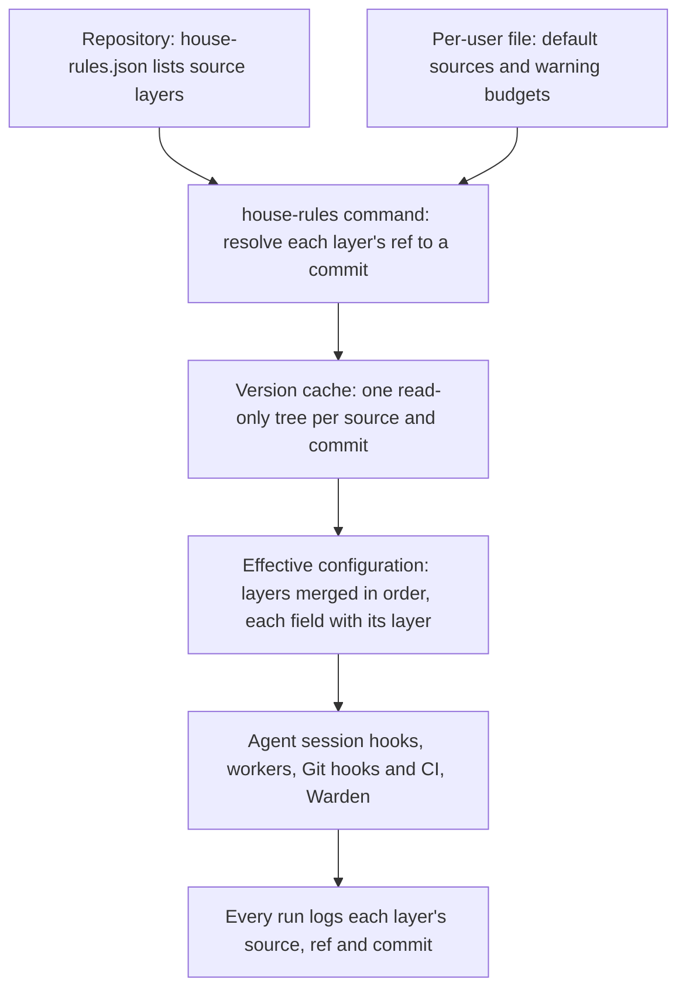

<a id="layered-configuration"></a>
# Layered House Rules configuration

Layered House Rules configuration lets every repository say which House Rules version and which further rule and setting repositories it uses, and makes every tool resolve them from the repository it runs in.
A repository lists ordered [source layers](#source-layer) in one file: House Rules first, then any number of custom repositories, each at a branch or a commit.
Later layers replace earlier entries with the same key, field by field, and the repository's own settings come last.
One small `house-rules` command per machine resolves the layers into a [version cache](#version-cache), the way a Rust toolchain file selects a toolchain without any "current version" state on the machine.
Agent session hooks, worker tooling, Git hooks, CI and Warden all resolve the same layers, and every run logs what it resolved.

Readers need Git branches and commits, JSON, and the [repository checks design](194-repository-checks.md#repository-checks) at the level of "a runner reads a configuration file and runs checks in Git hooks and CI".
The operator approved this design on 2026-10-24, after two simplification passes, as the [approval decision](#decision-approval) records; implementation follows it. The work is tracked in [#218](https://github.com/symbiotic-build/house-rules/issues/218).

How does one repository's configuration reach every tool that uses House Rules?



The [repository configuration](#repository-configuration) names the [source layers](#source-layer) and the repository's own settings.
The [house-rules command](#house-rules-command) runs [version resolution](#version-resolution): it turns each layer's ref into one commit and prepares that commit's files in the [version cache](#version-cache).
Each tool then reads the [effective configuration](#effective-configuration), which records the layer that set each value.
A repository without a configuration uses the default sources of the [global configuration](#global-configuration), and then House Rules `main`.
Each tool reads the repository configuration from its [configuration origin](#configuration-origin): Git hooks from the commit being checked, Warden from the PR's base branch.

<!-- spec-docs:navigation document="layered-configuration" -->
<!-- Generated by spec-docs; edit authored declarations. -->

## Overview

Layered House Rules configuration lets every repository say which House Rules version and which further rule and setting repositories it uses, and makes every tool resolve them from the repository it runs in.

**Audience:** House Rules maintainers, repository owners and teams adopting House Rules, familiar with Git branches and commits, JSON and the repository checks design.

**Scope:** The repository, layer and global configuration files, version resolution and its cache, the house-rules command, link mode, Git isolation for checks, and how every consumer resolves.

**Non-goals:** New language checks, a runner other than House Rules', a package registry, and implementation in this change.

## Document map

Use this map to choose the next explanation to read.

- [Layered House Rules configuration](218-layered-configuration.md#layered-configuration) — Read what layered configuration does and which tools resolve it.
- [Current state and evidence](218-layered-configuration.md#evidence) — See how House Rules reaches tools today and the constraints the design meets.
- [Tour: a Rust repository with two custom layers](218-layered-configuration.md#tour) — Follow a Rust repository with two custom layers from its file to a refused commit and a session.
- [Configuration files and layers](218-layered-configuration.md#configuration) — Declare layers, profiles and settings, and predict the effective value of every key.
- [Resolving a version](218-layered-configuration.md#resolving) — Know how a ref becomes a commit, where its files live, and what works offline or linked.
- [Consumers](218-layered-configuration.md#consumers) — Find where each tool reads the configuration and how checks avoid personal Git settings.
- [Worked examples](218-layered-configuration.md#examples) — Apply the design to a default repository, no configuration, link mode, a Warden review and an offline run.
- [Requirements](218-layered-configuration.md#requirements) — Find the obligations each mechanism must meet.
- [Decisions and alternatives](218-layered-configuration.md#decisions) — Read the operator's decisions with their words, the lead's recommendations and the design choices.
- [Open questions](218-layered-configuration.md#questions) — See which questions stay open after the approval.
- [Migration](218-layered-configuration.md#rollout) — Move a machine from one checkout to the command, and adopt the file in a repository.
- [Work packages](218-layered-configuration.md#work) — Plan the implementation pull requests and their order.
- [Reference](218-layered-configuration.md#reference) — Look up schemas, commands, variables, record formats, messages and naming conventions.
- [Acceptance](218-layered-configuration.md#acceptance) — See the planned demonstrations for each requirement.

## Entity index

Each technical term below links to its defining Markdown section.

- [Command environment variables](218-layered-configuration.md#environment-variables) (`layered-configuration.command-environment-variable`) — A command environment variable is an environment variable of the House Rules command: a variable whose name the command defines and reads, or sets for a script it starts.
- [Configuration origin](218-layered-configuration.md#configuration-origin) (`layered-configuration.configuration-origin`) — A configuration origin is the file or commit from which a consumer reads the repository configuration.
- [Effective configuration](218-layered-configuration.md#effective-configuration) (`layered-configuration.effective-configuration`) — The effective configuration is the result of applying every ruleset, the repository configuration and the global configuration in order, with the layer that set each value recorded beside it.
- [Global configuration](218-layered-configuration.md#global-configuration) (`layered-configuration.global-configuration`) — The global configuration is the per-user JSON file ~/.config/house-rules/house-rules.json that supplies default sources for repositories without a repository configuration and machine-only budgets.
- [House Rules command](218-layered-configuration.md#house-rules-command) (`layered-configuration.house-rules-command`) — The House Rules command is scripts/house_rules.py, one standard-library Python file that resolves layers, manages the version cache and links, and starts House Rules scripts at the resolved version.
- [Isolated Git environment](218-layered-configuration.md#git-isolation) (`layered-configuration.isolated-git-environment`) — An isolated Git environment is the set of environment variables with which the checks runner starts every check, so that no system or personal Git setting reaches it.
- [Run placeholder for layers](218-layered-configuration.md#run-placeholder-layer) (`layered-configuration.layer-placeholder`) — The run placeholder {layer} is the absolute path of the tree of the layer whose file defined the check's run.
- [Link mode](218-layered-configuration.md#link-mode) (`layered-configuration.link-mode`) — Link mode is the developer mode in which a source layer reads the working tree of a local checkout instead of a fetched commit.
- [Offline resolution](218-layered-configuration.md#offline-use) (`layered-configuration.offline-use`) — Offline resolution is resolution without a network, from what the version cache already holds.
- [Repository profile](218-layered-configuration.md#profile) (`layered-configuration.profile`) — A repository profile is a named set of layer settings for one kind of repository, such as rust, that a repository selects in profiles and every layer may define in its ruleset's profiles.
- [Repository configuration](218-layered-configuration.md#repository-configuration) (`layered-configuration.repository-configuration`) — A repository configuration is the versioned JSON file house-rules.json at a repository's root that lists its source layers, its profiles and its own settings.
- [Resolution record](218-layered-configuration.md#resolution-record) (`layered-configuration.resolution-record`) — A resolution record is the account of one resolution: the repository, the configuration origin, and for each layer its name, URL, ref, commit, source and fetch time.
- [Ruleset](218-layered-configuration.md#ruleset) (`layered-configuration.ruleset`) — A ruleset is the JSON file ruleset.json at the root of a source layer's repository that holds that layer's defaults: what applies always, and what applies per profile.
- [Source layer](218-layered-configuration.md#source-layer) (`layered-configuration.source-layer`) — A source layer is one entry of sources: a Git repository, named by name and url, at one ref.
- [Version cache](218-layered-configuration.md#version-cache) (`layered-configuration.version-cache`) — The version cache is the per-user folder that holds one read-only file tree per commit, and each source's branch and tag answers.
- [Version resolution](218-layered-configuration.md#version-resolution) (`layered-configuration.version-resolution`) — Version resolution is the procedure that turns each source layer's ref into one commit and makes that commit's files available in the version cache.
- [Check configuration](194-repository-checks.md#check-configuration) (`repository-checks.check-configuration`) — A check configuration is the versioned JSON file house-rules.json at the repository root that names the repository's House Rules source layer and declares its checks.
- [Check definition](194-repository-checks.md#check-definition) (`repository-checks.check-definition`) — A check definition is one command, the stages it runs at, the files it reads and how its result is read.
- [Check installation](194-repository-checks.md#check-installation) (`repository-checks.check-installation`) — Check installation is the repository-checks procedure that writes a repository's configuration, Git hooks and CI step, and prepares the local cache.
- [Check run report](194-repository-checks.md#check-run-report) (`repository-checks.check-run-report`) — A check run report is the runner's account of one run and of each check in it.
- [Check runner](194-repository-checks.md#check-runner) (`repository-checks.check-runner`) — The check runner is skills/repository-checks/scripts/checks.py, one standard-library Python file that reads the configuration, selects checks, runs them and prints the report.
- [Check stage](194-repository-checks.md#check-stage) (`repository-checks.check-stage`) — A check stage is one point in the change loop where the runner runs checks: pre-commit, pre-push or ci.
- [Clone settings](194-repository-checks.md#clone-settings) (`repository-checks.clone-setting`) — A clone setting is a per-clone Git setting that the install writes and the hook blocks read.
- [Hook block](194-repository-checks.md#hook-block) (`repository-checks.hook-block`) — A hook block is the marked shell fragment the install puts into a Git hook file to call the runner.
- [Run placeholders](194-repository-checks.md#run-placeholders) (`repository-checks.run-placeholder`) — A run placeholder is a name in braces in a check's run that the runner replaces with a value of the run before the command starts.
- [Runner environment variables](194-repository-checks.md#runner-environment-variables) (`repository-checks.runner-environment-variable`) — A runner environment variable is an environment variable whose name the runner defines.
- [Runner options](194-repository-checks.md#runner-options) (`repository-checks.runner-option`) — A runner option is one of the double-dash options of the runner's commands, such as --stage and --dry-run.
<!-- /spec-docs:navigation -->

<a id="evidence"></a>
## Current state and evidence

This section records how House Rules reaches tools today, which parts this design reuses and which constraints it must meet.

`FACT` House Rules main at `df20297` has one install path, read in this session:

- `scripts/sync.py --install-hooks` registers agent session hooks that run `scripts/session_context.py` from one House Rules checkout. The hooks print that checkout's rules in every repository.
- `scripts/session_context.py` reads every rule file relative to its own folder (`root()` returns the script's parent folder), so the checkout that holds the script decides the rules a session gets.
- The same install links each House Rules skill into agent homes, such as `~/.claude/skills/<name>`, pointing at that checkout.

`FACT` The [repository checks](194-repository-checks.md#repository-checks) runner of the open PRs [#212](https://github.com/symbiotic-build/house-rules/pull/212) and [#213](https://github.com/symbiotic-build/house-rules/pull/213), read at their heads `86b7e9f` and `30c8b99`, already has these parts:

- It reads `.agents/checks.json` from the snapshot being checked and always runs House Rules `main`. It resolves `main` with `git ls-remote` and keeps one read-only tree per commit in a per-user cache.
- Offline it uses the main last fetched, with a warning. [`HOUSE_RULES_REVISION`](194-repository-checks.md#runner-environment-variables) runs another commit for one deliberate test run, and the report marks it.
- Each report logs the House Rules revision and the SHA-256 of each check's program and scripts.
- The issue that asks for custom [source layers](#source-layer) in this runner is [#217](https://github.com/symbiotic-build/house-rules/issues/217); this design includes it.

`FACT` On the machine where this design was written, read on 2026-10-24:

- A local session-start script fetches House Rules main into one read-only checkout per commit and moves one stable link to it. Every agent session and every worker run reads House Rules through that link.
- Worker tooling writes the House Rules revision it used at the top of each run log.
- Warden, the review service, follows House Rules main through its own qualification step: it checks that a new main commit holds the prompt collection before it uses it, and keeps the last qualified commit.

The design must meet these constraints:

- Resolve the same layers in a Git hook and in CI for the same commit, so both give the same result.
- Keep no "current version" state that a person selects, because a repository's file alone must decide its version.
- Work offline from what was fetched before, and say so in every run that does.
- Never let a PR change the configuration of its own Warden review.
- Run the command and the resolver on Python 3.9 or later with the standard library only, as the checks runner does.

<a id="tour"></a>
## Tour: a Rust repository with two custom layers

Follow one repository from its configuration to a refused commit, a passing CI run and a session that reads the same rules.
The repository is a Rust service in a team that keeps shared rules in one repository, `team-rules`, and shared Rust settings in another, `rust-settings`.
The team follows `team-rules` at its latest commit and pins `rust-settings` to one reviewed commit.

**Procedure: write the configuration, install the checks, commit, push and start a session**

1. **Install the command once on the machine:** `python3 <House Rules checkout>/scripts/house_rules.py install`.
   - Copies the command to `~/.local/bin/house-rules`, prepares the global default's House Rules tree and registers the agent session hooks.
   - Writes nothing in any repository.
2. **Write the [repository configuration](#repository-configuration):** `house-rules init` in the repository.
   - Finds `Cargo.toml` and `docs/ENTITIES.json`, so it writes the profiles `rust` and `specs`.
   - The team then adds its two layers to `sources` by hand.
3. **Resolve and look at the result:** `house-rules resolve`.
   - Prints one line per layer with its URL, ref and the commit it resolved to.
   - Fetches each missing commit into the [version cache](#version-cache).
4. **Install the repository checks:** [`house-rules exec skills/repository-checks/scripts/checks.py install --ci github`](194-repository-checks.md#runner-options), as the [check installation](194-repository-checks.md#check-installation) of the repository checks design describes.
   - Writes the pre-commit and pre-push [hook blocks](194-repository-checks.md#hook-block) and, because of [`--ci github`](194-repository-checks.md#runner-options), the CI workflow, also in a repository without `.github/workflows/`.
   - The hook blocks start the installed command, so no hook names a path inside the cache.
5. **Stage and commit the adoption:** `git add house-rules.json .github/workflows/repository-checks.yml`, then commit through a reviewed PR.
6. **Stage and commit a change with trailing whitespace:** `git add src/main.rs`, then `git commit`.
   - The pre-commit hook resolves the same layers from the staged configuration.
   - The whitespace check fails; Git refuses the commit.
7. **Fix it, stage it and commit again.** Every check passes.
8. **Push the branch.** CI resolves the same layers from the pushed commit and passes. Its log names the same commits.
9. **Start an agent session in the repository.**
   - The session hook resolves from the repository's working tree.
   - It prints the House Rules rules of the resolved commit, then the rule file that `team-rules` adds.

> **Detail — configuration after step 2**
>
> ```json
> {
>   "version": 2,
>   "sources": [
>     {"name": "house-rules", "ref": "main"},
>     {"name": "team-rules", "url": "https://git.example.com/team/team-rules", "ref": "main"},
>     {"name": "rust-settings", "url": "https://git.example.com/team/rust-settings",
>      "ref": "3f2a9c0d41b7e65a8c1d2b3f4e5a6b7c8d9e0f1a"}
>   ],
>   "profiles": ["rust", "specs"],
>   "checks": {}
> }
> ```
>
> `house-rules` needs no `url`, because it is always House Rules. `main` is a branch, so every run uses its latest commit. The 40-digit `ref` is a commit, so `rust-settings` changes only through a reviewed PR that edits this line.

> **Detail — the [rulesets](#ruleset) of the three sources**
>
> - House Rules `ruleset.json` defines the `whitespace` and `spec-docs` checks and lists its always-load rules in `context`. Its `rust` profile is empty.
> - `team-rules` [`ruleset.json`](#ruleset) sets the pre-commit budget to 20 s and adds `rules/team.md` to the session context.
> - `rust-settings` [`ruleset.json`](#ruleset) has only a `rust` profile, which adds a check `cargo-deny` that runs in CI only and moves `spec-docs` to pre-push with a reason.

> **Detail — output of step 3**
>
> ```text
> house-rules: repository /work/service, configuration house-rules.json (working tree)
> house-rules: layer house-rules   https://github.com/symbiotic-build/house-rules ref main -> 4b1f0c2d9e8a7f6e5d4c3b2a1f0e9d8c7b6a5f4e (fetched 2026-10-24T09:00:00Z)
> house-rules: layer team-rules    https://git.example.com/team/team-rules ref main -> 7c2e19d04b3a5f6e7d8c9b0a1f2e3d4c5b6a7f80 (fetched 2026-10-24T09:00:01Z)
> house-rules: layer rust-settings https://git.example.com/team/rust-settings ref 3f2a9c0d41b7e65a8c1d2b3f4e5a6b7c8d9e0f1a (pinned)
> house-rules: profiles rust, specs
> ```
>
> The commits and times are illustrative. Every layer line names the URL as written, which never holds credentials, the ref, the full commit and, for a branch or tag, when the remote gave that answer, so a reader can compare any two logs.

> **Detail — check report of step 4**
>
> ```text
> repository checks: pre-commit on the staged index
> house-rules: repository /work/service, configuration house-rules.json (index)
> house-rules: layer house-rules   https://github.com/symbiotic-build/house-rules ref main -> 4b1f0c2d9e8a7f6e5d4c3b2a1f0e9d8c7b6a5f4e (reused, fetched 2026-10-24T09:00:00Z)
> house-rules: layer team-rules    https://git.example.com/team/team-rules ref main -> 7c2e19d04b3a5f6e7d8c9b0a1f2e3d4c5b6a7f80 (reused, fetched 2026-10-24T09:00:01Z)
> house-rules: layer rust-settings https://git.example.com/team/rust-settings ref 3f2a9c0d41b7e65a8c1d2b3f4e5a6b7c8d9e0f1a (pinned)
> house-rules: profiles rust, specs
> FAIL  whitespace   0.1 s
>       version: /usr/bin/git@9b04e1c7d2aa
>       src/main.rs:12: trailing whitespace.
>       fix: remove the trailing whitespace the output names, stage the fix and commit again
> settings:
>   budgets.pre-commit.seconds = 20                  from team-rules (reason: Our pre-commit includes a slower lint.)
>   checks.spec-docs.stages = ["pre-push", "ci"]     from rust-settings/rust (reason: Spec checks run at pre-push in Rust services.)
> Commit refused: 1 of 1 checks failed. Fix the findings, stage the fixes and commit again.
> ```
>
> Spec-docs is not listed, because its effective stages no longer include pre-commit; a check not configured for the stage does not appear in the report. The `version:` line is the check's version, the SHA-256 of its program, as the runner PRs log it. `reused` means the run took the commit that another run resolved less than 60 s earlier, as [Version resolution](#version-resolution) explains. The `settings` block lists every effective value that a later layer changed, with the layer that set it.

Each later chapter explains one part of this tour: the files in [Configuration files and layers](#configuration), how a ref becomes a commit in [Resolving a version](#resolving), and how each tool finds its configuration in [Consumers](#consumers).

<a id="configuration"></a>
## Configuration files and layers

This chapter defines the three kinds of file a configuration can come from and how their entries combine into one [effective configuration](#effective-configuration).
A repository's choices live in one tracked file, each rule repository's defaults in its [ruleset](#ruleset), and machine-only values in one per-user file that can only warn.

<a id="repository-configuration"></a>
### Repository configuration

A repository configuration is the versioned JSON file `house-rules.json` at a repository's root that lists its [source layers](#source-layer), its profiles and its own settings.
It is the one place a repository states which House Rules version and which further rule repositories it uses, so a reviewer sees every change to them in a PR's diff.

The file has five top-level fields:

- `version` is 2. Version 1 was the runner PRs' earlier `.agents/checks.json`.
- `sources` lists the [source layers](#source-layer) in order. It is required, so the file alone decides the layers: a hook and CI resolve the same list, and no per-user file can change it.
- `profiles` lists [profile](#profile) names in order. It is optional and defaults to none.
- `budgets` maps a [check stage](194-repository-checks.md#check-stage) to an entry with `seconds` and `reason`, as the repository checks design defines.
- `checks` maps a check identity to an entry, with the fields of the [check configuration](194-repository-checks.md#check-configuration).

The tour's file lists three sources and two profiles and changes no check. The exact schema is in [the schema reference](#schema-repository).

The runner PR [#212](https://github.com/symbiotic-build/house-rules/pull/212) introduces this file with exactly one source, the `house-rules` layer, and refuses a second source with a configuration error that names [#217](https://github.com/symbiotic-build/house-rules/issues/217). This design adds custom layers, profiles and their merge to that file; it renames nothing.

Only this file lists layers. A [ruleset](#ruleset) that lists sources is refused, so no layer can pull further repositories into a run that the repository did not list.

<a id="source-layer"></a>
### Source layer

A source layer is one entry of `sources`: a Git repository, named by `name` and `url`, at one `ref`.
Layers let a team share rules and settings in their own repositories, after House Rules and before the repository's own settings, without any special "organization" concept.

Each layer entry has three fields:

- `name` is the layer's name in logs and reports, in lower kebab case, unique in the list. The first layer is always `house-rules`, and no other layer may use that name.
- `url` is the repository to fetch. The `house-rules` layer may omit it; its default is `https://github.com/symbiotic-build/house-rules`. Every other layer needs it. A URL that carries a password, or any user name over `http` or `https`, stops resolution with a configuration error that says to use a Git credential helper, as the [credentials decision](#decision-no-credentials) records. An `ssh` login without a password is part of the URL. A URL in Git's `<transport>::<address>` form stops resolution too. The resolver detects that form as Git detects it.
- `ref` is a branch name, a full commit identity or an exact release tag. It is optional and defaults to `main`.

A `ref` of 40 hexadecimal digits is a commit. A `ref` of 64 hexadecimal digits, a SHA-256 commit, stops resolution with "SHA-256 sources are not supported yet", as the [SHA-1 sources decision](#decision-sha1-sources) records; it is never taken as a branch name. A `ref` of the form `v<major>.<minor>.<patch>`, digits only, such as `v1.4.0`, is a release tag. Any other value is a branch name.
A branch always resolves to its latest commit, so a layer that follows `main` gets every change at the next run.
A commit is a deliberate pin: it is visible in the file and changes only through a reviewed PR.
A release tag resolves like a branch, as the [resolution rules](#version-resolution) state. House Rules publishes such tags with a changelog entry; [#225](https://github.com/symbiotic-build/house-rules/issues/225) tracks that release step. A version range such as `v1` or `^1.4` is not a release tag; it is read as a branch name, and a missing branch stops resolution with an error naming it. Release tags arrive with the resolver ([#222](https://github.com/symbiotic-build/house-rules/pull/222)); until the checks runner uses it, the runner of [#212](https://github.com/symbiotic-build/house-rules/pull/212) reads `v1.4.0` as a branch name and stops with its missing-branch error.

In the tour, `team-rules` follows `main` and `rust-settings` is pinned to `3f2a9c0…`.

Listing a source trusts its content like a dependency, because a layer's check definitions run its commands.
A commit pin is how a repository makes that trust reviewed: the pinned content changes only in a PR that changes the pin.

<a id="ruleset"></a>
### Ruleset

A ruleset is the JSON file `ruleset.json` at the root of a source layer's repository that holds that layer's defaults: what applies always, and what applies per [profile](#profile).
Every source, House Rules included, has the same one file, so House Rules' defaults are just the first ruleset and a team's rules repository needs no other format.

A ruleset has five fields, each optional except `version`:

- `version` is 1.
- `context` lists Markdown files of this layer, relative to its repository root, that agent sessions receive, in order.
- `checks` maps a check identity to an entry. An entry for an identity no earlier step defined is a full [check definition](194-repository-checks.md#check-definition); an entry for an existing identity changes it field by field.
- `budgets` maps a check stage to an entry with `seconds` and `reason`.
- `profiles` maps a profile name to an entry with the same `context`, `checks` and `budgets` fields, applied when the repository selected that profile. A profile entry holds no `profiles` of its own.

`checks` and `budgets` have exactly the shapes of the [repository configuration](#repository-configuration)'s, so one entry moves between a ruleset and a repository's `house-rules.json` unchanged. The one difference: only a ruleset may set `enforced` in a check entry, so only a layer decides whether a check's failure refuses a commit or only warns, as [New built-in checks warn first](194-repository-checks.md#check-definition) describes in the repository checks design.

A check command of a layer can name files of its own layer with `{layer}`, the [run placeholder for layers](#run-placeholder-layer), so a team ships a check script in its rules repository.

A missing `ruleset.json` is no error: that source contributes nothing.
A ruleset that is not valid JSON, has an unknown field or lists `sources` stops resolution with a configuration error naming the file and its layer.

> **Detail — the tour's `team-rules` [`ruleset.json`](#ruleset)**
>
> ```json
> {
>   "version": 1,
>   "budgets": {"pre-commit": {"seconds": 20, "reason": "Our pre-commit includes a slower lint."}},
>   "context": ["rules/team.md"]
> }
> ```

House Rules' own [`ruleset.json`](#ruleset) holds its defaults in the same format:

- Its `context` lists the always-load rule files that `INDEX.md` names, in the same order, then the operator-writing skill that every session receives today. Session hooks deliver these files through the same `context` mechanism as a team's files.
- Its `checks` holds the built-in checks `whitespace` and `spec-docs`, which move into it from the runner's code.
- Its profiles are empty entries until a language default needs a check or a file.

`INDEX.md` stays the human index. A test in House Rules' CI refuses a change after which `INDEX.md`'s always-load list is not the start of the ruleset's `context`, in the same order.

<a id="profile"></a>
### Repository profile

A repository profile is a named set of layer settings for one kind of repository, such as `rust`, that a repository selects in `profiles` and every layer may define in its [ruleset](#ruleset)'s `profiles`.
Profiles let a layer ship language-specific checks that only repositories of that kind receive.

House Rules defines five profiles: `rust`, `typescript`, `python`, `svelte` and `specs`.
At the first implementation none of them defines a check; each is an empty entry in House Rules' ruleset. A later House Rules PR adds language checks to them, warning first, as [#218](https://github.com/symbiotic-build/house-rules/issues/218) tracks.
`spec-docs` stays in the ruleset's top-level `checks`, because it skips itself in a repository without `docs/DOCUMENTS.json`, and the repository checks design promises that a repository starts checking specifications when it adds one.

A profile name that no layer defines stops resolution with a configuration error, because it is most likely a spelling mistake.

`house-rules init` chooses profiles once, from marker files at the repository root, and writes them into the file:

| Profile | Marker files |
|---|---|
| `rust` | `Cargo.toml` |
| `typescript` | `package.json` and `tsconfig.json` |
| `python` | `pyproject.toml` |
| `svelte` | `svelte.config.js` |
| `specs` | `docs/ENTITIES.json` |

No tool detects profiles at run time. A repository that adds a language later edits `profiles` in a reviewed PR, so its checks never change because a file appeared.

<a id="global-configuration"></a>
### Global configuration

The global configuration is the per-user JSON file `~/.config/house-rules/house-rules.json` that supplies default sources for repositories without a repository configuration and machine-only budgets.
It serves one person on one machine and can never change whether a repository's declared checks pass.

The file has three fields:

- `version` is 1.
- `sources` lists default source layers, with the schema of the repository configuration. They apply to a repository without a repository configuration and to jobs that run in no repository.
- `budgets` sets machine budgets. A budget only ever prints a warning.

The folder is `$XDG_CONFIG_HOME/house-rules` when `XDG_CONFIG_HOME` is set, and `~/.config/house-rules` otherwise.
The folder also holds `links.json`, written by [link mode](#link-mode), and `custom/`, this computer's local index that agent sessions read.

A problem in this file never stops a check run. An invalid file is ignored with a warning that names it.
Resolution for a repository without a repository configuration is the one exception: it needs the file's `sources`, so an invalid file stops that resolution with a configuration error.

<a id="effective-configuration"></a>
### Effective configuration

The effective configuration is the result of applying every [ruleset](#ruleset), the repository configuration and the global configuration in order, with the layer that set each value recorded beside it.
It is what the checks runner and the session hooks use, and its provenance lets a report say where each value came from.

The application order is fixed.

**Procedure: build the effective configuration**

1. **Each source layer, in `sources` order:** its ruleset's top level, then its `profiles.<name>` entry for each profile in the repository's `profiles` order.
2. **The repository configuration:** its `budgets` and `checks`.
3. **The global configuration:** its `budgets`.

Step 3 applies only in Git hooks and in commands run on the machine. CI has no global configuration, and a value from it only ever warns.

One merge rule holds at every step:

- A check entry `checks.<identity>` changes the earlier entry field by field: it keeps every field the later entry does not set. A field's value is replaced whole; a list such as `stages` is one value, never merged element by element. A new identity needs a full definition.
- A budget entry `budgets.<stage>` replaces the earlier entry for that stage whole.
- `context` files append: each step adds its files after those of earlier steps.

Every entry that sets a field an earlier step set carries a `reason`, in a ruleset as in the repository configuration.
An entry that sets a field to its earlier value needs a reason too.
Only House Rules' top level sets defaults without one.

The layer label of a value is the source name, followed by `/` and the profile name for a profile entry: `house-rules`, `house-rules/rust`, `team-rules`, `rust-settings/rust`. The last two steps are labelled `repository` and `global`.

> **Detail — the tour's `spec-docs` entry after each step**
>
> - `house-rules` (top level): `stages` = `["pre-commit", "ci"]`, `enforced` = `true` and the full definition.
> - `rust-settings/rust`: `stages` = `["pre-push", "ci"]`, with the reason "Spec checks run at pre-push in Rust services." Every other field keeps its House Rules value.
> - `repository`: no entry, so nothing changes.
>
> The effective `stages` is `["pre-push", "ci"]`, from `rust-settings/rust`. At pre-commit the check is not selected, as the tour's report shows.

<a id="resolving"></a>
## Resolving a version

This chapter explains how a ref becomes a commit, where its files live, what works offline, and the two ways to run something other than the configured version.

<a id="version-resolution"></a>
### Version resolution

Version resolution is the procedure that turns each [source layer](#source-layer)'s ref into one commit and makes that commit's files available in the [version cache](#version-cache).
It runs once per run of any consumer, so every part of one run uses one set of commits.

**Procedure: resolve the layers of one run**

1. **Find the configuration** at the consumer's [configuration origin](#configuration-origin), and read its `sources`.
2. **Apply a one-run override:** when [`HOUSE_RULES_REVISION`](194-repository-checks.md#runner-environment-variables) or [`HOUSE_RULES_LINK`](#environment-variables) is set, it replaces the `house-rules` layer, as [link mode](#link-mode) and the revision override explain.
3. **Ask for each branch ref:** `git ls-remote <url> refs/heads/<branch>` names its latest commit.
4. **Ask for each release tag ref:** `git ls-remote <url> refs/tags/<tag> refs/tags/<tag>^{}` names its commit; for an annotated tag the `^{}` line does.
5. **Take each commit ref as it is.** It needs no network unless its files are missing.
6. **Fetch each missing commit** into the version cache and extract its files.
7. **Publish each branch or tag answer:** only after its commit's tree is complete, the record in the cache is replaced. An interrupted or failed fetch therefore keeps the previous usable record.
8. **Read the [rulesets](#ruleset)** of every layer and build the [effective configuration](#effective-configuration).
9. **Log the resolution** as the [resolution record](#resolution-record) defines.

> **Detail — resolution rules**
>
> - A record is replaced whole, so every reader sees a complete record. Parallel runs can ask the remote and fetch one source at the same time. When two writers race, the last one's answer stays until the next run asks again. The checks runner of [#212](https://github.com/symbiotic-build/house-rules/pull/212) writes the same branch records.
> - A branch or tag answer younger than 60 s is reused without asking the remote again, and the layer's source is `reused`. The window saves remote calls for runs one after another; it does not promise that parallel runs agree. How sessions detect a split is in [Agent sessions](#consumer-sessions).
> - Each fetch creates a new temporary bare repository inside its source's cache folder, fetches the one commit with depth 1 and extracts it into a temporary folder there, whose name starts with `.partial-`. Then it renames the temporary folder to `revisions/<commit>/` and deletes the repository. That rename alone publishes the tree. A tree is ready when its folder exists, and an existing tree is never replaced: a fetch whose rename finds the folder already there removes its own copy and uses the existing tree, as the [tree readiness decision](#decision-tree-ready) records. A `.partial-` folder that a killed process left stays until the cache is cleared.
> - A release tag resolves like a branch. Each run asks the remote, reuses an answer younger than 60 s, and falls back to the tag's last record when the remote cannot be reached. A tag moved on the remote is therefore followed at the next run that asks, the same as CI with an empty cache follows it. A tag the remote does not have stops resolution with the missing-tag message. A tag with no record while the remote cannot be reached stops with "run again when online".
> - Fetching a commit by its identity needs a server that allows it. GitHub does. A server that refuses stops resolution with an error that names the commit and the server's answer.
> - Every `ls-remote` and fetch passes `-c http.lowSpeedLimit=1 -c http.lowSpeedTime=30`, so Git stops a transfer that moves less than 1 byte per second for 30 s. Resolution adds no timer of its own, except in hook mode.
> - In hook mode (`house-rules exec --hook`), the agent product kills the hook after its timeout, 10 s, which would leave no visible line. `exec` owns one deadline for the whole hook, 8 s after the hook starts: `ls-remote`, fetches and the started script all share it. `exec` passes it to the script in [`HOUSE_RULES_DEADLINE`](#environment-variables), so the script knows the time left. At the deadline during resolution, a branch or tag takes the [offline resolution](#offline-use) path with the warning "the remote did not answer within 8 s", and a layer with nothing cached stops with the resolution failure below. A script that reaches the deadline stops its slow work and prints a visible line that names what was cut short. This is the one place House Rules stops on elapsed time, because the host's timeout is not progress-based and a killed hook reports nothing.
> - Messages show each URL as written, because a source URL never carries credentials. A message that refuses a URL never shows it, because it may hold the credentials it refuses.

`house-rules exec` passes the resolution to the script it starts in [`HOUSE_RULES_RESOLVED`](194-repository-checks.md#runner-environment-variables). The script uses it and resolves nothing again.

<a id="version-cache"></a>
### Version cache

The version cache is the per-user folder that holds one read-only file tree per commit, and each source's branch and tag answers.
It makes every resolution after the first local and fast, and it is what an offline run falls back to.

> **Detail — cache layout**
>
> - The cache root is [`HOUSE_RULES_CACHE`](194-repository-checks.md#runner-environment-variables), or `$XDG_CACHE_HOME/house-rules`, or `~/.cache/house-rules`.
> - `revisions/<commit>/` holds that commit's files, extracted with `git archive`, as in the runner PRs. A commit identifies its content, so a fork and its upstream share the tree of a common commit. Files are read-only; folders stay writable, so the cache can be removed.
> - `sources/<source hash>/` holds one source's files. The source hash is the lowercase hexadecimal SHA-256 of the source's URL exactly as written, in UTF-8, so every folder name has the same length and none collides with another file. Two spellings of one URL are two sources; an `ssh` login is part of the URL and keeps two accounts apart.
> - `sources/<source hash>/branches/<branch hash>.json` records the last published answer for one branch. The branch hash is the lowercase hexadecimal SHA-256 of the branch name's UTF-8 bytes, with undecodable bytes kept as they are (Python's `surrogateescape`). The record holds `url` as written, `branch`, `revision` and `fetched`, an ISO 8601 UTC time. A record belongs to the folder that holds it. The checks runner of [#212](https://github.com/symbiotic-build/house-rules/pull/212) writes the same record, so both tools share one answer.
> - `sources/<source hash>/tags/<tag hash>.json` records a release tag's answer: `url`, `tag`, `revision` and `fetched`. The tag hash follows the branch hash's rule. It is replaced as a branch record is.
> - `environments/<digest>/` holds the virtual environments of the checks runner, unchanged from the runner PRs.
> - `default` is a symbolic link to the House Rules tree of the last resolution of the global default sources. Agent-home skill links point through it, as [Agent sessions](#consumer-sessions) explains.
> - A folder whose name starts with `.partial-` inside a source's folder is a tree being built, as the [resolution rules](#version-resolution) explain.

`house-rules cache list` prints each source that has a branch or tag record, named by the URL its records hold, with those records and its saved link. Then it prints each tree with its size, and last the cache's total size. A source folder holds only hashes, so a source used only at a pinned commit has no record and is not named; its trees are still listed. A record that `cache list` cannot read, or whose fields are not text, is named in a warning on standard error and left out; a folder it cannot read stops it with an error.

<a id="cache-clearing"></a>
#### Clearing the cache

The cache only grows: every commit that a branch passes through keeps its tree, and every record stays. Nothing removes cache entries automatically, as the [no automatic pruning decision](#decision-no-pruning) records.

To clear the cache, delete its folder while no [House Rules command](#house-rules-command), hook or checks run is active. The next resolution fetches what it needs again. Until each branch or tag is resolved online again, it has no offline fallback.

<a id="offline-use"></a>
### Offline resolution

Offline resolution is resolution without a network, from what the version cache already holds.
A machine without a network keeps working on the rules it last fetched, and every run that does so says so.

- **A branch or release tag ref:** when `ls-remote` fails, resolution uses the ref's last record, and the layer's source is `offline`. The run prints one warning naming the layer, its commit and the record's `fetched` time.
- **A branch or tag with no record:** resolution stops with the [resolution failure](#failure-resolution) that names the layer and says to run again when online.
- **A commit ref:** a commit already in the cache needs no network. A missing commit stops resolution with a preparation error that names it.
- **A link:** a linked layer needs no network.

> **Detail — offline lines**
>
> ```text
> warning: cannot reach https://git.example.com/team/team-rules (fatal: unable to access …); using team-rules main as last answered 2026-10-24T09:00:01Z, 7c2e19d04b3a5f6e7d8c9b0a1f2e3d4c5b6a7f80
> house-rules: cannot reach https://git.example.com/team/team-rules (fatal: unable to access …) and no earlier fetch of team-rules main is cached; run again when online
> ```

<a id="failure-resolution"></a>
#### Failure state: resolution cannot complete

This refusal keeps a consumer from using layers it could not resolve completely.

**Trigger:** The [repository configuration](#repository-configuration) or a [ruleset](#ruleset) is invalid; a branch or commit does not exist at its URL; a remote cannot be reached and the cache holds nothing usable for that layer; a link is broken; the cache cannot be written; or the hook-mode deadline passes with a layer uncached.

**Outcome:** The command exits 2 and prints one line on standard error with the cause and its repair, as [Messages](#messages) lists. A checks run stops as the repository checks design's preparation failure does. A session hook prints the same line as a `HOUSE RULES HOOK ERROR:` line, then follows the [session fallback decision](#decision-session-fallback).

**Retained state:** Trees already complete stay in the cache and are used by the next resolution. No branch or tag record is replaced for a layer whose fetch failed. A temporary fetch folder is removed, or, when the process was killed, stays until the cache is cleared. When the cache cannot be written, the cache keeps what it held before.

**Recovery:** The author fixes the configuration through a reviewed PR, runs again when online, corrects the ref, or unlinks a broken link, as the message names. When the cache cannot be written, the message names the cache folder and the system's error; the person running the command frees disk space, makes the folder writable, or sets [`HOUSE_RULES_CACHE`](194-repository-checks.md#runner-environment-variables) to a writable folder, then runs again. Nothing else needs to be repaired, because no partial result is ever used.

**Authority:** The person running the command repairs its machine; a configuration change needs the repository's normal review.

**Verification:** [Offline run](#test-layers-offline), [two custom layers](#test-layers-two-custom). The cache-write case is planned for the resolver's tests: a read-only cache folder must stop with the message below and leave the cache unchanged.

<a id="overrides"></a>
### Overrides and link mode

A run uses something other than the configured version in exactly two ways, both visible in its log: a revision override for a deliberate test, and link mode for developing a layer.
Neither is stored in any repository, so no commit can make another machine run an unreviewed version.

The revision override is [`HOUSE_RULES_REVISION`](194-repository-checks.md#runner-environment-variables), a full commit identity that replaces the `house-rules` layer's ref for one run.
It keeps the meaning it has in the runner PRs: a deliberate test, marked in every log line of the layer with `override` and in a `TEST OVERRIDE` warning.

<a id="link-mode"></a>
#### Link mode

Link mode is the developer mode in which a source layer reads the working tree of a local checkout instead of a fetched commit.
It lets a person who edits House Rules or a team's rules repository try the edit in real repositories before pushing it.

**Procedure: try an edit to a rules repository**

1. **Link the checkout:** `house-rules link ~/src/team-rules`.
   - Reads the checkout's `remote.origin.url`, prints the URL it links and writes the link to `links.json` in the [global configuration](#global-configuration) folder.
   - `--url URL` names the source instead.
2. **Work in any repository that lists that source.** Every run of every consumer uses the checkout's working tree for that layer, uncommitted edits included, and warns.
3. **Unlink:** `house-rules unlink ~/src/team-rules`. The next run fetches the layer again.

> **Detail — the warning every linked run prints**
>
> ```text
> warning: LINKED team-rules -> /home/dev/src/team-rules at 9f3c2a1b4d5e6f708192a3b4c5d6e7f8091a2b3c with uncommitted changes; this run does not use the fetched source
> ```

A link applies to every repository that lists a source with the same URL, on this machine only.
[`HOUSE_RULES_LINK`](#environment-variables) links the `house-rules` layer to a checkout for one run, without writing `links.json`.
For the `house-rules` layer, a one-run variable wins over `links.json`: [`HOUSE_RULES_LINK`](#environment-variables) or [`HOUSE_RULES_REVISION`](194-repository-checks.md#runner-environment-variables), when set, decides the layer, and the run's warning names it. Setting both one-run variables stops resolution with a usage error, because a run can use only one of them.
A link whose folder is missing or is not a Git checkout stops resolution with an error that names the `unlink` command.

A linked run gives up the equal-result promise between hook and CI, because CI has no link. Every report says so through the warning above, so nobody mistakes a linked result for a configured one.

<a id="resolution-record"></a>
### Resolution record

A resolution record is the account of one resolution: the repository, the configuration origin, and for each layer its name, URL, ref, commit, source and fetch time.
Every consumer logs it, so a reader of any session context, worker log, check report or Warden review can tell which rules produced it.

The text form of a resolution record is the `house-rules:` lines the tour shows: one line for the configuration with its origin, one per layer with its URL, ref, commit, source and, for a branch or tag, the time the remote gave that answer, and one for the profiles when there are any. Warnings come before them.
The JSON form is in [the record format reference](#schema-resolution).
Its serialized JSON is at most 64 KiB, so it always fits in one environment value. A larger record stops resolution with a configuration error that names its size and the layer with the most context files, as the [record size decision](#decision-record-size) records. The number of sources has no limit of its own.

Each layer's source is one of these words:

- `fetched`: the branch or release tag was asked for in this resolution.
- `reused`: the branch's or tag's answer was younger than 60 s.
- `offline`: the remote could not be reached; the last answer was used.
- `pinned`: the ref is a commit.
- `override`: [`HOUSE_RULES_REVISION`](194-repository-checks.md#runner-environment-variables) replaced the ref.
- `link`: a link replaced the layer.

Besides layers, each consumer logs what it adds:

- The checks runner logs each effective value that a later step changed, with its layer and reason, and each check's version, the SHA-256 of its program and scripts, as the runner PRs define.
- Session hooks log the resolution in the first context part.
- Worker tooling logs it at the top of each run log, beside the prompt files' Git blob identities it already writes.
- Warden logs it in each review's debug data.

<a id="house-rules-command"></a>
### House Rules command

The House Rules command is `scripts/house_rules.py`, one standard-library Python file that resolves layers, manages the version cache and links, and starts House Rules scripts at the resolved version.
It is installed once per machine as `house-rules`, and the checks runner imports the same file as its resolver.

`house-rules install` copies the file to `~/.local/bin/house-rules`, with the absolute path of the interpreter that ran it on its first line and `-I`, so inherited Python settings cannot change it.
The installed copy resolves with its own code. It never hands itself over to another revision, so it has no state and no version selection beyond what the repository's file says.

The installed command is older than House Rules `main` after any House Rules merge that changes it.
A configuration whose `version` it does not know stops it with an error that names the install command, `python3 <House Rules checkout>/scripts/house_rules.py install`, run from a House Rules checkout that knows the version.
`house-rules resolve` also warns when the installed copy differs from the file in the global default's House Rules tree. The warning says to install the command from that tree.

`house-rules path` prints only the tree's path on standard output and its resolution lines on standard error, so a script can capture the path and still log the resolution. `house-rules resolve --json` prints only the JSON record on standard output.

`house-rules exec <path> [arguments]` runs a script from the resolved House Rules tree, such as `scripts/session_context.py`, with the resolution in [`HOUSE_RULES_RESOLVED`](194-repository-checks.md#runner-environment-variables).
With `--hook` it reads an agent hook's JSON input from standard input, takes the repository from its `cwd` field and passes the same input on to the script.
The script therefore always runs at the repository's resolved House Rules version, and it reads its rule files from its own tree.

The commands and their options are listed in [Commands](#commands).

<a id="consumers"></a>
## Consumers

This chapter names every tool that uses House Rules, where each one reads the [repository configuration](#repository-configuration), and how checks are kept from reading personal Git settings.

<a id="configuration-origin"></a>
### Configuration origin

A configuration origin is the file or commit from which a consumer reads the repository configuration.
Each consumer reads from the point that matches what it acts on, so a hook and CI agree, and a PR cannot weaken its own review.

| Consumer | Configuration origin | Without a repository configuration |
|---|---|---|
| Git pre-commit hook | staged index | no checks run |
| Git pre-push hook | each pushed commit | no checks run |
| CI step | commit under test | no checks run |
| Warden | PR's base commit | Warden's own default |
| Agent session hooks | working tree | global default sources |
| Worker and review-lane tooling | working tree of the work folder | global default sources |
| Jobs in no repository | none | global default sources |

The repository is the Git top level of the folder the consumer runs in: `git rev-parse --show-toplevel`.
The global default sources are the `sources` of the [global configuration](#global-configuration), and without them House Rules `main`.
A repository without a repository configuration has not adopted repository checks, so the checks runner checks nothing there, as the repository checks design already states.

The CI step reads the commit under test, not the PR's base. The repository checks design records why, in its [CI configuration decision](194-repository-checks.md#decision-ci-head-configuration): a PR controls its own CI workflow file anyway, and a PR that changes the configuration must show what the change does.
Warden is different, because it is the independent review; [Warden](#consumer-warden) explains its rule.

<a id="consumer-checks"></a>
### Git hooks and CI

The checks runner resolves the layers of each snapshot through the [House Rules command](#house-rules-command)'s resolver and builds the [effective configuration](#effective-configuration) from them.
This replaces the runner's own resolution of House Rules `main`; everything else in the repository checks design stays.

- **Hook entry point.** The [hook blocks](194-repository-checks.md#hook-block) start the installed command, named by the [clone setting](194-repository-checks.md#clone-settings) `house-rules.command`: [`house-rules exec --origin index skills/repository-checks/scripts/checks.py run --stage pre-commit`](194-repository-checks.md#runner-options) and [`house-rules exec --rev HEAD skills/repository-checks/scripts/checks.py run --stage pre-push`](194-repository-checks.md#runner-options). The pre-push hook's `exec` passes Git's pre-push lines on standard input through to the runner unchanged; the runner parses them, as the repository checks design describes. No hook names a path inside the cache, so clearing the cache never removes a hook's entry point.
- **Origin before resolution.** `--origin index` makes `exec` read `house-rules.json` from the staged index. `--rev HEAD` makes it read the configuration of the commit `HEAD` names to choose the runner's revision. An invalid working-tree file therefore never stops a commit whose staged file is valid. A snapshot without `house-rules.json` resolves the global default sources, then House Rules `main`, and the runner then finds no checks; that such a snapshot can still fail on an unavailable default is [#230](https://github.com/symbiotic-build/house-rules/issues/230). The pre-push hook resolves HEAD's layers before the runner reads Git's lines, so a push that only deletes refs passes only when those layers resolve; otherwise it stops with the resolution failure, which names its repair. This known limit is part of [#230](https://github.com/symbiotic-build/house-rules/issues/230) too, as the [simplification pass](#decision-simplification-pass) records. `exec` reads the staged file by its exact path, `git show :house-rules.json`; nothing staged at or below that path is a missing file, and any other failure, such as a folder of that name or a conflicted entry, stops with Git's error. A commit's file that Git cannot list or read is a failure that names it, never a missing file.
- **Resolution per snapshot.** Each snapshot is resolved from its own configuration. Within one run, a branch of one source is asked for once, so snapshots that list it use the same commit. Only that choice of commit is shared: each snapshot's [resolution record](#resolution-record), profiles, context and settings come from its own configuration.
- **One runner.** The runner that `exec` started checks every snapshot itself, each with its own resolution and settings; it never starts a runner of another revision, as the [runner handover decision](#decision-no-runner-handover) records.
- **Report.** Each snapshot entry holds its own [resolution record](#resolution-record) as `resolution` and its changed values as `settings`, each with its layer and reason. The run object holds no single House Rules revision.
- **Machine budgets.** Budgets from the global configuration only print warnings.
- **Check versions.** A check whose program file cannot be read for its version is not run; the report lists it as an `error`, so no check runs without a logged version.

<a id="git-isolation"></a>
#### Isolated Git environment

An isolated Git environment is the set of environment variables with which the checks runner starts every check, so that no system or personal Git setting reaches it.
It makes a hook give the same result as CI's fresh clone for the same commit and layers, unless the clone's own `.git/config` or `.git/info/attributes` says otherwise.
The runner PR [#212](https://github.com/symbiotic-build/house-rules/pull/212) builds it; this design records its contract, because every layer's checks rely on it.

The runner starts each check with:

- `GIT_CONFIG_NOSYSTEM=1` and `GIT_CONFIG_GLOBAL=/dev/null`, so no system or global Git configuration is read.
- `GIT_ATTR_NOSYSTEM=1`, so no system attribute file is read, and `GIT_NO_REPLACE_OBJECTS=1`, so no replace reference changes what a check reads.
- `GIT_CONFIG_COUNT`, `GIT_CONFIG_KEY_<n>` and `GIT_CONFIG_VALUE_<n>` holding only `core.attributesFile=/dev/null`. The personal attribute file under `~/.config/git/` is therefore not read either.

The runner first removes every inherited `GIT_CONFIG_PARAMETERS`, `GIT_CONFIG_COUNT`, `GIT_CONFIG_KEY_<n>` and `GIT_CONFIG_VALUE_<n>`, which `git -c` passes to hooks.
A check still reads the clone's `.git/config` and `.git/info/attributes`. They belong to that clone, and a clone owner who changes them accepts that a hook can disagree with CI; CI's fresh clone has neither, so CI decides. The operator's [isolation decision](#decision-git-isolation) records this limit.

<a id="consumer-sessions"></a>
### Agent sessions

Agent session hooks put House Rules rules into an agent's context at session start, resume, clear and compaction. With layers they print the rules of the repository's resolved version.

- **Session context.** Each registered hook runs `house-rules exec --hook scripts/session_context.py <part>`. The script runs from the resolved House Rules tree and prints that tree's rules. The first part starts with the resolution record.
- **Context.** The parts hold `INDEX.md`, then every layer's [ruleset](#ruleset) `context` files in layer order, House Rules' always-load rules first, then this computer's `custom/INDEX.md`. House Rules' files and a team's files travel the same way.
- **One event, one text.** Each part resolves on its own, so two parts can be cut from different resolutions. Every part names the revision and text fingerprint it was cut from, and part 1's resolution governs, as the [split detection decision](#decision-split-detection) records.
- **Compaction.** Claude Code and Codex run the same hooks after a compaction, so the re-injected rules come from a new resolution of the same repository.
- **Approved-work listing.** Its hook runs `house-rules exec --hook scripts/session_context.py approved` in the same way. Its GitHub searches stop at the hook's deadline from `HOUSE_RULES_DEADLINE`, not at a budget of their own; a listing cut short prints the issues found so far and a line that says the search was cut short.
- **Machine index.** The script reads this computer's `custom/INDEX.md` from the global configuration folder (`~/.config/house-rules/custom`) when that file exists, and from its own checkout otherwise.
- **End-of-turn guard.** A local guard that names a House Rules tool, such as the PR watcher, names it through `house-rules exec`, so the tool's revision matches the repository's.

A failed resolution never stops a session from starting. The hook prints the [resolution failure](#failure-resolution) line with its repair, then the House Rules files of the tree that `default` points to, under a line that says they are the global default's rules, not this repository's, and that the repository's custom layers are missing. The [session fallback decision](#decision-session-fallback) records why. The script it starts gets no resolution record.

Agent-home skill links serve every repository at once, so they follow the global default sources. They point through the cache's `default` link, which each resolution of the global default moves to its House Rules tree. `house-rules install` resolves the global default before it registers any link, so the link target exists; when that resolution fails, the install stops with its message and registers nothing.
In a repository whose House Rules commit differs from the global default's, the first context part names the repository's tree and says to read skill files there.

Instruction files that agent homes load at start, such as a global `CLAUDE.md`, name no checkout path any more. Their managed House Rules block says to follow the rules in the session context and to run `house-rules path` when a file must be opened.

<a id="consumer-workers"></a>
### Workers and review lanes

Worker and review-lane tooling starts model workers and review panels with House Rules prompts.
It resolves once per run, with `house-rules resolve --repo <work folder> --json`, and uses that one record for everything: the House Rules tree to build prompts from, and the custom layers' entries of the record's `context` list, which it appends to the prompts after the House Rules rules, in layer order.
Each run log starts with the resolution record in text form, followed by the prompt files' Git blob identities, which the tooling already writes.
A run in no repository, such as a scheduled job, uses the global default sources.

<a id="consumer-warden"></a>
### Warden

Warden reads the repository configuration from the PR's base commit, never from the PR's head.
A PR therefore cannot change the layers, the House Rules version or the context of its own review.

**Procedure: resolve the layers of one review**

1. **Take the base commit** the PR names when Warden admits the review: its base branch's commit at that moment.
2. **Read the configuration at it:** `house-rules.json` at that commit, through the repository host's file contents interface.
3. **Choose the House Rules commit before reading any ruleset.** A `house-rules` layer at `main` of the House Rules URL uses Warden's qualified main. Any other URL, branch or commit is resolved to one commit, and that commit is qualified the same way once: it must hold the prompt collection. A fork at `main` is therefore the fork's qualified commit, never the upstream's. The review stops with a stated reason when qualification fails.
4. **Check each custom layer's URL** against Warden's operator-configured list of allowed sources, which starts with every repository under `github.com/symbiotic-build/`. A layer outside the list stops the review with a reason that names it, so a repository's file cannot make the review service fetch arbitrary repositories into its prompts.
5. **Build the configuration from those exact commits:** `house-rules resolve` reads rulesets only from the chosen trees, and its record names the same commits the review uses.
6. **Add the custom layers' context** to the review rules after House Rules.
7. **Log the resolution** in the review's debug data, beside the House Rules revision it already shows.

A PR that changes `house-rules.json` is reviewed like any change, with the base branch's configuration. Its review states that the change takes effect after merge.

When the base configuration itself cannot be used, Warden cannot review any PR to that branch, the repairing PR included: for example, a base whose House Rules pin lacks the prompt collection. Warden never falls back to the PR head's rules for it, because the head would then choose its own review. Each review stops with the reason, which names the base commit and the invalid layer. Recovery is outside Warden: a person who may merge without Warden's approval under the repository's rules merges the repair, and Warden reviews the next PR with the repaired base. Until then the branch has no Warden review, and the stop says so.
A base commit without a repository configuration uses the global default sources of the machine that runs Warden, as for every consumer, and then House Rules `main` through Warden's qualification.
Warden's change lives in the Warden repository, as its own work package.

<a id="examples"></a>
## Worked examples

This chapter applies the design to five situations unlike the tour's.

### A default single-language repository

This Python repository has `pyproject.toml` and no specifications. `house-rules init` writes:

> **Detail — configuration and first report**
>
> ```json
> {"version": 2, "sources": [{"name": "house-rules", "ref": "main"}], "profiles": ["python"], "checks": {}}
> ```
>
> ```text
> repository checks: pre-commit on the staged index
> house-rules: repository /work/python-tool, configuration house-rules.json (index)
> house-rules: layer house-rules https://github.com/symbiotic-build/house-rules ref main -> 4b1f0c2d9e8a7f6e5d4c3b2a1f0e9d8c7b6a5f4e (fetched 2026-10-24T09:00:00Z)
> house-rules: profiles python
> PASS  whitespace   0.1 s
>       version: /usr/bin/git@9b04e1c7d2aa
> SKIP  spec-docs    requires docs/DOCUMENTS.json
> All 1 selected check passed; 1 skipped.
> ```

`house-rules init` always writes the `house-rules` layer at `main`, so the repository follows House Rules `main` on every machine and in CI.
The `python` profile defines no check yet, so the run uses the top level of House Rules' [ruleset](#ruleset) alone.

### A repository with no configuration

This repository has no `house-rules.json`. An agent session starts in it on a machine whose [global configuration](#global-configuration) names one default source, a fork of House Rules.

> **Detail — global configuration and the first context part**
>
> ```json
> {"version": 1, "sources": [{"name": "house-rules", "url": "https://git.example.com/fork/house-rules", "ref": "main"}]}
> ```
>
> ```text
> house-rules: repository /work/scripts, configuration none (global default sources)
> house-rules: layer house-rules https://git.example.com/fork/house-rules ref main -> 0d9e8a7f6e5d4c3b2a1f0e9d8c7b6a5f4e3d2c1b (fetched 2026-10-24T10:12:30Z)
> ```

The session receives the fork's rules. A commit in this repository runs no checks, because it has not adopted repository checks.

### Developer link mode

A maintainer edits a House Rules rule in `~/src/house-rules` and wants a real session to see the edit before pushing.

**Procedure: see an unpushed rule edit in one session**

1. **Start the session with the variable:** `HOUSE_RULES_LINK=~/src/house-rules claude` in the repository.
2. **Read the first context part.** It names the checkout and its state.

> **Detail — the first part's resolution lines**
>
> ```text
> house-rules: layer house-rules https://github.com/symbiotic-build/house-rules link /home/dev/src/house-rules at 5e6f7081a2b3c4d5e6f708192a3b4c5d6e7f8091 with uncommitted changes
> warning: LINKED house-rules -> /home/dev/src/house-rules at 5e6f7081a2b3c4d5e6f708192a3b4c5d6e7f8091 with uncommitted changes; this run does not use the fetched source
> ```
>
> Entities in this example: [command environment variables](#environment-variables).

The next session without the variable uses the fetched House Rules again; nothing was stored.

### A Warden review of a PR that changes the configuration

A PR in the tour's repository moves the `rust-settings` pin to a newer commit and adds a third layer.

**Procedure: review a PR that changes the configuration**

1. **Warden reads the base commit's file:** three layers, `rust-settings` at `3f2a9c0…`.
2. **The review runs with those layers.** The new layer's context is not in the review.
3. **The review notes the change:** "This PR changes house-rules.json. This review used the base branch's configuration; the change takes effect after merge."
4. **CI runs with the PR's file**, so the PR's check results show what the new pin and layer do.

The reviewer judges the change on its diff and on CI's result. After the merge, the next review on that repository uses the new layers.

### An offline run

The tour's developer commits on a train. The cache holds every layer from a fetch 40 min earlier.

> **Detail — the pre-commit report's resolution lines**
>
> ```text
> warning: cannot reach https://github.com/symbiotic-build/house-rules (fatal: unable to access …); using house-rules main as last answered 2026-10-24T09:00:00Z, 4b1f0c2d9e8a7f6e5d4c3b2a1f0e9d8c7b6a5f4e
> warning: cannot reach https://git.example.com/team/team-rules (fatal: unable to access …); using team-rules main as last answered 2026-10-24T09:00:01Z, 7c2e19d04b3a5f6e7d8c9b0a1f2e3d4c5b6a7f80
> house-rules: layer house-rules   https://github.com/symbiotic-build/house-rules ref main -> 4b1f0c2d9e8a7f6e5d4c3b2a1f0e9d8c7b6a5f4e (offline, fetched 2026-10-24T09:00:00Z)
> house-rules: layer team-rules    https://git.example.com/team/team-rules ref main -> 7c2e19d04b3a5f6e7d8c9b0a1f2e3d4c5b6a7f80 (offline, fetched 2026-10-24T09:00:01Z)
> house-rules: layer rust-settings https://git.example.com/team/rust-settings ref 3f2a9c0d41b7e65a8c1d2b3f4e5a6b7c8d9e0f1a (pinned)
> ```

The commit is checked with the rules last fetched. When the developer pushes later, CI resolves the latest commits; if House Rules main changed meanwhile, CI's result decides.

<a id="requirements"></a>
## Requirements

These obligations make the mechanisms above implementable and testable.
Their status is specified: the operator approved the design they belong to.

<a id="req-layers-ordered-merge"></a>
### Requirement: layers apply in order, field by field

A repository's layers combine predictably, and a reader can tell where each value came from.

**Actor:** [House Rules command](#house-rules-command) resolver.

**Condition:** A [repository configuration](#repository-configuration) lists sources and profiles.

**Result:** The [effective configuration](#effective-configuration) applies each layer's [ruleset](#ruleset) top level, then its profile entries in `profiles` order, then the repository and global files, as [Effective configuration](#effective-configuration) states. Checks change field by field, budgets per stage and context appends, and every value records its layer. A [ruleset](#ruleset) that lists sources, a field set again without a reason and an unknown profile are refused with configuration errors.

**Verification:** Fixture sources with rulesets that have top-level and profile entries.

**Tests:** [Two custom layers](#test-layers-two-custom), [default repository](#test-layers-default).

**Status:** specified.

**Basis:** [Layered sources decision](#decision-layered-sources).

<a id="req-layers-refs"></a>
### Requirement: a branch follows, a commit stays

A branch ref always uses the branch's latest commit, and a commit ref uses exactly that commit.

**Actor:** Resolver.

**Condition:** A layer's ref is a branch or a commit.

**Result:** A branch resolves to its latest commit, or to an answer at most 60 s old. A release tag resolves the same way, as the [resolution rules](#version-resolution) state. A commit resolves to itself without a network call when its files are cached. A missing branch or commit stops resolution with an error that names it.

**Verification:** Fixture remote whose branch moves between two runs.

**Tests:** [Two custom layers](#test-layers-two-custom).

**Status:** specified.

**Basis:** [Refs decision](#decision-refs).

<a id="req-layers-consumers"></a>
### Requirement: every consumer resolves from its repository

Each consumer uses the layers of the repository it runs in, read at its [configuration origin](#configuration-origin).

**Actor:** Session hooks, worker tooling, checks runner, Warden.

**Condition:** A consumer runs in, or for, a repository.

**Result:** Each consumer reads the repository configuration at the [configuration origin](#configuration-origin) its row names. Without one it uses the global default sources, then House Rules `main`. A job in no repository uses the global default sources.

**Verification:** One machine with one repository; a repository without configuration.

**Tests:** [Same revision everywhere](#test-layers-same-revision), [no configuration](#test-layers-no-configuration), [split session](#test-layers-split-session).

**Status:** specified.

**Basis:** [Consumers decision](#decision-consumers).

<a id="req-layers-machine-files"></a>
### Requirement: machine files only warn

The [global configuration](#global-configuration) never changes whether a repository's declared checks pass.

**Actor:** Checks runner.

**Condition:** A global configuration exists, valid or not.

**Result:** Its budgets only produce warnings, and CI applies none of its values. An invalid global configuration is ignored with a warning naming it.

**Verification:** Fixture global configurations with each case.

**Tests:** [Machine files](#test-layers-machine-files).

**Status:** specified.

**Basis:** [Shared settings in the repository, machine values in the global file](#decision-shared-local).

<a id="req-layers-git-isolation"></a>
### Requirement: checks read no personal Git settings

A check's result does not depend on the machine's or clone's Git configuration.

**Actor:** Checks runner.

**Condition:** Any [check stage](194-repository-checks.md#check-stage), with system, global or clone-local Git settings or attribute files present.

**Result:** Every check starts in the [isolated Git environment](#git-isolation). A setting in the system or global configuration, a personal attribute file or a `git -c` value given to the hook does not change any check's result. A clone's own `.git/config` and `.git/info/attributes` can; CI decides then.

**Verification:** Fixture clone with a global `core.whitespace`, a global `core.attributesFile` holding `* -whitespace`, and a `git -c` value.

**Tests:** [Git isolation demonstration](#test-layers-git-isolation).

**Status:** specified.

**Basis:** [Git isolation decision](#decision-git-isolation).

<a id="req-layers-logging"></a>
### Requirement: every run logs what it resolved

A reader of any log can tell which commits of which layers produced it.

**Actor:** Every consumer.

**Condition:** A consumer resolves layers.

**Result:** The log holds the [resolution record](#resolution-record): each layer's name, URL, ref, commit, source and fetch time. The checks runner adds each changed value with its layer and each check's version. Worker tooling adds its prompt files' versions.

**Verification:** Logs of a session hook, a worker run and a check run.

**Tests:** [Same revision everywhere](#test-layers-same-revision), [two custom layers](#test-layers-two-custom).

**Status:** specified.

**Basis:** [Logging decision](#decision-logging).

<a id="req-layers-offline"></a>
### Requirement: offline from the last fetch

A machine without a network keeps working from the [version cache](#version-cache), and says so.

**Actor:** Resolver.

**Condition:** The remote of a layer cannot be reached.

**Result:** A branch or release tag uses its last record with a warning that names the layer, commit and fetch time. A branch or tag without a record, and a commit missing from the cache, stop resolution with an error that names the layer and says to run again when online. A session hook prints that error, then follows the [session fallback decision](#decision-session-fallback); every other consumer stops.

**Verification:** Fixture runs with the remote made unreachable.

**Tests:** [Offline run](#test-layers-offline).

**Status:** specified.

**Basis:** [Command decision](#decision-command).

<a id="req-layers-link-mode"></a>
### Requirement: links and overrides are visible and stored nowhere in a repository

A run that uses a link or an override says so, and no repository file can create either.

**Actor:** Resolver.

**Condition:** `links.json` names a source, or [`HOUSE_RULES_LINK`](#environment-variables) or [`HOUSE_RULES_REVISION`](194-repository-checks.md#runner-environment-variables) is set.

**Result:** The layer's source is `link` or `override`, and the run prints the warning that [link mode](#link-mode) shows. Both variables together, and a link to a folder that is not a Git checkout, stop resolution with an error.

**Verification:** Fixture links and overrides.

**Tests:** [Link demonstration](#test-layers-link-mode).

**Status:** specified.

**Basis:** [Command decision](#decision-command), [refs decision](#decision-refs).

<a id="req-layers-cache"></a>
### Requirement: the cache can be listed and cleared

The version cache shows what it holds and how large it is, and a developer can clear it by deleting its folder.

**Actor:** House Rules command.

**Condition:** `house-rules cache list` runs, or the cache folder is deleted while no House Rules run is active.

**Result:** `list` prints every source that has a record, by the URL its records hold, every record, every tree with its size, and the cache's total size. After the folder is deleted, the next resolution fetches what it needs and succeeds online. A Git hook never starts from a path inside the cache.

**Verification:** Fixture cache with branch, tag and pinned sources, listed, then deleted and resolved again.

**Tests:** [Cache list and clearing](#test-layers-cache-list).

**Status:** specified.

**Basis:** [Command decision](#decision-command).

<a id="req-layers-warden-base"></a>
### Requirement: Warden reviews with the base configuration

A PR cannot change the configuration of its own review.

**Actor:** Warden.

**Condition:** Warden reviews a PR in a repository, whether or not the PR changes `house-rules.json`.

**Result:** Warden resolves from the PR's base commit, chooses and qualifies the House Rules commit before reading any ruleset, refuses a custom layer outside its allowed sources, logs the resolution and, for a PR that changes the file, states that the change takes effect after merge.

**Verification:** A review of a fixture PR that changes the file.

**Tests:** [Warden base configuration](#test-layers-warden-base).

**Status:** specified.

**Basis:** [Warden decision](#decision-warden-base).

<a id="decisions"></a>
## Decisions and alternatives

The first record is the operator's approval of this design, on 2026-10-24. The operator decided the next eight records on 2026-10-22 and 2026-10-23, and the two after them on 2026-10-24; the lead relayed them, with the operator's words, on 2026-10-24.
The lead's recommendations follow; the operator saw them and approved them with the design. The design choices made while writing it come last.

<a id="decision-approval"></a>
### Decision: approve the design

**Choice:** Approve this design. Implementation follows it, in the work packages under [Work packages](#work).

**Authority:** Operator decision, 2026-10-24, relayed by the lead. The operator answered "10. 1" to the question "Approve the design once these last cleanups are pushed, without a third check?". The approval follows two [simplification passes](#decision-simplification-pass), and it took effect with the push that carried the second pass's cleanups.

**Reason:** Two fresh read-only reviews found nothing left to cut beyond the cleanups this push carries, and Warden's reviews had settled every mechanism the design keeps.

**Rejected alternatives:** A third simplification pass before approval: the second pass found only text left over from removed mechanisms and a few small items.

<a id="decision-layered-sources"></a>
### Decision: ordered source layers, later entries win

**Choice:** The [repository configuration](#repository-configuration) lists an ordered list of [source layers](#source-layer): House Rules first, then any number of custom rule or setting repositories, then the repository's own settings. Later layers replace earlier entries with the same key, field by field. A shared custom repository is just another layer; there is no special "organization" concept. Only the repository file lists layers.

**Authority:** Operator decision, relayed by the lead on 2026-10-24. The operator wrote: "the repos are pinned to some branch / commit same as local the local should be updated based on repo or org settings same as rust toolchain... How else should this work? Same with custom settings they should be shareable between local and remote (or not coz it's env specific) It means you could have custom rule repo which is shared and pointed to by commit/branch same as custom settings for rust in setting file in the repo..." and then: "Well it's not 'organization' defaults it's just the custom what we already support but it could have more levels with latest entry replacing previous if they match [custom-setting-1, custom-setting-2]".

**Reason:** One ordered list covers a team's shared rules, a language's shared settings and a repository's own choices with one rule. Allowing only the repository file to list layers keeps every repository a run uses visible in one reviewed file.

**Rejected alternatives:** A fixed organization level between House Rules and the repository: rejected by the operator; a shared repository is one more layer. Layers that include further layers: they would bring repositories into a run that the repository never lists. Merging lists element by element: a later layer could then never remove a stage or path that an earlier layer added.

<a id="decision-refs"></a>
### Decision: a branch follows its latest commit, a commit is a deliberate pin

**Choice:** A layer's ref is a branch, default `main`, which always resolves to its latest commit, a commit, which is a deliberate pin that is visible and reviewed, or an exact release tag such as `v1.4.0`, which resolves like a branch: every run asks the remote, so a tag moved on the remote is followed. No version ranges. No stale version exists except deliberately. [`HOUSE_RULES_REVISION`](194-repository-checks.md#runner-environment-variables) stays as the one-run test override.

**Authority:** Operator decision, relayed by the lead on 2026-10-24. The operator wrote: "Everything should definitely log the prompt versions and house rules versions and check versions but I don't see any reason to keep stale version other than deliberate tests". The [simplification pass](#decision-simplification-pass) changed how a release tag resolves: it is asked on every run like a branch.

**Reason:** A branch ref gives every repository the latest rules without bot PRs. A commit ref is the deliberate exception, and because it lives in the repository file, a reviewer sees it.

Release tags were added later the same day: the operator answered "2. 1" to the question whether refs also accept versioned release tags, pinned exactly.

**Rejected alternatives:** Version ranges: the version would change without a reviewed edit of the file. A tag kept pinned to the commit this machine saw first: it needs a store kept for ever, and CI with an empty cache follows a moved tag anyway, so a hook and CI could disagree. A stored per-machine pin: it would let two machines run different versions for the same repository.

<a id="decision-shared-local"></a>
### Decision: shared settings in the repository, machine values in the global file

**Choice:** Shared settings live in the repository configuration and apply identically in hook and CI. Machine-only values are budgets, which only ever warn, and live in the per-user [global configuration](#global-configuration). There is no per-clone local file.

**Authority:** Operator decision, relayed by the lead on 2026-10-24, from the operator's words quoted in the [layered sources decision](#decision-layered-sources): settings "should be shareable between local and remote (or not coz it's env specific)".

A per-clone `house-rules.local.json` for budgets was dropped by a lead decision on 2026-10-24, from the overcomplication review of [#212](https://github.com/symbiotic-build/house-rules/pull/212): its only content was warning budgets, which the global configuration already holds. It comes back when a local setting that matters appears.

**Reason:** A value that can change a check's result must be the same on every machine, or hook and CI disagree. A budget only prints a warning, so it can differ by machine.

**Rejected alternatives:** A local file that can turn checks off or change their stages: a commit would then pass on one machine and fail in CI.

<a id="decision-git-isolation"></a>
### Decision: checks never read personal Git configuration

**Choice:** Checks read no system or global Git configuration and no personal attribute file. Only environment variables do this. A clone's `.git/config` and `.git/info/attributes` still reach checks, and CI's fresh clone decides when they make a hook disagree.

**Authority:** Operator decision, relayed by the lead on 2026-10-24. The lead's relay states the decision; it did not quote the operator's words for it. Narrowed the same day, when the operator answered "3. 1" to the question whether the [isolated Git environment](#git-isolation) is more mechanism than the equal-result promise needs: only the environment variables stay.

**Reason:** Personal settings are the common way a machine differs from CI, and environment variables exclude them for every Git command a check starts. Excluding the clone's own files as well needed a temporary Git folder with alternates and an index copy per snapshot; the operator judged that more mechanism than the promise needs. A clone's files are its owner's deliberate choice, and CI still checks every commit.

**Rejected alternatives:** A temporary Git folder with the repository's objects as alternates, and a copy of the index for working-tree checks: it also excludes the clone's files, at the cost of a folder per snapshot and its cleanup. Copying the snapshot into a fresh repository for each check: a full copy per commit.

<a id="decision-logging"></a>
### Decision: every run logs layers, settings and versions

**Choice:** Every run logs each resolved layer (source, ref, resolved commit), which layer each effective setting came from, check versions (program digest) and prompt versions.

**Authority:** Operator decision, relayed by the lead on 2026-10-24, quoted in the [refs decision](#decision-refs): "Everything should definitely log the prompt versions and house rules versions and check versions".

**Reason:** With several layers on branches, a log that names only House Rules cannot explain a result. The [resolution record](#resolution-record) and the settings list make every log self-explaining.

**Rejected alternatives:** Logging only changed layers or a digest of all of them: a reader could not see which commit of which repository applied without reproducing the resolution.

<a id="decision-command"></a>
### Decision: one rustup-style command per machine, with no current version

**Choice:** One small `house-rules` command is installed once per machine. It keeps a [version cache](#version-cache), fetches by ref automatically, uses the last fetched version offline with a warning, has a cache list command, and a developer [link mode](#link-mode), `house-rules link <checkout>` or a one-run environment variable, whose use every run logs. It keeps no "current version" state.

**Authority:** Operator decision, relayed by the lead on 2026-10-24. The operator asked "do we need something like nvm in this case?"; the lead answered no, a rustup-style automatic resolution, and the operator accepted it.

**Reason:** A repository's file alone decides its version, as a Rust toolchain file does. A command that a person switches between versions, as a Node version manager does, would let the machine disagree with the repository.

**Rejected alternatives:** A version manager with a selected current version: rejected by the operator's question and its answer. One checkout per machine, as today: it gives every repository the same version and cannot hold custom layers.

<a id="decision-consumers"></a>
### Decision: every consumer resolves from the repository it runs in

**Choice:** Every consumer resolves from the repository it runs in, falling back to the [global configuration](#global-configuration)'s default sources and then House Rules `main`: agent session hooks (context at start and after compaction, for Claude Code and Codex), the approved-work listing, the end-of-turn guard, worker and review-lane tooling, Git hooks and CI, agent-home skill links and Warden. Jobs not tied to a repository use the global default.

**Authority:** Operator decision, relayed by the lead on 2026-10-24. The operator asked: "ok so the hooks and everything that we added need to understand that there are versions to this based on the repo install? (or if there is no installed version in the repo for the prompts or house rules it will use your global one?)", and answered the lead's confirmation with "yes".

**Reason:** A session, a worker and a check in one repository must use the same rules, or an agent follows one version while its commit is checked against another.

**Rejected alternatives:** Only checks follow the repository and sessions keep the machine checkout: a session could then follow rules its own commits are not checked against.

<a id="decision-warden-base"></a>
### Decision: Warden reads the configuration from the PR's base branch

**Choice:** Warden reads the repository configuration from the PR's base branch, never from the PR head, so a PR cannot weaken its own review. A PR that changes the configuration is reviewed like any change and takes effect after merge.

**Authority:** Operator decision, relayed by the lead on 2026-10-24. The lead's relay states the decision; it did not quote the operator's words for it.

**Reason:** Warden is the independent review. With the head's file, a PR could pin House Rules to a commit without a rule it breaks, or drop a team layer, and be reviewed under the weaker rules.

**Rejected alternatives:** Reading the head's file, as CI does: CI shows what a change does, while the review must judge it under the rules already in force.

<a id="decision-session-fallback"></a>
### Decision: a session with a failed resolution gets the global default's rules, labelled

**Choice:** When resolution fails in a session hook, the hook prints the failure with its repair, then the global default's House Rules files under a line that says they are not this repository's resolved rules and that its custom layers are missing.

**Authority:** Operator decision, 2026-10-24, relayed by the lead: the operator answered "3. 1" to the question "What should a session get when its repository's layers cannot be resolved? 1. The error and repair, then the global default's rules with that label (recommended)." The lead had proposed it on the accepted finding of the same triage that substitute rules need an explicit decision.

**Reason:** A session without any House Rules would follow no rules at all, which is worse than following the default rules while knowing they are not the repository's. The labelled line keeps the difference visible to the agent, and the repair says how to get the right rules.

**Rejected alternatives:** Printing only the failure: the agent would work without any shared rules. Printing the default rules without a label: the agent could not tell they are a substitute.

<a id="decision-warden-sources"></a>
### Decision: Warden fetches custom layers only from allowed sources

**Choice:** Warden's operator configures the list of source URLs Warden may fetch for custom layers. The list starts with every repository under `github.com/symbiotic-build/`; other repositories are added by name when a team asks. A layer outside it stops the review with a reason that names it.

**Authority:** Operator decision, 2026-10-24, relayed by the lead: the operator answered "4. 1" to the question "Which custom layer sources may Warden fetch? 1. Allow only repositories under github.com/symbiotic-build/, and add others by name when a team asks (recommended)." The lead had proposed the list while mapping Warden's review path for its work package.

**Reason:** Warden reviews many repositories with one service. Without a list, any repository's file could make it fetch arbitrary repositories into its prompts, which the repository's own reviewers may never have seen.

**Rejected alternatives:** Trusting every URL a base branch lists: the base branch is reviewed by that repository, not by Warden's operator.

<a id="decision-implementation"></a>
### Decision: implement the design

**Choice:** Implement this design in the work packages under [Work packages](#work), and bring the lead's recommendations and design choices to the operator for review.

**Authority:** Operator instruction, 2026-10-23, relayed by the lead: "Make a new thread for this compile all these finidngs spec it and implement it.. this is necessary for this tool to be usable by general public...". The operator gave it before this record existed, and the [approval decision](#decision-approval) later approved the record.

**Reason:** The operator decided the main choices and asked for implementation. The remaining choices were the lead's; the operator approved them with the design.

**Rejected alternatives:** Waiting for an approval of the record before any implementation: the operator asked for implementation, and the record's open choices change file names and defaults, not the mechanisms.

<a id="decision-file-names"></a>
### Recommendation: `house-rules.json` at the repository root

**Choice:** The repository configuration is `house-rules.json` at the repository root. It replaces `.agents/checks.json` of the runner PRs.

**Authority:** Lead recommendation, 2026-10-23, which the operator saw and did not contest. The operator can change it when reviewing this design.

**Reason:** The file now configures every House Rules consumer, not only checks, so a name after its owner, at the root where tools look first, says what it is. A Rust toolchain file sits at the root for the same reason.

**Rejected alternatives:** Keeping `.agents/checks.json`: the name says checks, while the file now also decides session rules and Warden's layers.

<a id="decision-global-file"></a>
### Recommendation: a per-user global file that never changes a check result

**Choice:** A per-user `~/.config/house-rules/house-rules.json` may set machine budgets, which only warn, and supply default sources for repositories without a configuration. It can never change whether a repository's declared checks pass.

**Authority:** Lead recommendation, 2026-10-23, which the operator saw and did not contest. The [simplification pass](#decision-simplification-pass) removed its personal checks.

**Reason:** A person needs default sources for repositories that have not adopted House Rules, and budgets that suit one machine, without affecting anyone else's result.

**Rejected alternatives:** No global file: a fork or a team's rules could not apply to unadopted repositories. A global file that changes repository checks: hook and CI would disagree.

<a id="decision-profiles"></a>
### Recommendation: defaults that always apply and per-language profiles, chosen once at init

**Choice:** House Rules ships defaults that always apply, and profiles `rust`, `typescript`, `python`, `svelte` and `specs`, in its [ruleset](#ruleset). `house-rules init` detects profiles once from marker files and writes them into the repository file; no tool guesses at run time.

**Authority:** Lead recommendation, 2026-10-23, which the operator saw and did not contest. This design differs from it in two points, which the lead decided on 2026-10-24 and the operator can change:

- **Naming defaults stay in their one home.** The recommendation had each profile carry the naming defaults merged in [#197](https://github.com/symbiotic-build/house-rules/pull/197). Those defaults are prose in `prompts/skills/naming-defaults.md`, which reviewers and implementers already receive. A copy in the profiles would give them two homes, which the core rules forbid.
- **No language check ships yet, and spec-docs stays in the top level.** A language check such as a formatter reads the working tree, so it runs in CI only and needs that language's toolchain in CI. A missing toolchain is a start error, which refuses even a check that only warns. Language checks therefore follow in their own House Rules PR. `spec-docs` stays in the top level because it skips itself without `docs/DOCUMENTS.json`, and the repository checks design promises that a repository starts checking specifications when it adds one.

**Reason:** A repository's choice of profiles is recorded once and reviewed, so its checks never change because a file appeared. Profiles give later language checks a place to reach the right repositories, warning first.

**Rejected alternatives:** Detecting profiles at every run: a new `package.json` in a Rust repository would silently add TypeScript checks.

<a id="decision-reuse-window"></a>
### Decision: reuse a branch answer for 60 s

**Choice:** A branch or tag answer younger than 60 s is reused without asking the remote again.

**Authority:** Lead decision, 2026-10-24, made while writing this design. The [simplification pass](#decision-simplification-pass) extended it to release tags and removed the per-source lock that let parallel runs share one remote call.

**Reason:** Runs one after another, such as several commits in a row or a commit followed by a push, would otherwise each ask the remote. A change younger than 60 s reaches the next run after the window, which is not a stale version in the operator's sense. The window saves calls only; parallel runs can still each ask the remote, and session parts cut from different answers are caught by the [split detection decision](#decision-split-detection).

**Rejected alternatives:** Asking the remote on every resolution, as the runner PRs do for one run: every run would make its own remote call. A longer window or a configurable one: it would turn the window into a stored version and a second way to choose freshness.

<a id="decision-no-command-handover"></a>
### Decision: the installed command never hands itself over

**Choice:** The installed command resolves with its own code. Only `house-rules exec` runs code of the resolved revision. A configuration version the command does not know stops it with an error that names the install command.

**Authority:** Lead decision, 2026-10-24. The [simplification pass](#decision-simplification-pass) replaced its `self-update` repair with the install command.

**Reason:** A command that starts another revision of itself would need a handover protocol of its own. Resolution changes rarely; scripts change often, and `exec` already runs them at the resolved revision.

**Rejected alternatives:** Handing every command to the resolved revision's copy: one more process and protocol on every hook, to gain nothing for resolution.

<a id="decision-links-file"></a>
### Decision: links live in their own machine file

**Choice:** `house-rules link` writes `links.json` in the global configuration folder; it never rewrites `house-rules.json` there.

**Authority:** Lead decision, 2026-10-24.

**Reason:** The global configuration is edited by hand. A command that rewrote it would drop its formatting and could lose an edit made at the same time.

**Rejected alternatives:** A `links` field in the global configuration: the command would rewrite a hand-edited file.

<a id="decision-default-link"></a>
### Decision: agent-home skill links follow the global default

**Choice:** Skill links in agent homes point through the cache's `default` link, which each resolution of the global default sources moves to its House Rules tree. A session in a repository with another House Rules commit is told where that commit's skills are.

**Authority:** Lead decision, 2026-10-24, within the [consumers decision](#decision-consumers), which lists agent-home skill links.

**Reason:** An agent home serves every repository at once, so its links cannot follow one repository. They follow the global default, which the consumers decision names for everything not tied to a repository.

**Rejected alternatives:** Writing skill links into each repository: it would add House Rules files to every repository. Leaving links on one checkout: they would never move with the global default.

<a id="decision-split-detection"></a>
### Decision: session parts detect a split resolution instead of preventing it

**Choice:** Each session part resolves on its own. The text fingerprint and revision every part already carries detect parts cut from different resolutions; the fingerprint covers every layer's commit. Part 1 holds all of its resolution lines, each context file named inside its layer's tree line. Part 1's resolution governs: on a split, the parts tell the agent to read every file that part 1's resolution lines list. A resolution whose lines do not fit in part 1's 8 800 characters is a failed resolution: part 1 prints an error line that names the layer with the most context files, and the session gets the global default's rules.

**Authority:** Lead decision, 2026-10-24, on the blocking lead decision of the Warden round 1 triage of [#221](https://github.com/symbiotic-build/house-rules/pull/221), which asked how all parts of one session event receive one resolution. Completed by a lead decision, 2026-10-24, on the blocking lead decision of the Warden round 2 triage of [#221](https://github.com/symbiotic-build/house-rules/pull/221), which showed that the House Rules tree alone holds no team layer's context files. Changed by a lead decision, 2026-10-24, on the blocking lead decision of the Warden round 5 triage of [#221](https://github.com/symbiotic-build/house-rules/pull/221). It supersedes the round 4 lead decision that resolution lines start in part 1 and continue in later parts.

**Reason:** Claude Code starts the parts as independent processes and passes them no identity of the event they belong to; a session identity is shared by later compactions too. Any capture keyed on time would be another window with the same edge. Detection already exists, costs nothing in the normal case, and tells the agent exactly what to do in the rare one. Recovery needs part 1's complete list: in the reviewers' split case, a team layer lists 128 context files of 128 characters, part 1 resolves configuration A, and every later part resolves configuration B after an edit, so lines that continued past part 1 would come only from B and A's remaining files could not be found. Holding the whole list in part 1 adds no cache state and fails visibly; the limit is a few hundred context files per session.

**Rejected alternatives:** A per-session capture file reused for a few seconds: the same window problem, plus state to clean up. One hook that prints every part: Claude Code caps one hook's output at 10 000 characters, which is why the parts exist. Telling the agent to run `house-rules resolve` on a split: a third resolution, which may match neither part. Resolution lines that continue into later parts: a split loses the continuation. A file in the cache that holds the complete list, named by its hash: complete without a limit, but a new kind of cache state written by a session hook. Only tree lines in part 1, with the agent rebuilding the list from each tree's [`ruleset.json`](#ruleset): the agent would repeat the merge rule by hand, and an error there is silent.

<a id="decision-hook-deadline"></a>
### Decision: a hook has one deadline, 2 s before the hook timeout

**Choice:** In hook mode, `exec` owns one deadline, 8 s after the hook starts, which is 2 s before the product's 10 s hook timeout. The [resolution rules](#version-resolution) state what shares it and what happens at it.

**Authority:** Lead decision, 2026-10-24, on the blocking lead decision of the same triage, which asked for a timing contract that ends in complete context or a visible failure. Extended by a lead decision, 2026-10-24, on the blocking lead decision of the Warden round 2 triage of [#221](https://github.com/symbiotic-build/house-rules/pull/221), which showed that a resolution of 7.5 s followed by the approved-work listing's own 7 s budget still runs past the host's timeout. The [simplification pass](#decision-simplification-pass) removed lock waits from the deadline, because the per-source lock is gone.

**Reason:** The product kills a hook at its timeout, and a killed hook shows the agent nothing, which breaks the rule that every failure is visible. The verification rules prefer progress-based limits, but here the host's limit is fixed and elapsed; the deadline only turns a silent kill into a named fallback. Everywhere else resolution keeps Git's progress-based limit.

**Rejected alternatives:** A longer hook timeout: it delays every session start on a stalled network and still ends in a silent kill. Resolving in a separate background step before the session: the hooks are the only code that runs at session start. Fixed shares, such as 3 s for resolution and 5 s for the script: two timers, and a slow fetch would fail even when the script needs no time.

<a id="decision-no-pruning"></a>
### Decision: the cache only grows; there is no automatic pruning

**Choice:** No [House Rules command](#house-rules-command) removes cache entries. Records never expire, trees stay and no use is recorded. `house-rules cache list` shows the cache's size, and the documented way to clear it is to delete the cache folder while nothing runs. This replaces `cache prune`, the 7-day tree rule, the 30-day record expiry, `revisions/<commit>.used`, and the removal of side files and temporary folders.

**Authority:** Lead decision, 2026-10-24, after the fix rounds of [#221](https://github.com/symbiotic-build/house-rules/pull/221). The lead wrote: "Cut `cache prune`, record expiry, old-folder cleanup and `.used` from the design and from the resolver … The cache only grows." It replaces the lead decisions of the same day that pruning goes by last use, that an unused branch record expires after 30 days, and that pruning removes a tree's side files and keeps source folders. The [simplification pass](#decision-simplification-pass) changed its alternatives, because release tags no longer pin a commit on a machine.

**Reason:** Four Warden review rounds each found a new race between pruning and the resolutions, fetches and checks-runner writes around it: a tree renamed away just after a resolver chose it, a republished tree's stamp deleted, a suspended fetch's folder removed, an expired tag record letting a moved tag change a pin, and a fresh record deleted after another writer replaced it. No operator requirement asks for automatic pruning. A cache that only grows has none of these races, and clearing it by hand while nothing runs is safe.

**Rejected alternatives:** More locking around pruning: each round's fix added a new edge, and the checks runner would have to take the same locks. Pruning by age alone: it removes trees that a running consumer or a commit-pinned repository still uses. Automatic pruning stays a separate open question, linked from [Open questions](#questions).

<a id="decision-sha1-sources"></a>
### Decision: source layers are SHA-1 repositories for now

**Choice:** A `ref` of 64 hexadecimal digits stops resolution with "SHA-256 sources are not supported yet". A source must be a repository in SHA-1 format. A repository in SHA-256 format can still adopt House Rules and run its checks.

**Authority:** Lead decision, 2026-10-24, on the blocking lead decision of the Warden round 2 triage of [#221](https://github.com/symbiotic-build/house-rules/pull/221), which asked how the resolver and the checks runner of [#212](https://github.com/symbiotic-build/house-rules/pull/212) accept the same refs. The lead stated that this concerns the commit hash format, not the ref kinds the operator is reviewing.

**Reason:** The runner's fetch and branch records are built for SHA-1, and both tools must accept the same refs. No source in use is SHA-256. Adding the format later is one change to both tools.

**Rejected alternatives:** SHA-256 in the resolver only: the two tools would disagree about a valid file. SHA-256 in both now: it grows the runner's change for no current user.

<a id="decision-tree-ready"></a>
### Decision: a tree is ready when its folder exists

**Choice:** A fetch renames its temporary folder to `revisions/<commit>/`, and that rename alone publishes the tree. A tree is ready when its folder exists. An existing tree is never replaced; a fetch that loses the rename removes its copy and uses the winner's tree. The checks runner of [#212](https://github.com/symbiotic-build/house-rules/pull/212) follows the same rule.

**Authority:** Lead decision, 2026-10-24, on the blocking lead decision of the Warden round 3 triage of [#221](https://github.com/symbiotic-build/house-rules/pull/221), which showed that two sources fetching one commit under different source locks could replace a finished tree under a running consumer. The [simplification pass](#decision-simplification-pass) removed the `revisions/<commit>.fetched` side file that this decision wrote before the rename.

**Reason:** Trees are shared by commit, so two sources can publish one commit at the same time. With the rename as the only publication step, there is nothing left to repair: a folder at the ready path is always complete.

**Rejected alternatives:** A lock per commit around publication: one more lock kind, in both tools. A side file with the first-fetch time, written before the rename: a second file per tree that every publisher must write, for a time no requirement needs. Replacing an existing tree: it can replace a finished tree that another publisher just placed.

<a id="decision-record-size"></a>
### Decision: the resolution record is at most 64 KiB

**Choice:** The serialized resolution record is at most 64 KiB. A larger one stops resolution with a configuration error that names its size and the layer with the most context files.

**Authority:** Lead decision, 2026-10-24, on the blocking lead decision of the Warden round 3 triage of [#221](https://github.com/symbiotic-build/house-rules/pull/221), which showed with a probe that two layers listing 2 048 context files make a 198 843-byte record that cannot start a script through one environment value. It replaces the 32-source limit, whose reason that probe disproved.

**Reason:** The record travels in one environment value, and the operating system limits its size, not the number of layers. One byte bound covers every way the record can grow, with a message that names the cause.

**Rejected alternatives:** Keeping the 32-source cap and also capping context files per layer: two limits that still do not bound long URLs. Passing the record through a file or descriptor: a new transport in both tools, with cleanup.

<a id="decision-no-credentials"></a>
### Decision: source URLs carry no credentials

**Choice:** A source URL that carries a password, or any user name over `http` or `https`, is a configuration error that says to use a Git credential helper. The cache key of a source is the SHA-256 of its URL as written, and messages show the URL as written.

**Authority:** Lead decision, 2026-10-24, from the overcomplication review of [#212](https://github.com/symbiotic-build/house-rules/pull/212).

**Reason:** Redacting credentials from every record, message and Git error was a mechanism with many places to get wrong. Git credential helpers already keep secrets out of URLs. Without credentials, the URL as written is a safe key and a safe display string, and an `ssh` login stays part of it.

A URL in Git's `<transport>::<address>` form is refused as well. Python's URL parser sees an empty address in front of the `::`, so the check never looks at the address inside, and a Warden probe on [#212](https://github.com/symbiotic-build/house-rules/pull/212) printed a token from such a URL in both reports. The lead added this on 2026-10-24, relayed by the owner of [#212](https://github.com/symbiotic-build/house-rules/pull/212); both tools detect the form with Git's own rule.

**Rejected alternatives:** Normalizing URLs into a canonical key: equal spellings would share answers, at the cost of rules for logins, ports and suffixes that two tools must keep identical. Parsing the address inside the transport form: one more URL grammar to keep identical in two tools, for a form no source needs.

<a id="decision-no-git-settings"></a>
### Decision: a repository declares no Git settings

**Choice:** The `git_settings` field was removed from `house-rules.json`, because its values could print credentials in reports and the temporary Git folder it served is gone.

**Authority:** Lead decision, 2026-10-24, after Warden round 4 of [#212](https://github.com/symbiotic-build/house-rules/pull/212), relayed by that PR's owner. It replaces the `git_settings` field of the operator's narrowed isolation decision.

<a id="decision-no-runner-handover"></a>
### Decision: the checks runner hands no snapshot to another revision

**Choice:** The runner that `exec` started checks every snapshot of a run itself, each with its own resolution and settings. It never starts a runner of another revision.

**Authority:** Lead decision, 2026-10-24, from the overcomplication review of [#212](https://github.com/symbiotic-build/house-rules/pull/212). It replaces the round 1 lead decision that a snapshot with another House Rules commit is checked by that commit's runner.

**Reason:** A handover between runner revisions is a protocol with two sides that must stay compatible across every pair of versions. A pushed commit's rules come from its own resolution; the runner's own code changes rarely.

**Rejected alternatives:** Handing each snapshot to the runner of its resolved revision: one more process per snapshot and a version-to-version protocol.

<a id="decision-ruleset"></a>
### Decision: one ruleset file per rule repository, with one merge rule

**Choice:** A project keeps `house-rules.json` at its root with `sources`, `profiles` and its own `checks` and `budgets`. Each rule repository, House Rules included, has one [`ruleset.json`](#ruleset) at its root, with `context`, `checks`, `budgets` and `profiles.<name>` entries of the same three fields. The files apply in the order and with the merge rule that [Effective configuration](#effective-configuration) states. House Rules' ruleset lists its always-load rules in `context`, and a CI test keeps `INDEX.md`'s always-load list in step with it.

**Authority:** The file locations are an operator decision of 2026-10-24, relayed by the lead. The operator wrote: "house-rules.json in target repo is fine ... Then for the repo which holds the rules only that should have some standard simple format easy to understand ... It should map easily into overrides and general house-rules defaults." The format and the merge rule are lead decisions of the same day. They replace `checks/base.json` and `checks/profiles/<profile>.json`, and they answer the open question about the folder of those files. The application order was a lead recommendation of 2026-10-23, which the operator saw and did not contest; the [simplification pass](#decision-simplification-pass) folded it into this decision.

**Reason:** One file per rule repository is easy to read, and one entry moves between a ruleset and a project file unchanged. House Rules' own rules and a team's rules then reach sessions through one mechanism instead of two lists. Each later step of the order is more specific than the one before, so "later wins" puts the most specific choice last. Machine files come after the repository because they only warn.

**Rejected alternatives:** A base file and a file per profile in a `checks/` folder: two paths for one repository's defaults, under a folder named after only part of their content. A `.house-rules/` folder in projects: the operator kept `house-rules.json` at the root. All top levels first, then all profiles: a team layer's top level could not change a House Rules profile setting, which the tour's `rust-settings` needs to override.

<a id="decision-simplification-pass"></a>
### Decision: the simplification pass cuts nine mechanisms

**Choice:** The first pass drops or shortens nine mechanisms, and the second pass adds the last two items:

- **Personal checks.** The [global configuration](#global-configuration) keeps `version`, `sources` and `budgets` only. Its budgets still apply only on this machine, labelled `global`.
- **`HOUSE_RULES_FALLBACK`.** The session script reads `custom/INDEX.md` from the configuration folder when that file exists, and from its own checkout otherwise.
- **The `.fetched` side file.** The rename alone publishes a tree. A layer's `fetched` is the time its branch or tag answer was given, and `null` for a commit pin, an override and a link.
- **`exec --origin push`.** The pre-push hook runs `house-rules exec --rev HEAD` and passes Git's pre-push lines through unchanged. The checks runner parses them.
- **The kept-for-ever tag store.** A release tag resolves like a branch, as the [resolution rules](#version-resolution) state.
- **The per-source lock.** Parallel runs may ask the remote and fetch one source at the same time. The 60 s window still saves calls for runs one after another.
- **`self-update`.** An unknown configuration version names the install command from a House Rules checkout.
- **The long session bullet.** [Agent sessions](#consumer-sessions) points to the [split detection decision](#decision-split-detection) instead of repeating it.
- **The transport-form grammar and the separate URL messages.** The prose says only that the transport form is refused as Git detects it. One message row covers every refused URL, in a configuration file and in `link`.
- **One merge rule.** Every entry that sets a field an earlier step set carries a reason, whether or not the value is equal. This replaces the equal-value exemption and the lead decision "a command that names its layer changes with the layer".
- **The application order in the ruleset decision.** The [decision on one file per rule repository](#decision-ruleset) holds the order, and its Choice points at [Effective configuration](#effective-configuration). This replaces the recommendation "the application order".

**Authority:** Lead decisions, 2026-10-24, from the simplification pass the operator asked for before approving the design: a fresh read-only reviewer read the design at 8df5475 in full and found nine items, and the lead took all nine as cuts. A second read-only reviewer read the design at ac6391b, and the lead took its items: text left over from removed mechanisms, each mechanism described once, one merge rule and the application order folded into the ruleset decision. After Warden round 10 on [#221](https://github.com/symbiotic-build/house-rules/pull/221) showed that the pre-push hook resolves HEAD's layers before the runner sees a push that only deletes refs, the lead accepted that as a known limit within the approved design, tracked in [#230](https://github.com/symbiotic-build/house-rules/issues/230), rather than add a second parser of Git's pre-push lines. This decision replaces the lead decision "a hook fallback says so to its script", which set `HOUSE_RULES_FALLBACK` for the script. It changes the [refs decision](#decision-refs), the [global file recommendation](#decision-global-file), the [reuse window decision](#decision-reuse-window), the [command handover decision](#decision-no-command-handover), the [hook deadline decision](#decision-hook-deadline), the [no pruning decision](#decision-no-pruning) and the [tree readiness decision](#decision-tree-ready).

**Reason:** Each mechanism had no requirement that needs it, or a simpler one meets the same need:

- CI with an empty cache already follows a moved tag, so a tag kept per machine could only make a hook disagree with CI.
- The checks runner already parses Git's pre-push lines, so a second parser in `exec` repeated it.
- The rename alone publishes a complete tree, so a side file written before it added state that no requirement reads.
- The install command is the one repair for an old command; `self-update` could copy a file just as old.
- No requirement asks for personal checks, and machine budgets cover what one machine may change.
- No result depended on the lock; it only saved parallel remote calls.
- The fallback variable only told the session script where the machine index lives, and the file's presence now decides that.
- The session bullet and the URL rows repeated what the split detection decision and one message pattern already state.
- The equal-value exemption needed a second exception for `{layer}`, because equal text can run another tree's script. One rule without the exemption covers both cases.
- The application order is part of the ruleset format and its merge rule, so one decision holds both.

**Rejected alternatives:** Keeping each mechanism until a requirement asks to remove it: each one adds state, a message or a parser that two tools must keep identical, for no requirement.

<a id="questions"></a>
## Open questions

These questions stay open after the [approval](#decision-approval). On 2026-10-24 the operator raised points; release tags, Git isolation and the files' folder are answered above, and these remain. Until they are answered, the mechanisms above stand as written.

- **Language of the command:** whether the installed `house-rules` command stays standard-library Python, as the checks runner is, or moves to another language. The operator asked for a measurement first: Rust and JavaScript versions of the spec checker are compared with Python. The command stays Python until that result is in.
- **Local sources:** whether a [source layer](#source-layer) can be a local folder rather than a Git repository, beyond the developer [link mode](#link-mode).
- **Snapshots without configuration:** a hook on a snapshot without `house-rules.json` still depends on the global default sources, and a push that only deletes refs depends on HEAD's layers, [#230](https://github.com/symbiotic-build/house-rules/issues/230).
- **Automatic pruning:** how to reclaim space from trees no repository uses any more, without breaking a running consumer, a fetch in progress or a commit pin, is [#227](https://github.com/symbiotic-build/house-rules/issues/227). The language decision may move the command to Rust; pruning would then be designed fresh in that implementation.

Answering them changes names, defaults or the implementation language, not the approved mechanisms.

<a id="rollout"></a>
## Migration

This chapter explains how a machine moves from one House Rules checkout to the command, and how a repository adopts the file.

Today's install, `scripts/sync.py --install-hooks`, points every agent home at one checkout: its session hooks, its skill links and its managed instruction blocks. A local script may also keep that checkout at House Rules main.

**Procedure: move one machine to the command**

1. **Preview:** `python3 <checkout>/scripts/house_rules.py install` with [`--dry-run`](194-repository-checks.md#runner-options). Lists every file it would write, and writes nothing.
2. **Install:** the same command without [`--dry-run`](194-repository-checks.md#runner-options).
   - Copies the command to `~/.local/bin/house-rules`.
   - Creates the [global configuration](#global-configuration) with `{"version": 1}` when it is absent.
   - Links `custom/` of the global configuration folder to the checkout's `custom/` when that exists and the link is absent.
   - Resolves the global default sources, so the cache's `default` link exists before anything points through it. When that fails, the install stops here with the resolution message, and the repair is to run it again when online.
3. **Re-register agent homes:** the install runs `sync.py --install-hooks --command ~/.local/bin/house-rules`, then moves skill links to the `default` link and writes the new managed block. It keeps a backup beside each file it changes, as `sync.py` does, and writes a receipt in `custom/installations/` that lists every file it changed with its backup, the agent homes' hook files included.
4. **Move local tooling:** worker and lane scripts call `house-rules resolve --repo <work folder> --json` once per run instead of using a checkout path. They take the House Rules tree from its `layers` and append its `context` files in order, as [Workers and review lanes](#consumer-workers) describes. Scheduled jobs call `house-rules resolve --json` the same way.
5. **Check:** start a session in one repository, start a worker in it and run its checks. All three logs name the same commits.

The old checkout and any per-commit checkouts stay on disk; the install removes nothing.

**Procedure: undo the move**

1. **Restore every file from the receipt:** for each hook file, skill link and instruction file the receipt lists, put back its backup. The hook files then hold the interpreter-form entries they held before the move. An older `sync.py` does not need to recognize the command form.
2. **Refresh the checkout's hooks:** `python3 <checkout>/scripts/sync.py --install-hooks`. It finds its own interpreter-form entries and rewrites them in place, so no entry is added twice.
3. **Restore local tooling:** point worker and lane scripts back at the checkout path they used.
4. **Verify the undo:** `python3 <checkout>/scripts/sync.py` reports no findings.

The installed command and the cache can stay; nothing starts them any more.

A repository adopts with `house-rules init`, which writes `house-rules.json` with the detected profiles and nothing else.
No repository has `.agents/checks.json` yet, because the runner PRs have not merged, so the rename needs no compatibility period and no message for the old name.
Nothing changes in a repository that has not adopted, except that sessions there follow the global default sources.

<a id="work"></a>
## Work packages

The work lands as five PRs and one machine step, in this order. Each PR has the review procedure's budget of three fix rounds, and splits when it needs more.

- **Resolver and command:** `scripts/house_rules.py` with `resolve`, `path`, `exec`, `link`, `unlink`, `cache list`, `init`, `install` with [`--dry-run`](194-repository-checks.md#runner-options) and `version`, with its tests, and House Rules' own [`ruleset.json`](#ruleset) with the test that keeps it in step with `INDEX.md`. No consumer changes yet. Depends on nothing.
- **Agent sessions:** `scripts/session_context.py` reads the resolution, prints it, prints every layer's ruleset context, House Rules' own included, reads `custom/INDEX.md` from the [global configuration](#global-configuration) folder when that file exists, and from its own checkout otherwise; `install` registers hooks through `house-rules exec --hook`, skill links through `default` and the new managed block. Depends on the resolver.
- **Checks on layers:** the runner accepts custom layers in `sources`, resolves through the resolver, merges layers with provenance, reads every ruleset, House Rules' included, and applies the global configuration's budgets. The runner PR [#212](https://github.com/symbiotic-build/house-rules/pull/212) already brings `house-rules.json` and the [isolated Git environment](#git-isolation). Depends on the resolver and on the runner PRs [#212](https://github.com/symbiotic-build/house-rules/pull/212) and [#213](https://github.com/symbiotic-build/house-rules/pull/213) being merged. Closes [#217](https://github.com/symbiotic-build/house-rules/issues/217).
- **Warden:** base-commit resolution, qualification of the chosen House Rules commit before any [ruleset](#ruleset) is read, the allowed-source list, custom layer context and the resolution in debug data, in the Warden repository. Depends on the resolver.
- **Rule and documentation text:** `INSTALL-AGENTS.md`, `AGENTS.md` and the README describe the command and the machine index's new folder. Depends on agent sessions.
- **Machine migration:** the [Migration](#rollout) procedure on the machine that runs the agents, and the demonstration that a session, a worker and a check log the same commits. It changes local tooling only and needs no PR. Depends on the first three PRs.

<a id="reference"></a>
## Reference

This chapter lists the exact schemas, commands, variables, record formats, messages and naming conventions.

<a id="schema-repository"></a>
### Repository configuration schema

| Field | Type | Required | Meaning |
|---|---|---|---|
| `version` | integer | yes | 2 |
| `sources` | list of layer entries | yes | [source layers](#source-layer) in order |
| `profiles` | list of names | no | profiles in order |
| `budgets` | map of stage to budget entry | no | warning budgets |
| `checks` | map of identity to check entry | no | check changes and repository checks |

A layer entry has `name` (required), `url` (required except for `house-rules`) and `ref` (default `main`).
A budget entry has `seconds`, a positive number, and `reason`. A check entry has the fields of the repository checks design's [configuration fields](194-repository-checks.md#configuration-fields); it cannot set `enforced`.
An unknown field, a duplicate layer name, a first layer that is not `house-rules`, a later layer named `house-rules`, a name that is not lower kebab case, a branch name Git refuses (`git check-ref-format --branch`) and an unsupported version stop resolution with a configuration error.

### Ruleset and global schemas

| File | Fields |
|---|---|
| [ruleset](#ruleset) | `version`, `context`, `checks`, `budgets`, `profiles` |
| ruleset profile entry | `context`, `checks`, `budgets` |
| [global configuration](#global-configuration) | `version`, `sources`, `budgets` |

Each kind of file has its own `version`: 2 for the [repository configuration](#repository-configuration), whose version 1 was the runner PRs' earlier draft, and 1 for the others. A ruleset's check entry may set `enforced`. `context` entries are repository-relative paths of Markdown files inside the layer.

<a id="run-placeholder-layer"></a>
### Run placeholder for layers

The [run placeholder](194-repository-checks.md#run-placeholders) `{layer}` is the absolute path of the tree of the layer whose file defined the check's `run`. It joins the [run placeholders](194-repository-checks.md#run-placeholders) of the repository checks design; [`{house_rules}`](194-repository-checks.md#run-placeholders) stays the House Rules layer's tree. A later layer that sets a `run` needs a reason, as the [merge rule](#effective-configuration) requires for every field an earlier step set.

<a id="commands"></a>
### Commands

```text
house-rules resolve [--repo PATH] [--rev COMMIT] [--json]
house-rules path [--repo PATH]
house-rules exec [--repo PATH] [--hook] [--origin index | --rev COMMIT] PATH [ARGUMENT]...
house-rules link CHECKOUT [--url URL]
house-rules unlink CHECKOUT|URL
house-rules cache list
house-rules init [--dry-run] [--profile NAME]...
house-rules install [--dry-run]
house-rules version
```

- [`--dry-run`](194-repository-checks.md#runner-options) makes `init` and `install` list what they would write and write nothing, as it does for the runner's `install`.
- `--repo PATH` names the repository; the default is the Git top level of the current folder. Outside any repository the command uses the global default sources.
- `--rev COMMIT` reads the [repository configuration](#repository-configuration) from that commit instead of the working tree. Warden and tests use it.
- `exec --origin index` reads it from the staged index, and `exec --rev COMMIT` from that commit, as [Git hooks and CI](#consumer-checks) describes.
- `--profile NAME` replaces the detected profiles.
- Output channels: `path` prints only the path on standard output, and `resolve --json` only the JSON record. A command's own result goes to standard output: the text form of `resolve` and `install`, the listing of `cache list`, and what `link`, `unlink`, `init` and `version` did. Warnings and errors go to standard error, except a hook fallback's `HOUSE RULES HOOK ERROR:` line, which goes to standard output so that the agent sees it in the session's context. `exec` passes its script's standard output and standard error through unchanged, so a session hook's context still reaches the agent on standard output.
- Exit status 0 is success, 1 a usage error and 2 a configuration or resolution failure, matching the checks runner's status 2 for preparation failures. `exec` exits with its script's status.

<a id="environment-variables"></a>
### Command environment variables

A command environment variable is an environment variable of the [House Rules command](#house-rules-command): a variable whose name the command defines and reads, or sets for a script it starts.

| Variable | Meaning |
|---|---|
| [`HOUSE_RULES_LINK`](#environment-variables) | links the `house-rules` layer to a checkout for one run |
| [`HOUSE_RULES_REVISION`](194-repository-checks.md#runner-environment-variables) | revision override of the `house-rules` layer for one run |
| [`HOUSE_RULES_CACHE`](194-repository-checks.md#runner-environment-variables) | cache root |
| [`HOUSE_RULES_RESOLVED`](194-repository-checks.md#runner-environment-variables) | set by a starting tool: the [resolution record](#resolution-record) in JSON |
| `HOUSE_RULES_DEADLINE` | set by `exec --hook`: the hook's deadline, in seconds since 1970-01-01 UTC |

[`HOUSE_RULES_REVISION`](194-repository-checks.md#runner-environment-variables), [`HOUSE_RULES_CACHE`](194-repository-checks.md#runner-environment-variables) and [`HOUSE_RULES_RESOLVED`](194-repository-checks.md#runner-environment-variables) keep the names and meanings the runner PRs gave them; [`HOUSE_RULES_RESOLVED`](194-repository-checks.md#runner-environment-variables) now holds the whole resolution record. The runner PRs' `HOUSE_RULES_URL` is retired: a fork or a fixture is a `url` in the repository configuration.

<a id="schema-resolution"></a>
### Resolution record format

```json
{"version": 1,
 "repository": "/work/service",
 "configuration": {"origin": "index", "commit": null},
 "profiles": ["rust", "specs"],
 "layers": [
  {"name": "house-rules", "url": "https://github.com/symbiotic-build/house-rules", "ref": "main",
   "ref_kind": "branch", "revision": "4b1f0c2d9e8a7f6e5d4c3b2a1f0e9d8c7b6a5f4e", "source": "reused",
   "fetched": "2026-10-24T09:00:00Z", "tree": "/home/dev/.cache/house-rules/revisions/4b1f…",
   "link": null},
  {"name": "team-rules", "url": "https://git.example.com/team/team-rules", "ref": "main",
   "ref_kind": "branch", "revision": "7c2e19d04b3a5f6e7d8c9b0a1f2e3d4c5b6a7f80", "source": "reused",
   "fetched": "2026-10-24T09:00:01Z", "tree": "…", "link": null},
  {"name": "rust-settings", "url": "https://git.example.com/team/rust-settings", "ref": "3f2a9c0d41b7e65a8c1d2b3f4e5a6b7c8d9e0f1a",
   "ref_kind": "commit", "revision": "3f2a9c0d41b7e65a8c1d2b3f4e5a6b7c8d9e0f1a", "source": "pinned",
   "fetched": null, "tree": "…", "link": null}],
 "context": [{"layer": "house-rules", "path": "rules/core.md"}, {"layer": "team-rules", "path": "rules/team.md"}],
 "warnings": []}
```

- `configuration.origin` is `working tree`, `index`, `commit`, `base`, `global` or `default`. `commit` names the commit for `commit` and `base`, and is `null` otherwise.
- `ref_kind` is `branch`, `commit` or `tag`. `source` is one of the words [Resolution record](#resolution-record) lists.
- `fetched` is the time the remote gave the branch or tag answer, from that answer's record. It is `null` for a commit pin, an override and a link.
- `context` lists every layer's context files in layer order, House Rules' always-load rules first, with the layer label and the path inside that layer's tree. Session hooks and worker tooling deliver exactly these files.
- `link` is `null`, or an object with `path`, `head` (the checkout's commit) and `dirty` (true when the working tree differs from it).
- The checks runner's report holds one such record per snapshot, as `resolution` in the snapshot entry, beside `settings`: a list of objects with `key` (such as `checks.spec-docs.stages`), `value`, `layer`, `replaces` (the earlier layer, or `null` for a new key) and `reason`.

<a id="messages"></a>
### Messages

| Cause | Message | Exit |
|---|---|---|
| invalid JSON | `house-rules: <file>: invalid JSON at line <l> column <c>: <error>` | 2 |
| unreadable snapshot file | `house-rules: cannot read house-rules.json from <commit or the index> in <repository> (<git error>)` | 2 |
| refused URL | `house-rules: <file>: sources[<i>]: the URL of <layer> <reason>` | 2, or 1 for `link` |
| first layer | `house-rules: <file>: sources[0] must be house-rules; House Rules is always the first layer` | 2 |
| record too large | `house-rules: the record for this run is <n> bytes, over the 64 KiB limit; <layer> lists the most context files (<count>)` | 2 |
| [ruleset](#ruleset) lists sources | `house-rules: <layer> <file>: only house-rules.json lists sources` | 2 |
| unknown profile | `house-rules: profile <name> is defined by no layer (<layer names>)` | 2 |
| missing reason | `house-rules: <layer> <key>: sets a field that <earlier layer> set; add a reason` | 2 |
| missing branch | `house-rules: <layer>: no branch <branch> at <url>; check the ref in house-rules.json` | 2 |
| SHA-256 source | `house-rules: <layer>: SHA-256 sources are not supported yet` | 2 |
| missing tag | `house-rules: <layer>: no release tag <tag> at <url>; check the ref in house-rules.json` | 2 |
| missing commit | `house-rules: <layer>: commit <commit> not found at <url> (<git error>); check the ref` | 2 |
| offline, no record | `house-rules: cannot reach <url> (<git error>) and no earlier fetch of <layer> <ref> is cached; run again when online` | 2 |
| both one-run variables | [`house-rules: set HOUSE_RULES_LINK or HOUSE_RULES_REVISION, not both`](194-repository-checks.md#runner-environment-variables) | 1 |
| broken link | `house-rules: link <key>: <path> is not a Git checkout; run house-rules unlink <path>` | 2 |
| cache not writable | [`house-rules: cannot write the cache <folder> (<system error>); free space, make it writable or set HOUSE_RULES_CACHE`](194-repository-checks.md#runner-environment-variables) | 2 |
| old command | `house-rules: <file> has version <n>; this house-rules command knows version 2; install the newer command: python3 <House Rules checkout>/scripts/house_rules.py install` | 2 |
| hook deadline | `warning: the remote did not answer within 8 s; using <layer> <ref> as last answered <time>, <commit>` | 0 |
| source not allowed | `Warden: layer <name> at <url> is not an allowed source; ask the Warden operator to allow it` | review stops |

The refused-URL `<reason>` is one of these texts:

- `is not a URL Git can use; check its host and port`
- `is not valid text`
- `carries credentials; use a Git credential helper`
- `uses Git's <transport>:: form, which this command does not accept; use a plain URL and a Git credential helper`

For `link`, the message names `the --url value` or `remote.origin.url of <checkout>` in place of `<file>: sources[<i>]: the URL of <layer>`, and the exit status is 1.

Warnings start with `warning:` and never change an exit status: [offline resolution](#offline-use), the hook deadline, a link, an override, an invalid global configuration and an installed command that differs from the global default's.

<a id="naming-conventions"></a>
### Naming conventions

Each kind of public name in this design follows one convention:

- Configuration and record fields are lower snake case with modifiers before the head noun: `ref_kind`. A time is a past participle, `fetched`, as in the runner PRs' report; the House Rules naming defaults' `_at` suffix gives way to that existing field. They have no prefix.
- Layer names, profile names and check identities are lower kebab case, noun first: `team-rules`, `rust-settings`. They have no prefix or suffix.
- Layer labels are a layer name, optionally followed by `/` and a profile name: `rust-settings/rust`.
- Commands are lower-case words after `house-rules`, verb first: `resolve`, `cache list`, `unlink`.
- Options are lower kebab case after `--`, named for their value's noun: `--repo`, `--profile`.
- Environment variables are upper snake case and start with `HOUSE_RULES_`, modifiers before the head noun: [`HOUSE_RULES_LINK`](#environment-variables).
- [Configuration origins](#configuration-origin) and layer sources are lower-case words separated by a space: `working tree`, `reused`.
- Files are lower kebab case with their format's suffix: `house-rules.json`, [`ruleset.json`](#ruleset), `links.json`.

Reviewers check these conventions. The environment variables join the runner environment variables of the repository checks design in the checks-on-layers work package, whose setting naming rule in `docs/ENTITIES.json` then enforces their spelling. The other kinds are ordinary words that the checker would match in prose.

<a id="acceptance"></a>
## Acceptance

These cases become tests in their work packages.
Until then each is a planned demonstration; none has been run.

<a id="test-layers-default"></a>
### Demonstration: default single-language repository

**Method:** demonstration.

**Requirements:** [Ordered merge](#req-layers-ordered-merge).

**Inputs:** A fixture Python repository without `sources`, a fixture House Rules source whose [`ruleset.json`](#ruleset) has top-level checks and an empty `python` profile, and no [global configuration](#global-configuration).

**Expected:** `house-rules init` writes the example's file. A commit runs whitespace and skips spec-docs, and the report has the example's lines.

Evidence: planned, following [a default single-language repository](#examples).

<a id="test-layers-two-custom"></a>
### Demonstration: two custom layers and a pin

**Method:** demonstration.

**Requirements:** [Ordered merge](#req-layers-ordered-merge), [refs](#req-layers-refs), [logging](#req-layers-logging).

**Inputs:** The tour's three fixture sources. Then a new commit on `team-rules` `main` and on `rust-settings` `main`, more than 60 s later. Separately, a `team-rules` [ruleset](#ruleset) that lists `sources`, and a `rust-settings` change without a reason.

**Expected:** The tour's report, with the `settings` block naming `team-rules` and `rust-settings/rust`. After the new commits, `team-rules` resolves to its new commit and `rust-settings` stays at its pin. The ruleset with `sources` and the change without a reason stop with their messages.

Evidence: planned, following the [tour](#tour).

<a id="test-layers-no-configuration"></a>
### Demonstration: no configuration

**Method:** demonstration.

**Requirements:** [Consumers](#req-layers-consumers).

**Inputs:** A fixture repository without `house-rules.json`; a global configuration with one fork source; then no global configuration.

**Expected:** The session hook prints the example's lines and the fork's rules; without a global configuration it prints House Rules `main`. A commit runs no checks.

Evidence: planned, following [a repository with no configuration](#examples).

<a id="test-layers-same-revision"></a>
### Demonstration: same revision everywhere

**Method:** demonstration.

**Requirements:** [Consumers](#req-layers-consumers), [logging](#req-layers-logging).

**Inputs:** The machine after the [Migration](#rollout) procedure, one adopted repository, one session, one worker run and one check run in it.

**Expected:** The session's first context part, the worker's run log and the check report each name the same layers and commits.

Evidence: planned, following [Migration](#rollout).

<a id="test-layers-split-session"></a>
### Demonstration: split session

**Method:** demonstration.

**Requirements:** [Consumers](#req-layers-consumers).

**Inputs:** A team layer whose ruleset lists 40 context files of 128 characters each, in configuration A: its resolution lines need about 6 600 characters, within part 1's 8 800. Part 1 resolves A; every later part resolves configuration B, which lists other files. Separately, the reviewers' layer with 128 such files, whose lines need about 21 000 characters.

**Expected:** Part 1 names every one of A's 40 files inside its layer's tree line, and the later parts name another text, so the agent reads all of A's files from part 1 alone. The 128-file layer gets part 1's error line naming that layer and the count, followed by the global default's rules.

Evidence: planned, following [Agent sessions](#consumer-sessions).

<a id="test-layers-machine-files"></a>
### Demonstration: machine files

**Method:** demonstration.

**Requirements:** [Machine files](#req-layers-machine-files).

**Inputs:** A global configuration with a 1 s pre-commit budget; an invalid global file.

**Expected:** Each run passes when the repository's checks pass. The budget prints a warning in the hook; CI prints no budget warning from it. The invalid global file prints its warning.

Evidence: planned, following [Effective configuration](#effective-configuration).

<a id="test-layers-git-isolation"></a>
### Demonstration: isolated Git environment

**Method:** demonstration.

**Requirements:** [Git isolation](#req-layers-git-isolation).

**Inputs:** A staged trailing space in a fixture clone, with `core.whitespace=-blank-at-eol` in the global configuration, a global `core.attributesFile` holding `* -whitespace`, and a commit started with `git -c core.whitespace=-blank-at-eol commit`.

**Expected:** The whitespace check fails in every case, as it does in a fresh clone.

Evidence: planned, following [Isolated Git environment](#git-isolation).

<a id="test-layers-offline"></a>
### Demonstration: offline run

**Method:** demonstration.

**Requirements:** [Offline](#req-layers-offline).

**Inputs:** The tour's cache with every layer fetched, and every remote unreachable; then an empty cache; then a pinned commit missing from the cache.

**Expected:** The first run prints the example's warnings and lines, and its checks run. The empty cache and the missing commit stop with their messages and exit status 2.

Evidence: planned, following [an offline run](#examples).

<a id="test-layers-link-mode"></a>
### Demonstration: link mode

**Method:** demonstration.

**Requirements:** [Links and overrides](#req-layers-link-mode).

**Inputs:** A checkout with an uncommitted rule edit linked with `house-rules link`; the same through `HOUSE_RULES_LINK`; both variables set; a linked folder removed.

**Expected:** Both linked runs use the edit and print the warning with `uncommitted changes`. After `unlink` the run uses the fetched source. Both variables, and the removed folder, stop with their messages.

Evidence: planned, following the developer link example in [Worked examples](#examples).

<a id="test-layers-cache-list"></a>
### Demonstration: cache list and clearing

**Method:** demonstration.

**Requirements:** [Cache](#req-layers-cache).

**Inputs:** A fixture cache after one resolution of a branch source, a release-tag source and a source pinned at a commit, with a link to the branch source's checkout. Separately, an adopted clone whose cache folder is deleted while nothing runs, then committed in.

**Expected:** `cache list` names the branch and tag sources by their URLs with their records, shows the link under the branch source, does not name the pinned source, lists all three trees with their sizes, and ends with the total size. After the deletion, the clone's commit starts its hook through the installed command, resolves every layer online, fetches their trees and runs its checks.

Evidence: planned, following [Version cache](#version-cache).

<a id="test-layers-warden-base"></a>
### Demonstration: Warden base configuration

**Method:** demonstration.

**Requirements:** [Warden base configuration](#req-layers-warden-base).

**Inputs:** A fixture repository whose base commit lists two layers, and a PR that moves a pin and adds a third layer. Separately, a base commit whose `house-rules` layer is a fork at `main`, and one that lists a custom layer outside Warden's allowed sources.

**Expected:** The review's debug data lists the base commit's two layers; the review states that the change takes effect after merge; CI on the PR resolves three layers. The fork's review uses the fork's qualified commit, not the upstream's. The layer outside the allowed sources stops the review with its message.

Evidence: planned, following [a Warden review of a PR that changes the configuration](#examples).
